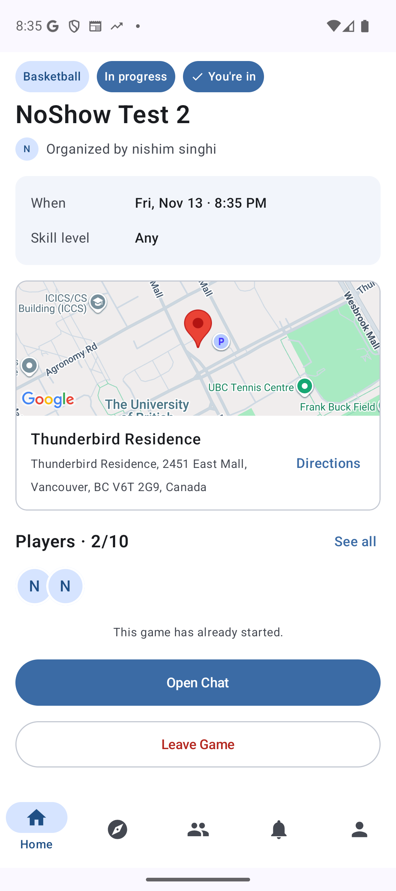
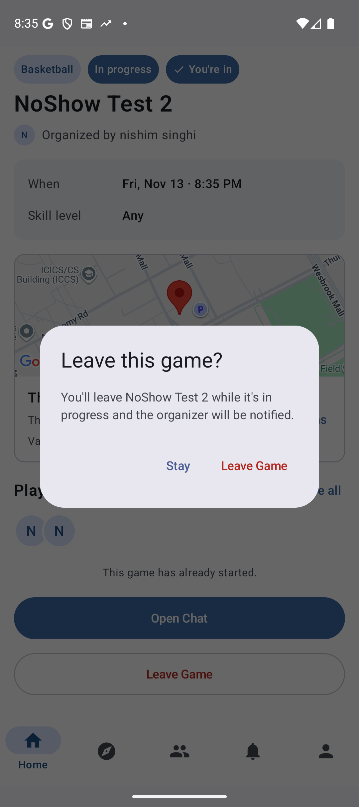
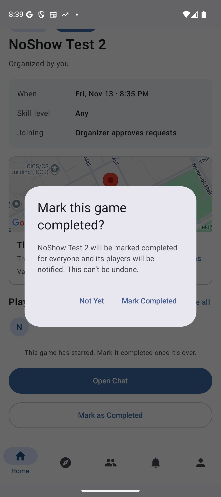
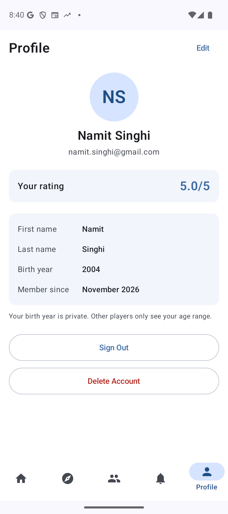

# CP3 Peer Review: SportsNow

| | |
|---|---|
| **Peer group reviewed** | SportsNow (`pawanpaddaeng/SportsNow_Project`) |
| **Reviewing group** | MatchMarket |
| **Commit reviewed** | _[commit SHA of the `main` snapshot you downloaded; the zip has no `.git` folder]_ |
| **Artifacts reviewed** | `SportsNow_Project-main` source (backend, frontend, docs, scripts), `CP2_SportsNow.apk` |
| **Date** | Nov 13, 2026 |
| **Scope** | Scored against the CP2 scope: one end-to-end feature and all interfaces of one component. Work not due until CP3 or M3 is listed as a recommendation, not a fault. |

## Score Summary

| **Section** | **Item** | **Score** |
|---|---|---|
| Manual code review | Code is maintainable, efficient, handles error cases well | **8/10** |
| Manual test review | Tests are complete for one end-to-end feature and all interfaces of one component, errors and edge cases are thoroughly tested, correct assertions are used | **5/10** |
| Manual test review | Test code is maintainable and well-structured | **8/10** |
| Manual test review | Test implementation matches the requirements and design | **4/10** |
| Manual test review | Non-functional requirements are tested well | **0/10**\* |
| Manual test review | Tests achieve high coverage and cases of < 100% coverage are well-justified | **2/10** |
| Manual test review | All back-end tests can be run automatically | **2/10** |
| Automated code review | Codacy runs with the required setup | **7/10** |
| Automated code review | All remaining Codacy issues are well-justified | **9/10** |

\* Not yet due: NFR tests are part of CP3. The 0 only records that none exist yet.

**Major fault:** Leaving a game after it starts erases it from the player's score, so the organiser can't mark them as a no-show or rate them, yet the game still counts as played ([Section 4](#4-major-fault)). **Severity: Medium-High.**

---

## 1. Manual Code Review: 8/10

### Strengths
- **Clear structure:** the backend and frontend are split by domain (`user`, `game`, `friend`, `chat`, `review`). Files and functions are short (the largest file is `game/db/games.ts`, 636 lines).
- **Well documented:** almost every function explains what it does and why (e.g. `lockGame`, `games.ts:278`).
- **Named constants instead of magic numbers** (e.g. `MAX_DISCOVER_DISTANCE_M`, `GAMES_IN_SCORE`, `HEARTBEAT_MS`).
- **Strong error handling:** typed `{ ok: false; problem }` results are mapped to HTTP statuses, there is one shared `500` handler, `SELECT … FOR UPDATE` transactions prevent race conditions, and all SQL is parameterised.
- **Careful security:** JWTs are pinned to HS256, the sign-up email must match the Google token, and the public profile never returns email or birth year.

### Issues found

| # | Location | Issue | Suggestion |
|---|---|---|---|
| C1 | `AppState.kt:95` (`signOut`), `core/notifications/deviceTokens.ts` | Signing out doesn't unregister the device's FCM token, so a signed-out phone keeps showing that user's notifications, including message previews (`chatSocket.ts:60`). | Delete the token on the server and call `FirebaseMessaging.deleteToken()` on sign-out. |
| C2 | `friend/db/friends.ts:68-91` (`searchUsers`) | Search loads every user and fuzzy-matches them in Node on every keystroke, which won't scale. | Pre-filter in SQL (`LIKE` or a `FULLTEXT` index), cap the results, and debounce on the client. |
| C3 | `review/reputation.ts:35-50` | The score hides bad behaviour: (a) missing ratings count as 5 stars, so a 1-star rating only lowers a game to 4.56; (b) new accounts start at a perfect 5.0; (c) a no-show only drops the score to 4.2 and is forgotten after 5 games. | Average only the ratings given, with a Bayesian prior. Show "new player" instead of 5.0, and keep no-shows longer. |
| C4 | `game/location/DeviceLocation.kt:20` vs. NFR 1 | Discover can wait up to 10 s for a location fix, but NFR 1 promises results in under 5 s. | Cap the wait at about 3 s and fall back to the last known location. |
| C5 | `Requirements_and_Design.md` §4.1 | The design doesn't match the code: four built endpoints are missing from it, and `DELETE /players/{userId}` is marked *(planned)* but is built. | Update §4.1 to match the code. |
| C6 | `user/routes/authRoutes.ts:34,49` | `GOOGLE_CLIENT_ID` skips the startup check in `env.ts`, so if it's missing the server starts but every login fails. | Add it to `env` with `requiredEnv`. |
| C7 | `game/routes/gameRoutes.ts:210-213` | The game edit reads the old values outside the transaction, so two edits at once can produce a wrong "what changed" notification. Minor. | Return the old values from `updateGame`. |

---

## 2. Manual Test Review

### 2.1 Completeness: 5/10
CP2 asks for all interfaces of one component and one end-to-end feature. SportsNow met the first half and missed the second.

- ✅ **Game component (about 8/10 on its own):** 95 Jest tests cover all 13 endpoints unmocked and 12 of 13 mocked. Many edge cases are tested, and the assertions check both the HTTP response and the database.
  - Missing edge cases: sign-in failure tests (bad, expired or missing token), `createGame` has 1 of 7 planned validation tests, `removePlayer` has no error tests, and `completeGame` doesn't test `not_started`, `completed` or a database failure.
- ❌ **End-to-end (0/10 on its own):** `androidTest/e2e/` only has Android Studio's generated example test. The planned `DiscoverGameTest.kt` doesn't exist.

### 2.2 Test code maintainability: 8/10
- Every test has the required Input / Expected comments, and shared helpers keep tests short and safe to run in parallel.
- Deductions: one test per file (about 95 files) repeats setup code, which explains Codacy's 14% duplication, and one validation test is in the mocked folder although it needs no mock.

### 2.3 Tests vs. requirements and design: 4/10
- Testing.md wasn't updated for CP2. The line links, commit hash, test-database setup, GitHub Actions location, coverage screenshots and E2E log all still say *"To be added at CP2"*.
- The Game tests match their plan closely, and the Discover Game E2E plan is detailed but not implemented.

### 2.4 Non-functional requirements: 0/10
Not yet due (CP3), and no NFR tests exist yet. For CP3: time `GET /api/games/discover` in Jest for NFR 1, and use `BatteryManager` or `dumpsys batterystats` for NFR 2.

### 2.5 Coverage: 2/10
We judged only the Game component. Coverage can't be verified: there are no coverage screenshots or justification for anything under 100%, and Codacy shows 0%. `jest.config.js` is set up correctly, so the team only needs to run it and add the screenshots.

### 2.6 Back-end tests run automatically: 2/10
- There is no GitHub Actions workflow, and the project description counts tests that CI doesn't run as incomplete.
- Nothing explains how to start the test MySQL database, so a TA can't run the unmocked tests.
- Credit: the test script correctly runs the mock, no-mock and combined suites, each with its own coverage report.

---

## 3. Automated Code Review

### 3.1 Codacy setup: 7/10
- ✅ Three tools are enabled and use the repo's config files, and the commit is recorded.
- ❌ An inline suppression breaks the rules: `@Suppress("DEPRECATION")` at `game/location/Geocoding.kt:51`.
- ⚠️ The screenshot shows the *Code patterns* page instead of the *Issues* page, so we couldn't confirm Trivy is enabled.

### 3.2 Remaining issues justified: 9/10
Codacy reports 0 issues. Small deduction: the 14% duplication is dismissed without evidence, and the `@Suppress` hides an issue that should be fixed or justified.

---

## 4. Major Fault

### Leaving a game mid-game erases it from the player's score

**Severity: Medium-High.** Reputation is the core of the app, and catching no-shows is its main job. It isn't High because it needs a deliberate action by the player, and it doesn't crash the app or leak data.

**This is a bug, not a design choice.** Leaving mid-game is allowed on purpose, but the code breaks its own stated goal:
- `leaveGame` (`games.ts:480`): the request stays approved *"as a record that they played"*.
- `completeGame` (`games.ts:424`): attendance is kept apart *"so leaving the game doesn't erase it from a player's score"*.

That only works if the player leaves after the game is completed. A player who leaves mid-game gets no attendance row, so the game is erased from their score. It also contradicts use case 11, which says players leave *"before it starts"*.

| Part of the app | Counts them as having played? |
|---|---|
| `leaveGame` comment and profile "games played" | ✅ yes |
| Reputation score, no-show checklist, ratings (`game_attendance`) | ❌ no |

As a result, a player who never came can tap **Leave Game** from home after the start time and avoid both the no-show penalty and ratings.

**Steps to reproduce (accounts A and B)**
1. **A** creates a game starting in about 3 minutes. **B** sends a join request, and **A** approves it.
2. After the start time, **B** taps **Leave Game** on the in-progress game.
3. **A** taps **Mark as Completed**. ➜ B isn't in the list, so A can't mark B as a no-show.
4. B's score stays **5.0**. For comparison, if B stays in the game and A marks them as a no-show, B's score drops to 4.2.

**Suggested fix:** Write the attendance rows from approved join requests instead of current players, or block leaving a started game.

**Reproduced on `CP2_SportsNow.apk`** (Pixel 9 emulator, API 36, the team's deployed backend, Nov 13, 2026).

| | |
|---|---|
|  |  |
| **1.** The app offers **Leave Game** during the game. | **2.** It warns *"while it's in progress"*, then lets B leave with no penalty. |
|  |  |
| **3.** A's completion dialog has no one to mark as a no-show. | **4.** B's rating is still **5.0/5**. |

Also see `CP3_screenshots/4_A_game_completed_1_player.png`: the completed game shows only 1/10 players.

### Other faults found (secondary)
- A signed-out phone still gets that user's message notifications (C1).
- New accounts start with a perfect 5.0, so repeat no-shows can just make a new account (C3b).

---

## 5. Recommendations (priority order)

**Missing CP2 work**
1. Write the Discover Game E2E test.
2. Add a GitHub Actions workflow that starts MySQL and runs the backend tests.
3. Update Testing.md for CP2: line links, commit hash, test-database setup, and coverage screenshots with justification.
4. Add the missing Game edge-case tests, and remove the `@Suppress`.

**App fixes**
5. Fix the leave-mid-game bug, and unregister FCM tokens on sign-out.
6. Update Requirements_and_Design §4.1 to match the code.

**Later (CP3 and M3)**
7. Write the two NFR tests.
8. Test the other components, and add E2E tests for two more features.
