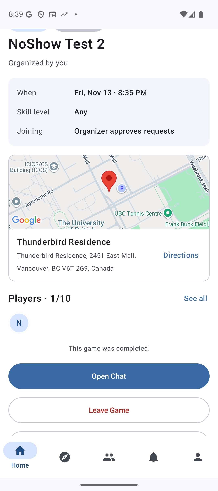

# CP3 Peer Review: SportsNow

| | |
|---|---|
| **Peer group reviewed** | SportsNow (`pawanpaddaeng/SportsNow_Project`) |
| **Reviewing group** | MatchMarket |
| **Commit reviewed** | [`eccf7d9343f9ef4d088c1da59cb5ecf89106b622`](https://github.com/pawanpaddaeng/SportsNow_Project/commit/eccf7d9343f9ef4d088c1da59cb5ecf89106b622) |
| **Artifacts reviewed** | `SportsNow_Project-main` source (backend, frontend, docs, scripts), `CP2_SportsNow.apk` |
| **Date** | Nov 13, 2026 |
| **Scope** | Scored against the CP2 scope: one end-to-end feature and all interfaces of one component. Work not due until CP3 or M3 is listed as a recommendation, not a fault. |

## Score Summary

| **Section** | **Item** | **Score** |
|---|---|---|
| Manual code review | Code is maintainable, efficient, handles error cases well | **8/10** |
| Manual test review | Tests are complete for one end-to-end feature and all interfaces of one component, errors and edge cases are thoroughly tested, correct assertions are used | **5/10** |
| Manual test review | Test code is maintainable and well-structured | **8/10** |
| Manual test review | Test implementation matches the requirements and design | **4/10** |
| Manual test review | Non-functional requirements are tested well | **0/10**\* |
| Manual test review | Tests achieve high coverage and cases of < 100% coverage are well-justified | **5/10** |
| Manual test review | All back-end tests can be run automatically | **2/10** |
| Automated code review | Codacy runs with the required setup | **7/10** |
| Automated code review | All remaining Codacy issues are well-justified | **8/10** |

\* Not yet due: NFR tests are part of CP3. The 0 only records that none exist yet.

**Major fault:** Leaving a game after it starts erases it from the player's score, so the organiser can't mark them as a no-show or rate them, yet the game still counts as played ([Section 4](#4-major-fault)). **Severity: Medium-High.**

---

## 1. Manual Code Review: 8/10

### Strengths
- **Clear structure:** the backend and frontend are both split by domain (`user`, `game`, `friend`, `chat`, `review`). The largest backend file is `game/db/games.ts` at 636 lines.
- **Well documented:** key functions explain what they do and why (e.g. `lockGame`, `leaveGame` and `completeGame` in `games.ts`).
- **Named constants instead of magic numbers** (e.g. `MAX_DISCOVER_DISTANCE_M`, `GAMES_IN_SCORE`, `HEARTBEAT_MS`).
- **Strong error handling:** problems are mapped to HTTP responses through tables (e.g. `SEND_ERRORS`, `INVITE_ERRORS`), `asyncRoute` sends unexpected errors to one shared handler, and changes lock rows with `SELECT … FOR UPDATE` (`lockGame`).
- **Careful security:** JWTs are pinned to HS256, the sign-up email must match the Google account, and the public profile doesn't return email or birth year.

### Issues found

| # | Location | Issue | Suggestion |
|---|---|---|---|
| C1 | `AppState.kt:95` (`signOut`), `core/notifications/deviceTokens.ts` | Signing out doesn't unregister the device's FCM token, and no route deletes it, so the server keeps sending that user's notifications to the signed-out phone, including message previews (`chatSocket.ts:60`). | Delete the token on the server and call `FirebaseMessaging.deleteToken()` on sign-out. |
| C2 | `friend/db/friends.ts:68-91` (`searchUsers`) | Each search reads every user from the database and compares all their names in Node, so the work per search grows with the number of users. | Pre-filter in SQL (e.g. `LIKE` or a `FULLTEXT` index) and only compare those rows. |
| C3 | `review/reputation.ts:35-50` | The score hides bad behaviour: (a) missing ratings count as 5 stars, so in a 10-player game one 1-star rating only lowers that game to 4.56; (b) new accounts start at a perfect 5.0; (c) the score only averages the last 5 games (`GAMES_IN_SCORE`), so a new player's no-show only drops their score to 4.2, and it leaves the score after 5 more games. | Average only the ratings given, with a Bayesian prior. Show "new player" instead of 5.0. Count no-shows over a longer window, or show them separately. |
| C4 | `game/location/DeviceLocation.kt:20` vs. NFR 1 | When the phone has no location fix from the last 2 minutes, Discover waits up to 10 s for a new one before loading, but NFR 1 promises results in under 5 s. | Shorten the wait so Discover fits within NFR 1. The fallback to the last known fix already exists. |
| C5 | `Requirements_and_Design.md` §4.1 | The design doesn't match the code: `POST /api/games/{id}/complete`, `POST /api/games/{id}/leave` and `DELETE /api/users/me` are built but not listed, and `DELETE /players/{userId}` is marked *(planned)* but is built. | Update §4.1 to match the code. |

---

## 2. Manual Test Review

### 2.1 Completeness: 5/10
CP2 asks for all interfaces of one component and one end-to-end feature. SportsNow met the first half and missed the second.

- ✅ **Game component (about 8/10 on its own):** 75 Jest tests cover all 13 endpoints unmocked and 12 of 13 mocked. Besides the HTTP response, 36 of the 80 Game test files also check what was saved in the database.
  - Missing edge cases: sign-in failure tests (bad, expired or missing token), `createGame` has 1 of the 6 planned validation tests, `removePlayer` has no error tests, and `completeGame` doesn't test `not_started`, `completed` or a database failure.
- ❌ **End-to-end (0/10 on its own):** `androidTest/e2e/` only has Android Studio's generated example test. The planned `DiscoverGameTest.kt` doesn't exist.

### 2.2 Test code maintainability: 8/10
- 83 of the 84 test files have the required Input / Expected comments. The shared helpers build unique users so test files can run at the same time on one database.
- Deductions: 75 of the 84 test files hold a single test, so the helper import and `cleanUpAfterTests()` setup are repeated in 82 files.

### 2.3 Tests vs. requirements and design: 4/10
- Testing.md wasn't updated for CP2. The line links, commit hash, test-database setup, GitHub Actions location and E2E log are all still marked as coming at CP2.
- The Discover Game E2E plan is detailed but not implemented.

### 2.4 Non-functional requirements: 0/10
Not yet due (CP3), and no NFR tests exist yet. For CP3: time `GET /api/games/discover` in Jest for NFR 1, and use `BatteryManager` or `dumpsys batterystats` for NFR 2.

### 2.5 Coverage: 5/10
- **Interfaces:** all 13 Game routes have unmocked tests, and 12 of 13 have mocked tests (`removePlayer` has none).
- **End-to-end:** none; the Discover Game test isn't written.

### 2.6 Back-end tests run automatically: 2/10
- There is no GitHub Actions workflow, and the project description counts tests that CI doesn't run as incomplete.
- Testing.md's step for starting the test database still says *"We will add these steps at CP2"*.
- Credit: the test script correctly runs the mock, no-mock and combined suites, one after the other.

---

## 3. Automated Code Review

### 3.1 Codacy setup: 7/10
- ✅ 3 tools are enabled, detekt uses the repo's config file, and the commit is recorded.
- ❌ An inline suppression breaks the rules: `@Suppress("DEPRECATION")` at `game/location/Geocoding.kt:51`.
- ⚠️ The screenshot shows the *Code patterns* page instead of the *Issues* page, so we couldn't confirm Trivy is enabled.

### 3.2 Remaining issues justified: 8/10
Codacy reports 0 issues. Small deduction: the 14% duplication is dismissed without evidence, and the `@Suppress` hides an issue that should be fixed or justified.

---

## 4. Major Fault

### Leaving a game mid-game erases it from the player's score

**The bug.** A player can still tap **Leave Game** after a game has started. When the organiser later marks the game completed, `completeGame` (`games.ts:429`) only records attendance for players who are still in the game. The player who left gets no attendance record, so:
- the organiser can't mark them as a no-show,
- no one can rate them (`createRating` returns `player_not_found`), and
- the game has no effect on their reputation score,

yet the game still counts towards "games played" on their profile. A player who never came can therefore tap **Leave Game** from home after the start time and avoid both the no-show penalty and ratings.

**Severity: Medium-High.** Reputation is the core of the app, and catching no-shows is its main job. It isn't High because it needs a deliberate action by the player, and it doesn't crash the app or leak data.

**Why this is a bug, not a design choice.** SportsNow lets players leave mid-game on purpose: someone who plays for a while and then leaves still played. Their code comments in `backend/src/game/db/games.ts` say so, and say leaving shouldn't wipe a game from a player's score:
- line 457 (`leaveGame`): *"A player can leave at any time, even mid-game."*
- line 480 (`leaveGame`): *"once the game started the request stays approved as a record that they played"*
- line 424 (`completeGame`): attendance is *"kept apart from game_players so leaving the game doesn't erase it from a player's score"*

But the code doesn't do that for a player who leaves mid-game:
1. Leaving deletes the player's row from `game_players` (`games.ts:476`).
2. Attendance is only written when the organiser completes the game (`POST /api/games/:gameId/complete`, `gameRoutes.ts:266`), and only for players still in `game_players` at that moment (`games.ts:429-433`).
3. The score reads only `game_attendance` (`review/db/ratings.ts:112`).

So the protection only works for a player who leaves *after* the game is completed. A player who leaves *during* the game, the case the comments describe, gets no attendance row and is erased from their score. The code doesn't do what its own comments say it should, which makes it a bug.

The result is also inconsistent: the profile counts the game as played, but the score, the no-show list and ratings treat the player as if they were never in it. And it contradicts the team's use case 11, which says a player leaves a game *"before it starts"*.

**Steps to reproduce (accounts A and B)**
1. **A** creates a game that starts soon. **B** sends a join request, and **A** approves it.
2. After the start time, **B** taps **Leave Game** on the in-progress game.
3. **A** taps **Mark as Completed**. ➜ B isn't in the list, so A can't mark B as a no-show.
4. B's score stays **5.0**. For comparison, if B stays in the game and A marks them as a no-show, B's score would drop to 4.2 (from the code).

**Suggested fix:** Write the attendance rows from approved join requests instead of current players, or block leaving a started game.

**Reproduced on `CP2_SportsNow.apk`** (the team's deployed backend, Nov 13, 2026).

| | |
|---|---|
|  |  |
| **1.** The app offers **Leave Game** during the game. | **2.** It asks B to confirm leaving *"while it's in progress"* and lets B leave. |
|  |  |
| **3.** A's completion dialog has no one to mark as a no-show. | **4.** After completion the game lists only A (**1/10**, down from 2/10 in image 1), so B isn't recorded as a player. |
|  | |
| **5.** B's rating is still **5.0/5**. | |

---

## 5. Recommendations (priority order)

**Missing CP2 work**

1. Write the Discover Game E2E test.
2. Add a GitHub Actions workflow that starts MySQL and runs the backend tests.
3. Update Testing.md for CP2: line links, commit hash and test-database setup.
4. Add the missing Game edge-case tests, and remove the `@Suppress`.

**App fixes**

5. Fix the leave-mid-game bug, and unregister FCM tokens on sign-out.
6. Update Requirements_and_Design §4.1 to match the code.
