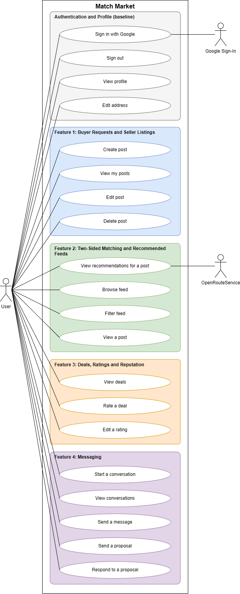
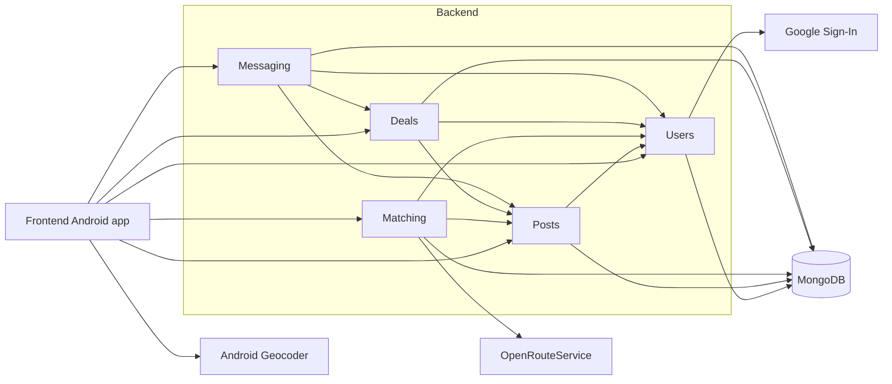
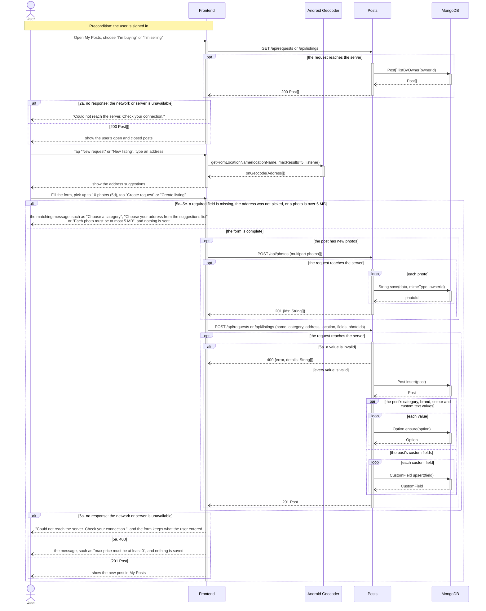
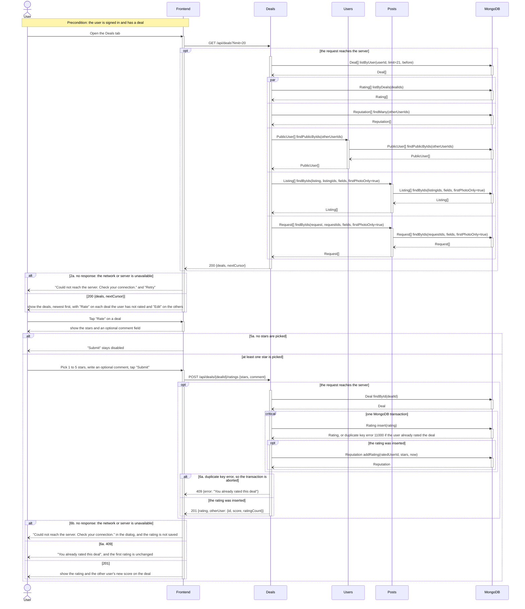
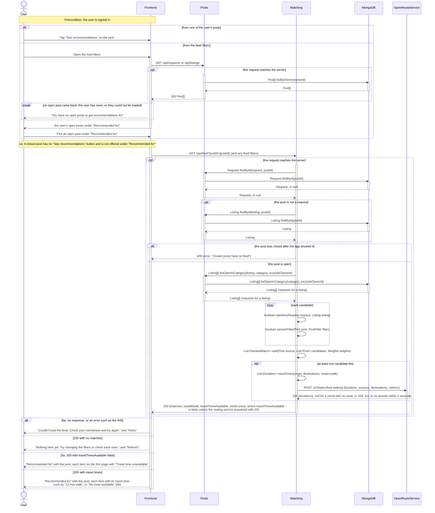
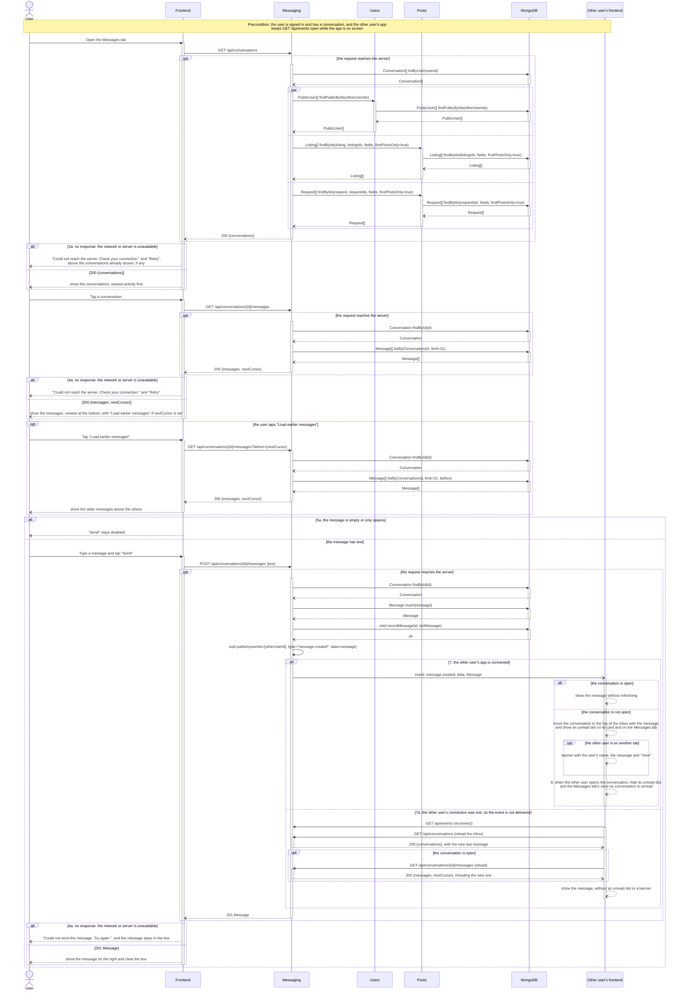
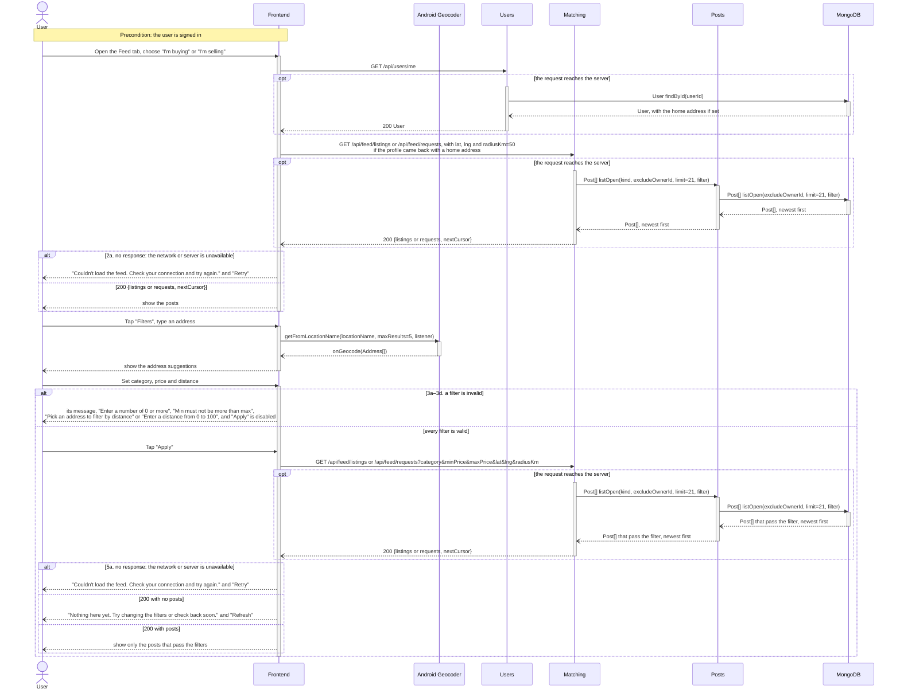

# Match Market Requirements and Design

## 1. Change History

| **Change Date** | **Modified Sections** | **Rationale** |
| --------------- | --------------------- | ------------- |
| 2026-10-12 | All | Initial draft for Match Market (two-sided second-hand marketplace), replacing the M1 LeftOBite idea. |
| 2026-10-12 | 2 | Updated project description to match the M2 presentation slides (tagline, problem, audience, matching approach). |
| 2026-10-12 | 3.1, 3.4 | Authentication is a required baseline, not a feature; features renumbered from four to three. |
| 2026-10-12 | 3.2, 3.4 | Split "Manage posts" into "Create buyer request" and "Create seller listing", one per actor. |
| 2026-10-12 | 3.5, 4.6 | Split the post use case into "Create Buyer Request" and "Create Seller Listing" formal specs and sequence diagrams (five formal specs). |
| 2026-10-12 | 4.1, 4.2, 4.4, 4.5, 4.6, 5 | Store listing photos in MongoDB using GridFS instead of a separate file volume. |
| 2026-10-12 | 3.5, 4.1 | Set photo limits: at most 10 photos, at most 5 MB each. |
| 2026-10-12 | 3.1, 3.4, 3.5, 4.1, 4.2, 4.6, 5 | Buyer requests can optionally include reference photos, same limits as listings. |
| 2026-10-12 | 2, 3.4, 3.5, 4.1, 4.6 | Removed match explanations; the feed shows ranked items with travel time only. |
| 2026-10-12 | 3.4, 3.5, 5 | Specified how users set soft-preference importance (0 to 5 sliders, defaults, normalized weights). |
| 2026-10-12 | 2, 3.4, 3.5, 4.1, 4.7, 5 | Defined hard requirements vs soft preferences vs temporary filters; one shared hard-requirement rule for both feeds, four importance weights, per-request radius with a profile default, optional filters and sort on a single /feed endpoint, travel times for the first page only. |
| 2026-10-12 | All | Removed offers, reservations, transactions, live updates, and push notifications; deferred to a future release. |
| 2026-10-12 | 3.2, 3.4, 3.5, 4.1, 4.6, 5 | Confirmed Feature 1 scope and clarified required inputs, saved defaults, photo counts, ownership, and the open/closed lifecycle. Added Manage Own Posts to the use-case coverage and recorded cross-component decisions still awaiting team agreement. |
| 2026-10-19 | 2-5 | Cross-checked the draft against main and active branches; corrected API and data-model descriptions; separated intended requirements from implementation status; recorded unresolved scope and behaviour differences. |
| 2026-10-21 | 4 | Matched Section 4 to the code on main: feed routes and filters, the hard-requirement rule, collections, libraries and test tools, and route prefixes in the sequence diagrams. |
| 2026-10-21 | 5 | Matched the data model to the code on main: request and listing fields, the options, custom fields and sessions collections, and request number validation. |
| 2026-10-21 | 3.2, 3.3, 4.6 | Redrew the use case diagram (one User actor, use cases grouped and colour-coded by feature), the actors and the sequence diagrams for the five current use cases; removed OpenRouteService geocoding; added Firebase Cloud Messaging. |
| 2026-10-21 | 4.1, 4.3, 4.5, 4.6 | Added the planned Transactions and Messaging components and Firebase Cloud Messaging; limited the dependency and sequence diagrams to the components and interfaces in 4.1; added error paths, loops, return messages and activation bars to the sequence diagrams. |
| 2026-10-21 | 2, 3.1, 3.6, 4.1, 4.2, 5 | Restored offers, transactions, live updates and messaging as planned features, reversing the 2026-10-12 removal; requests mark each field hard or soft; added browsing and filtering to Feature 2 and screen mock-ups; marked the user profile store and travel times as planned; added the planned proposals, transactions and messages collections. |
| 2026-10-21 | 3.7, 4.7 | Filled in the NFR values: 1 second at the 95th percentile with 1,000 candidate posts for feed ranking, the NFR test that measures it, and a 2-second routing timeout so the feed stays within 3 seconds. Justified the 3-second limit of the routing-service NFR. |
| 2026-10-30 | 3.5, 5 | Posts have a required name of up to 80 characters, entered in the post form and shown as the post's heading with its category underneath. Added the name to Use Case 1 and to the requests and listings data model. |
| 2026-10-30 | 2, 3.1, 3.3, 3.4, 3.5, 3.6, 4.1, 4.3, 4.5, 4.6, 4.7 | Connected travel times to OpenRouteService: the first page of recommendations shows each match's travel time (walking until a travel mode can be chosen), with "No route available" and "Travel time unavailable" for failures 5b and 5a, and NFR 2 is now tested. |
| 2026-10-31 | 3.1, 3.3, 3.4, 4.1, 4.2, 4.5, 5 | Added the Deals, Ratings and Reputation feature as built: the Deals tab, rating a deal, editing a rating, and the reputation score. Added the Deals component, its five interfaces, and the deals, ratings and reputations collections. |
| 2026-10-31 | 2, 3.1-3.6, 4.1, 4.3, 4.5, 4.6, 5 | Removed offers, acceptance, transactions and live updates. Deals, Ratings and Reputation is now Feature 3, Use Case 2 is now Rate a Deal, and the Deals component replaces Transactions. Redrew the use case diagram. |
| 2026-10-31 | 3.1 | Feature 3: deals are now recorded when a user accepts a proposed price in a conversation, so recording a deal is no longer planned on the back end. |
| 2026-11-01 | 3.5, 3.6 | Connected the feed to Messaging: Use Case 4 now starts from the "Message" button on a post, which sends the first price proposal and opens the conversation. |
| 2026-11-01 | 2, 3.1–3.5, 4.1–4.6, 5 | Following TA feedback, split combined use cases into one goal each (Section 3.4 and the use case diagram) and narrowed the formal use cases to match: Create Post, Rate a Deal, View Recommendations for a Post, Send a Message and Filter Feed. Described Messaging as built: conversations, messages, price proposals that record a deal when accepted, and live updates through Server-Sent Events. Used one term for each idea: deal, proposal, recommendation, hard requirement, soft preference, backend and frontend. Removed the planned ranking preferences use case and the planned Firebase Cloud Messaging push notifications, which are not built. |
| 2026-11-01 | 3.5, 4.1, 5 | Matched the ranking and categories to the code: soft preferences count by their importance, missing a soft maximum price or soft minimum condition lowers the score, and categories are saved in the singular. |
| 2026-11-02 | 3.4, 3.6, 4.1, 4.2, 4.5, 5 | Matched the profile to the code: the users collection and `GET`/`PATCH /api/users/me` are built, `GET /api/users/:id/reputation` is documented, and Sign out is a use case. Removed the screen mock-ups, which are optional. Added the Deals interface that Messaging calls to record a deal, and made the frontend's link to Messaging one-way, since the live updates arrive on a request the app makes. |
| 2026-11-12 | 4.1 | Photos are no longer public: `GET /api/photos/:id` needs a session token and may only be cached on the user's device. |
| 2026-11-12 | 4.1 | `POST /api/custom-fields` returns 409 if the user already has a custom field with the same name, instead of replacing it. |
| 2026-11-13 | 4.1 | Messaging: listed the errors every conversation route shares, as tested by the conversation interface tests: 401 without a session, 404 for a malformed id, 400 for an unsupported field or malformed JSON, and 413 for a body over 16 KB. |
| 2026-11-13 | 3.4, 3.5 | Following TA feedback that some use cases were too fine, merged Accept a proposal and Decline a proposal into Respond to a proposal, which includes Create deal when accepting. In Use Case 4, failure 7a1 now says how long reconnecting takes, as measured by the end-to-end tests. |
| 2026-11-14 | 4.1 | Accepting a proposal again after a failed accept now finishes the same deal, using the new Deals interface `findByPosts`, and the proposal is marked accepted last. Listed what proposing returns, that the note is trimmed, and that either user can propose again after a decline. |
| 2026-11-14 | 4.1 | `GET /api/events`: listed what each event carries, that it reaches every open stream of the other user and nobody else, and the 401, as tested by its interface tests. |
| 2026-11-14 | 3.2, 3.4 | Following TA feedback to simplify the use case diagram, removed every include and extend relationship and connected each use case directly to the user, showed Respond to a proposal as one use case, and merged Close post and Reopen post into Edit post. Removed Create deal as a separate use case, since the user never starts it: Respond to a proposal now describes recording the deal when a proposal is accepted. |
| 2026-11-15 | 3.2, 3.4, 4.1, 5 | Added the Manage profile use case, covering the Profile tab and setting the home address, to the Authentication and Profile group and the use case diagram; the use cases after it are renumbered. Listed the `PATCH /api/users/me` errors covered by its interface tests, including 413 for a body over 4 KB, and added the profile data rules. |
| 2026-11-17 | 4.1, 4.7 | `GET /api/feed`: listed the 404 for a post that does not exist, as tested by its interface tests. NFR 1 is now measured: the NFR test `feedLatency.test.ts` ranks 1,000 candidate posts, and 95% of 100 feed requests return within 45 ms. |
| 2026-11-18 | 4.6 | Following TA and peer-review feedback, the Send a Message sequence diagram now shows every failure in Use Case 4 (2a, 4a, 5a, 6a, 7a) and loading earlier messages, and each database write has a reply. Removed its invalid-text branch, which the app never reaches because Send is disabled for an empty message. |
| 2026-11-18 | 4.7 | NFR 2 is now measured for every failure it names: the NFR test times a routing service that never answers (about 2 seconds) and one that is rate-limited, fails or is unreachable (under 10 ms). |
| 2026-11-18 | 4.1 | `POST /api/auth/google`, `/refresh` and `/logout`: listed what each returns and its 400, 401 and 413 errors, and that reusing a refresh token revokes the whole sign-in, as tested by their interface tests. |
| 2026-11-18 | 3.5, 4.6 | Following TA and peer-review feedback, the Create Post, Rate a Deal, View Recommendations and Filter Feed sequence diagrams now show every failure scenario of their use cases, and every database write has a reply. Rate a Deal shows that the Deals tab offers "Rate" only on deals the user has not rated, and that the rating and score are saved in one transaction. Filter Feed no longer shows a 400 for invalid filters, which the app never sends because it disables "Apply". Use Case 2 now names the messages the app shows when the deals or the rating cannot reach the server. Each branch is labelled with its use case step, and failures with the same result share a branch. |
| 2026-11-18 | 4.4 | Following TA feedback that the app had two HTTP paths, it now uses OkHttp for every request, so HttpURLConnection is no longer listed. |
| 2026-11-18 | 3.5, 4.6 | Following TA feedback, a user with no open posts, recommendations with no results and filters with no results are now part of the success scenarios of Use Cases 3 and 5 instead of failures, and the later failures are renumbered (Use Case 3: 1b is now 1a; Use Case 5: 5b is now 5a). The sequence diagrams follow. |
| 2026-11-18 | 4.1 | Following TA feedback, each route is listed under the component that serves it: `GET /api/users/:id/reputation` moved from Users and Auth to Deals, which keeps the reputations, and `GET /api/feed/listings/:id` and `/requests/:id` moved from Deals to Matching, which serves them. The option and custom field routes are listed one by one, with their parameters, results and errors. |
| 2026-11-18 | 4.2, 5 | Following TA feedback that Section 5 is not part of the template, the collections and data rules moved to Section 4.2, Databases, and Section 5 was removed. |
| 2026-11-18 | 3.5 | Following peer-review feedback, Use Case 1 says which failures apply to requests and which to listings. The use case links now use `id` anchors, which more Markdown viewers support. |
| 2026-11-19 | 4.7 | Following peer feedback that the NFR 2 test used only one candidate post, NFR 2 is now measured with the NFR 1 workload of 1,000 candidates, and checks that the feed keeps its ranked order without travel times. Updated the measured times of both NFRs. |
| 2026-11-19 | 3.5, 4.1 | Following TA and peer-review feedback, Use Case 3 steps 3–5 now say what the system does for the user instead of how it ranks; the scoring details moved to the `rank` interface of Matching in 4.1. |
| 2026-11-19 | 3.4, 4.1, 4.2, 4.4 | Matched the document to the implementation: the Posts interfaces follow the same format as the other components, with each one's request body, return value and status, and errors, and a JSON body over 1 MB returns 413; photos are stored in the GridFS `photos` bucket; the sessions collection lists all its fields; the Posts data rules no longer include review notes; dotenv is listed; and the Profile button is named "Sign Out" as in the app. |
| 2026-11-25 | 4.1, 4.5, 4.6 | Renamed the Users and Auth component to Users, matching the backend's `components/users` folder. It still verifies Google sign-in, issues session tokens and protects every route with `requireAuth`. |
| 2026-11-25 | 4.5 | Matched the dependencies diagram to the code: Matching, Deals and Messaging call the Posts component's store, so the diagram now shows those three links, and the sign-in routes under `/api/auth` are named as the routes that do not call `requireAuth`. |
| 2026-11-25 | 4.1, 4.2, 4.3, 4.6 | Following the course's sequence diagram format, the messages in all five sequence diagrams are now interfaces: REST calls between the app and the back end, and Java-style method signatures with parameters for calls to MongoDB, between components and inside a component. Every reply and failure branch is kept; calls that were described together are now shown one by one, in parallel where the code runs them in parallel, and the rating is shown in its transaction. View Recommendations now also shows opening the recommendations from the post itself. Section 4.2 lists the database interfaces the diagrams use. Section 4.3 names the interfaces of the Android Geocoder and OpenRouteService, and Section 4.1 adds the internal `publish` interface of Messaging, since the diagrams call them. |
| 2026-11-26 | 3.1, 3.4, 3.5, 4.1, 4.6 | Following TA feedback that live updates matter, live updates now reach the whole app, not only an open conversation: the app keeps `GET /api/events` open while it is on screen; new messages and proposal changes update the inbox, mark the conversation and the Messages tab unread, and show a banner with "View" on the other tabs; and an accepted proposal updates the proposer's Deals and My Posts tabs. Use Case 4 and its sequence diagram describe the new steps, and failure 2a also covers a reload that fails while conversations are shown. |
| 2026-11-26 | 3.5, 3.6 | Use Cases 1 and 3 now use the app's labels, "Must have" and "Nice to have", instead of Hard and Soft. Added Section 3.6, Screen Mock-ups (none, since they are optional), so the numbering follows the template. |
| 2026-11-26 | 4.1, 4.6 | Following TA feedback, each component now has a service that owns its rules, and other components call that service instead of reading or writing its data. Accepting a proposal now asks Deals to record the deal (`recordDeal`) and Posts to close the posts (`closeForDeal`), instead of Messaging writing both itself. Section 4.1 lists the internal interfaces other components call (Posts' `findById`, `findByIds`, `listOpen`, `listOpenInCategory` and `closeForDeal`, Users' `findPublicByIds`, and Deals' `recordDeal` and `earlierDeal`), and the View Deals, View Recommendations, Send a Message and Filter Feed sequence diagrams now read posts and users through Posts and Users. |
| 2026-11-26 | 3.2, 3.3, 3.4, 3.5, 4.1, 4.3, 4.4, 4.5, 4.6 | Following the CP3 TA feedback: one User actor, since buying and selling use the same use cases; Google is "Google Sign-In" everywhere, with the interface the backend calls; Manage profile is split into View profile and Edit address, in the text and the use case diagram, so the later use cases are renumbered; Use Case 3 failure 1a and Use Case 4 steps 7 and 7a1 describe only what the user sees; the Matching interface no longer mentions filters that were never built; Section 4.4 names the test libraries in use. In every sequence diagram the app has activation bars, and each call shows its result before the branches on it, so a network failure is a missing response rather than a second reply. After the services refactor, the diagrams pass `firstPhotoOnly` to Posts' `findByIds` as the code does, View Recommendations shows the feed filters it applies (`passesFilter`), and Send a Message sends the live update before it replies 201; Section 4.5 says other components go through Posts' and Deals' services. |
| 2026-11-27 | 4.1 | Feeds leave out other testers' test posts, and no conversation can be started about one, so the test routes can be on for the VM. |
| 2026-11-28 | 4.1 | Matching's `satisfies` no longer checks the category itself, since the feed only passes candidates in the post's category. |

---

## 2. Project Description

**Match Market** is an Android app, "the marketplace where buyers post too". Traditional marketplaces are one-way: sellers post and buyers hunt, re-running the same searches across several sites for days, while sellers never see who is already looking for what they own. Match Market makes the marketplace two-sided. A buyer posts a persistent *request* once, with a category and fields such as maximum price, minimum condition, size, search radius, brand and colour, marking each field as a hard requirement (a must-have) or a soft preference. Sellers post *listings* with photos, and can browse buyer requests that fit what they have.

The app matches both sides automatically, like a dating app for second-hand goods. Buyers and sellers fill in the same structured fields, listings that break a buyer's hard requirements are filtered out, and the remaining recommendations are ranked by how well they fit the buyer's soft preferences. Users see how far away each recommendation is, and the travel time for the first page of recommendations, and can also browse and filter all open posts.

Buyers and sellers message each other about a post to discuss the item and arrange collection, and either side can propose a price. When the other side accepts it, the sale is recorded as a deal. Both users see their deals in the Deals tab, rate each other from 1 to 5 stars, and build a reputation score that the other side can see.

The primary audience is buyers who know what they want and would rather be matched to it than scroll listings until one appears. The secondary audience is sellers with a specific item to move, who want it in front of the right buyer quickly. One account can act as both buyer and seller.

---

## 3. Requirements Specification

### **3.1. List of Features**

1. **Buyer Requests and Seller Listings**: Signed-in users create persistent buyer requests and seller listings, view their own posts, edit them, close and reopen them, and delete them. Listings include 1–10 item photos and requests may include up to 10 reference photos. Closed posts stay in the owner's list and are excluded from the feeds.
2. **Two-Sided Matching and Recommended Feeds**: Users browse other users' open listings or requests, newest first, and narrow them by category, price and distance. For each of their own open posts they also get recommendations: hard-requirement filtering and soft-preference ranking produce a buyer feed of listings for each request and a seller feed of requests for each listing, with the distance to each. Addresses are picked through the Android Geocoder, and travel times are computed with the OpenRouteService API.
3. **Deals, Ratings and Reputation**: Users see their deals in a Deals tab, with the agreed price, the listing and request behind each deal, and the other user's score. Either side of a deal can rate the other from 1 to 5 stars with an optional comment, and can edit that rating later. A user's reputation is the average of the ratings they have received. A deal is recorded when one user accepts the other user's proposed price in a conversation (Feature 4).
4. **Messaging**: Buyers and sellers message each other in the app about a listing or a request, to ask about the item and arrange collection. Either side can propose a price, which the other side accepts or declines; accepting records the deal (Feature 3) and closes the posts. New messages and proposal changes reach the other user without refreshing: in their open conversation, in their inbox, as an unread dot on the conversation and the Messages tab, and as a banner while they are on another tab. When a proposal is accepted, the proposer's Deals and My Posts tabs update too.

Authentication is a baseline requirement of the app rather than a feature: users sign in with Google, and the backend verifies the Google ID token and issues its own session token.

### **3.2. Use Case Diagram**

### **3.3. Actors Description**

1. **User**: A person signed in with Google. Every account can buy and sell: it posts requests (as a buyer) and listings (as a seller), gets recommendations for them, messages other users, makes deals and rates them. Buying and selling use the same use cases, so there is one actor.
2. **Google Sign-In** (external): Verifies the user's identity at sign-in.
3. **OpenRouteService** (external): Computes travel times between the user's post and recommended posts.

### **3.4. Use Case Description**

Each use case covers one goal, and the user starts each of them directly, so the use case diagram connects every use case to the user. The five marked with a link have a formal specification in Section 3.5.

**Authentication and Profile** (baseline requirement, not counted as a feature)

1. **Sign in with Google**: The user signs in with their Google account and gains access to their posts and the feed.
2. **Sign out**: The user taps "Sign Out" on the Profile tab, which ends their session on the device and the backend.
3. **View profile**: The user opens the Profile tab and sees their Google name, email and photo, their reputation score, when they joined, and how many requests and listings they have; tapping a count opens those posts in My Posts.
4. **Edit address**: On the Profile tab, the user sets, changes or removes their home address, picked from the address suggestions. When a home address is set, the feed starts filtered to posts within 50 km of it (see Filter feed).

**Feature 1: Buyer Requests and Seller Listings**

5. **Create post** ([Use Case 1](#uc1)): A user creates a buyer request or a seller listing.
6. **View my posts**: A user opens My Posts and sees their own open and closed requests or listings.
7. **Edit post**: A user changes the fields of one of their posts and saves it, or closes or reopens it. Closing an open post removes it from the feeds and recommendations but keeps it in My Posts, and reopening shows it there again. Closed posts can also be edited.
8. **Delete post**: A user deletes one of their posts permanently, after confirming.

**Feature 2: Two-Sided Matching and Recommended Feeds**

9. **View recommendations for a post** ([Use Case 3](#uc3)): A user sees the posts that fit one of their open posts, ranked by how well they fit, with the distance to each and the travel time for the first page.
10. **Browse feed**: A user scrolls through other users' open posts, newest first.
11. **Filter feed** ([Use Case 5](#uc5)): A user narrows the feed by category, price or distance.
12. **View a post**: A user opens another user's post from the feed or the recommendations to see its details and photos.

**Feature 3: Deals, Ratings and Reputation**

13. **View deals**: A user opens the Deals tab and sees their deals, newest first, as buyer or seller. Each deal shows its title, agreed price, date, the listing and request it came from, the other user's score, and both ratings. Tapping the listing or request opens it, even if it has since closed. A user with no deals sees "No deals yet".
14. **Rate a deal** ([Use Case 2](#uc2)): A user rates the other side of a deal from 1 to 5 stars with an optional comment. The other user's score updates on the card.
15. **Edit a rating**: A user changes the stars or comment of a rating they gave earlier, and the other user's score updates.

**Feature 4: Messaging**

16. **Start a conversation**: On another user's open post, a user taps "Message" and sends a proposal (a price with an optional note), and the conversation with the post's owner opens. A post opened from the recommendations for one of the user's posts also links that post to the conversation.
17. **View conversations**: A user opens the Messages tab and sees their conversations, newest activity first, each with the other user, the listing and request, and the last message. Conversations with news the user has not seen yet have an unread dot, and the list updates without refreshing.
18. **Send a message** ([Use Case 4](#uc4)): A user sends a message in a conversation, and it reaches the other user without refreshing.
19. **Send a proposal**: A user proposes a price, with an optional note, in a conversation that has no pending or accepted proposal. The proposal reaches the other user without refreshing, in the same ways as a message.
20. **Respond to a proposal**: A user accepts or declines the other user's pending proposal. Accepting records the deal between the two users at that price, closes both posts, and shows the deal in both users' Deals tabs; the proposer's Deals and My Posts tabs update without refreshing. After a decline, either user can propose again.

### **3.5. Formal Use Case Specifications (5 Most Major Use Cases)**

#### Use Case 1: Create Post

**Description**: A user creates a buyer request or a seller listing, which then appears in their My Posts. The steps are the same for both kinds of post; where they differ, the step says which.

**Primary actor(s)**: User

**Main success scenario**:
1. The user opens My Posts and chooses "I'm buying" (requests) or "I'm selling" (listings).
2. The app shows the user's open and closed posts of that kind.
3. The user taps "New request" or "New listing".
4. The app shows the post form.
5. The user enters a name and a category and picks an address from the suggestions.
    - For a request: a maximum price (required), and optionally a minimum condition, maximum size, search radius, brand and colour. Each of these fields, including the maximum price, is marked "Must have" or "Nice to have", and a "Nice to have" field gets an importance from 1 to 5. The user may also add a description, custom fields, and up to 10 reference photos.
    - For a listing: a price, a condition and 1–10 photos, and optionally a brand, colour, size, description and custom fields.
6. The user taps "Create request" or "Create listing".
7. The app saves the post and shows it in My Posts.

**Failure scenario(s)**:
- 2a. The network or server is unavailable when the posts are loaded.
    - 2a1. The app shows "Could not reach the server. Check your connection."
- 5a. A required field is missing or invalid.
    - 5a1. The app shows what is wrong, and nothing is saved. For either kind of post: "Choose a category" or "Enter a name". For a request: "Max price is required" or "max price must be at least 0". For a listing: "Enter a price", "price must be a number of at least 0" or "Add at least one photo".
- 5b. The address was typed but not picked from the suggestions.
    - 5b1. The app highlights the address field and shows "Choose your address from the suggestions list".
- 5c. A photo is larger than 5 MB.
    - 5c1. The app shows "Each photo must be at most 5 MB" and the post is not saved.
- 5d. The user tries to add more than 10 photos.
    - 5d1. The photo picker only lets the user select as many photos as are still allowed, and the app disables adding photos once there are 10.
- 6a. The network or server is unavailable when the post is submitted.
    - 6a1. The app shows "Could not reach the server. Check your connection." and the form keeps what the user entered.

#### Use Case 2: Rate a Deal

**Description**: A user rates the other side of one of their deals from 1 to 5 stars with an optional comment. The other user's score updates.

**Primary actor(s)**: User

**Main success scenario**:
1. The user opens the Deals tab.
2. The app shows the user's deals, newest first, with "Rate" on each deal they have not rated yet.
3. The user taps "Rate" on a deal.
4. The app shows the stars and an optional comment field.
5. The user picks 1 to 5 stars, optionally writes a comment, and taps "Submit".
6. The system saves the rating and updates the other user's score.
7. The app shows the rating and the other user's new score on the deal.

**Failure scenario(s)**:
- 2a. The deals cannot be loaded.
    - 2a1. The app shows "Could not reach the server. Check your connection." and a "Retry" button.
- 5a. The user has not picked any stars.
    - 5a1. "Submit" is disabled.
- 6a. The user already rated this deal on another device.
    - 6a1. The app shows "You already rated this deal" and the first rating is unchanged.
- 6b. The network or server is unavailable.
    - 6b1. The app shows "Could not reach the server. Check your connection." and the rating is not saved.

#### Use Case 3: View Recommendations for a Post

**Description**: A user sees the posts that fit one of their own open posts (listings for a request, requests for a listing), ranked by how well they fit.

**Primary actor(s)**: User

**Main success scenario**:
1. The user opens one of their open posts and taps "See recommendations", or picks the post under "Recommended for" in the feed filters. If the user has no open posts, the feed filters show "You have no open posts to get recommendations for" instead.
2. The app shows "Recommended for: <post>".
3. The system finds other users' open posts in the same category that meet every requirement the buyer marked "Must have", within the request's search radius (10 km if none was set), and that match any feed filters (Use Case 5).
4. The system puts the posts that best fit the buyer's soft preferences first. How they are scored is described under [Matching](#41-main-components).
5. The system looks up the walking travel time to each of the first 20 results.
6. The app shows the ranked list, 20 at a time; each item shows its price or budget, its condition (listings), and its distance, plus its travel time on the first page, such as "12 min walk". If no post fits, the app shows "Nothing here yet. Try changing the filters or check back soon." and a "Refresh" button.

**Failure scenario(s)**:
- 1a. The post is closed.
    - 1a1. The app does not show "See recommendations" for it, and does not offer it under "Recommended for".
- 5a. The routing service is unavailable, rate-limited or takes more than 2 seconds.
    - 5a1. The app shows the ranked list without travel times, and each item on the first page shows "Travel time unavailable".
- 5b. No route exists for the user's travel mode.
    - 5b1. The app shows "No route available" for that item.
- 6a. The network or server is unavailable.
    - 6a1. The app shows "Couldn't load the feed. Check your connection and try again." and a "Retry" button.

#### Use Case 4: Send a Message

**Description**: A user sends a message in one of their conversations, and it reaches the other user without refreshing.

**Primary actor(s)**: User

**Main success scenario**:
1. The user opens the Messages tab.
2. The app shows the user's conversations, newest activity first, each with the other user, the listing and request, and the last message.
3. The user taps a conversation.
4. The app shows its messages with the newest at the bottom, 30 at a time, with "Load earlier messages" when there are older ones.
5. The user types a message of up to 1000 characters and taps "Send".
6. The system saves the message, and the app shows it on the right and clears the message box.
7. The system pushes the message to the other user, whose app shows it without refreshing: in the conversation if it is open; otherwise at the top of their inbox with an unread dot on the conversation and the Messages tab, and, while they are on another tab, in a banner with "View", which opens the conversation.
8. When the other user opens the conversation, its unread dot goes away, and so does the Messages tab's once no conversation is unread.

**Failure scenario(s)**:
- 2a. The network or server is unavailable when the conversations are loaded.
    - 2a1. The app shows "Could not reach the server. Check your connection." and a "Retry" button, above the conversations it already shows, if any.
- 4a. The network or server is unavailable when the messages are loaded.
    - 4a1. The app shows "Could not reach the server. Check your connection." and a "Retry" button.
- 5a. The message is empty or only spaces.
    - 5a1. "Send" is disabled.
- 6a. The network or server is unavailable when the message is sent.
    - 6a1. The app shows "Could not send the message. Try again." and the message stays in the message box.
- 7a. The other user's connection to the server was lost.
    - 7a1. Their app reconnects and reloads their inbox and the conversation they have open, which then show the message within about a minute, without an unread dot or a banner.

#### Use Case 5: Filter Feed

**Description**: A user narrows the feed of other users' open posts by category, price or distance.

**Primary actor(s)**: User

**Main success scenario**:
1. The user opens the Feed tab and chooses "I'm buying" (listings) or "I'm selling" (requests).
2. The app shows other users' open posts of that kind, newest first. If the user has set a home address on their profile, the feed starts filtered to posts within 50 km of it, and the Filters sheet shows that address and distance.
3. The user taps "Filters" and sets any of: category, minimum and maximum price ("Min budget" and "Max budget" for requests), and "Near address", picked from the suggestions, with "Within (km)".
4. The user taps "Apply".
5. The app reloads the list with only the posts that pass the filters; "Clear" removes the filters. If no posts pass the filters, the app shows "Nothing here yet. Try changing the filters or check back soon." and a "Refresh" button.

**Failure scenario(s)**:
- 2a. The network or server is unavailable.
    - 2a1. The app shows "Couldn't load the feed. Check your connection and try again." and a "Retry" button.
- 3a. A price is not a number of 0 or more.
    - 3a1. The app shows "Enter a number of 0 or more".
- 3b. The minimum is more than the maximum.
    - 3b1. The app shows "Min must not be more than max".
- 3c. A distance is set without an address.
    - 3c1. The app shows "Pick an address to filter by distance".
- 3d. The distance is outside 0–100 km.
    - 3d1. The app shows "Enter a distance from 0 to 100".
- 5a. The network or server is unavailable.
    - 5a1. The app shows "Couldn't load the feed. Check your connection and try again." and a "Retry" button.

### **3.6. Screen Mock-ups**

None. Mock-ups are optional, and the use cases above describe each screen's fields, buttons and messages.

### **3.7. Non-Functional Requirements**

1. **Performance: Feed ranking latency**
    - **Description**: The feed returns the first page of ranked recommendations for a post within 1 second for 95% of requests, with 1,000 open candidate posts in the same category, not counting the travel-time lookup. Section 4.7 describes how it is measured.
    - **Justification**: Recommendations are the core of the app, so the feed must load quickly. 1 second is the limit for a user's flow of thought to stay uninterrupted ([Nielsen Norman Group, "Response Times: The 3 Important Limits"](https://www.nngroup.com/articles/response-times-3-important-limits/)), and 1,000 open posts in one category is several times more than we expect from a student community.

2. **Reliability: Graceful degradation without the routing service**
    - **Description**: If the external routing service fails, times out or is rate-limited, the feed still returns the ranked recommendations within 3 seconds, without travel times, and shows that travel time is unavailable.
    - **Justification**: Prevents third-party service failures from disrupting core functionality. 3 seconds is the 1-second feed target in NFR 1 plus the 2-second routing timeout in Section 4.7, and stays well under the 10-second limit for keeping a user's attention.

---

## 4. Designs Specification

### **4.1. Main Components**

1. **Posts**
    - **Purpose**: Owns buyer requests and seller listings, including their photos, validation, and ownership.
    - **Rationale**: Both post types share most fields and lifecycle, so one component avoids duplicate logic; alternative of separate Requests and Listings components was rejected because every matching and feed operation needs both.
    - **Lifecycle and ownership**: Newly created posts have status open. Only the authenticated owner may edit, close, reopen or delete a post. Closing changes the stored status to closed and keeps the post in the owner's My Posts; closed posts can still be edited and are excluded from feeds and recommendations. Reopening sets the status back to open, and deleting removes the post permanently.
    - **Interfaces**: All routes use the `/api` prefix and require an authenticated session (401 without one). Failures return `{ error }`, and invalid input returns 400 with `{ error, details }` listing every problem. A JSON body over 1 MB returns 413.
        1. `POST /api/requests` and `POST /api/listings`
            - **Purpose**: Create a post from JSON `{ name, category, description?, address, location: { longitude, latitude }, photoIds }`, plus `price`, `condition` and `listingFields` for a listing or `requestFields` for a request. Photos are uploaded first with `POST /api/photos`. Returns 201 with the saved post, which is open and has its `id`, `ownerId`, `createdAt` and `updatedAt`. A new category or field value is added to the options list. 400 for a missing required field or a value out of range, such as a name over 80 characters, a description over 2,000, more than 10 photos (or none for a listing), more than 16 fields, or a negative price.
        2. `GET /api/requests` and `GET /api/listings`
            - **Purpose**: Return the caller's own open and closed posts, newest first.
        3. `GET /api/requests/:id` and `GET /api/listings/:id`
            - **Purpose**: Return one of the caller's posts. 403 for another user's post, 404 for an unknown or malformed id.
        4. `PATCH /api/requests/:id` and `PATCH /api/listings/:id`
            - **Purpose**: Change one of the caller's posts from JSON with any of the fields of `POST`, plus `status`: `"closed"` closes the post and `"open"` reopens it. Closed posts can also be edited. The changes are merged into the stored post and the whole post is checked again. Returns 200 with the updated post. 400 if the result is invalid or `status` is anything else, 403 for another user's post, 404 for an unknown or malformed id.
        5. `DELETE /api/requests/:id` and `DELETE /api/listings/:id`
            - **Purpose**: Permanently delete one of the caller's posts. Returns 204. 403 for another user's post, 404 for an unknown or malformed id.
        6. `POST /api/photos`
            - **Purpose**: Upload 1–10 photos as multipart form data in the `photos` field: JPEG, PNG, WebP or GIF, at most 5 MB each. Returns 201 with `{ ids }`. 400 for no photos, more than 10, or a file that is not one of those image types; 413 for a photo over 5 MB.
        7. `GET /api/photos/:id`
            - **Purpose**: Return a photo's image, with its type, to any signed-in user. 404 if the photo does not exist. Only the user's own device may cache it.
        8. `GET /api/options?field=<field>`
            - **Purpose**: Return the values users can pick for a field, such as category, brand, colour or a custom text field, as `[{ field, key, label, builtin, createdBy, createdAt }]`, sorted by label. 400 without `field`.
        9. `POST /api/options`
            - **Purpose**: Add a value to a field's list from JSON `{ field, label }`, with a label of 1 to 60 characters; categories are saved in the singular. Returns 201 with the option, or with the existing one when the list already has it. 400 for a missing field or label.
        10. `GET /api/custom-fields`
            - **Purpose**: Return the caller's reusable custom field definitions as `[{ ownerId, key, label, type }]`.
        11. `POST /api/custom-fields`
            - **Purpose**: Save a custom field definition from JSON `{ label, type }`: a label of 1 to 60 characters and a type of text, number or bool. Returns 201 with the definition. 400 for a bad label or type, or a label that names a built-in field; 409 if the caller already has a field with the same name, in any case.
        12. `DELETE /api/custom-fields/:key`
            - **Purpose**: Delete one of the caller's definitions. Returns 204, or 404 if the caller has none with that key.
        13. `Post findById(PostKind kind, String id)` and `List<Post> findByIds(PostKind kind, List<String> ids, List<String> fields, boolean firstPhotoOnly)`
            - **Purpose**: Internal interfaces that return posts of either kind, open or closed: one by id, or the named fields of many in one query, with only their first photo if `firstPhotoOnly` is set. Matching, Deals and Messaging call them instead of reading the posts themselves.
        14. `List<Post> listOpen(PostKind kind, String excludeOwnerId, int limit, PostFilter filter)` and `List<Post> listOpenInCategory(PostKind kind, String category, String excludeOwnerId)`
            - **Purpose**: Internal interfaces that return other users' open posts: newest first with the feed filters, or every open post in a category. Matching calls them for the browse feed and for the candidates it ranks.
        15. `void closeForDeal(String listingId, String requestId, Date now)`
            - **Purpose**: Internal interface that closes the posts of a new deal. Messaging calls it when a proposal is accepted, so only Posts changes a post's status.

2. **Matching**
    - **Purpose**: Hard-requirement filtering and weighted ranking in both directions, plus travel time.
    - **Rationale**: Isolated from storage and HTTP so the team-written logic can be tested through the feed's interface tests; alternative of database-only filtering was rejected because ranking needs weighted scoring.
    - **Interfaces**:
        1. `GET /api/feed?postId=<id>&limit=&cursor=&category=&minPrice=&maxPrice=&lat=&lng=&radiusKm=`
            - **Purpose**: Return the feed for the user's own request or listing, with travel times for the first page: each recommendation has travelMinutes, and the response has travelMode and travelTimesAvailable, which is false when the routing service did not answer. The post type decides the direction: a request returns listings, a listing returns requests. Every parameter except postId, limit and cursor is an optional temporary filter. A value looser than the saved requirement is ignored, and an unsupported parameter returns 400. Returns 404 if the post does not exist, 403 for another user's post and 409 for a closed post. Posts created by the test routes are not candidates, except the caller's own test seller's listing.
        2. `GET /api/feed/listings` and `GET /api/feed/requests`
            - **Purpose**: Return other users' open posts, newest first, with the same filters; `before` pages through them. Posts created by the test routes are left out, except the caller's own test seller's listing.
        3. `GET /api/feed/listings/:id` and `GET /api/feed/requests/:id`
            - **Purpose**: Return one listing or request, open or closed, to any signed-in user. The Deals tab uses it to open the posts of a deal. 404 for a malformed or unknown id.
        4. `boolean satisfies(Request request, Listing listing)`
            - **Purpose**: The single hard-requirement rule (straight-line distance within radius, plus price, condition, dimensions or any other field the buyer marked "Must have") used by both feed directions, on candidates already in the same category.
        5. `List<RankedMatch> rank(Post source, List<Post> candidates, Weights weights)`
            - **Purpose**: Score each candidate on price, condition, distance and preference match, and order the best first by the viewer's weights, which count the four scores equally until users can save ranking preferences. In the preference match, each soft preference counts by its importance from 1 to 5, or 3 if it has none. A listing over a soft maximum price or below a soft minimum condition loses more score the further it misses, which can go below 0; the price penalty stops growing at 50% over the maximum.
        6. `List<Duration> travelTimes(Location origin, List<Location> destinations, TravelMode mode)`
            - **Purpose**: Get travel times from the external routing service for one page of results; returns empty when it is unavailable.

3. **Users**
    - **Purpose**: Verifies Google sign-in, issues session tokens, and stores each user's profile, which is created at their first sign-in.
    - **Rationale**: Keeps identity and per-user settings in one place so Posts and Matching only depend on a user id; alternative of storing settings on each post was rejected because settings apply across all of a user's posts.
    - **Interfaces**:
        1. `POST /api/auth/google`
            - **Purpose**: Exchange a Google ID token (`{ idToken }`) for the user's names and email, a session token and a refresh token, and save the user. Returns 400 if no token is sent, 401 if Google rejects the token or the account's email is not verified, and 413 for a body over 4 KB.
        2. `POST /api/auth/refresh`
            - **Purpose**: Trade `{ refreshToken }` for a new session token and refresh token without calling Google; the old refresh token stops working. Returns 401 if the token is unknown, expired or already used, and reusing a used token also revokes every token from that sign-in. Returns 400 if no token is sent and 413 for a body over 4 KB.
        3. `POST /api/auth/logout`
            - **Purpose**: Revoke `{ refreshToken }` and every token from the same sign-in; 204 even if the token is unknown. Returns 400 if no token is sent and 413 for a body over 4 KB. Session tokens last 15 minutes; refresh tokens have a 30-day lifetime. Protected routes use requireAuth and currentUser.
        4. `GET /api/users/me`
            - **Purpose**: Return the signed-in user's profile: names, email, photo URL, address and location if set, and when it was created and updated. 404 if there is none.
        5. `PATCH /api/users/me`
            - **Purpose**: Set the profile address from JSON `{ address, location: { longitude, latitude } }`, or clear it with `{ address: null, location: null }`. Returns the updated profile, with the address trimmed. 400 for an unsupported field, a missing or blank address, an address over 200 characters, a missing, malformed or out-of-range location, only one of the two cleared, or malformed JSON; 413 for a body over 4 KB; 404 if the user has no profile.
        6. `userId requireAuth(token)`
            - **Purpose**: Internal interface protecting every other route.
        7. `List<PublicUser> findPublicByIds(List<String> userIds)`
            - **Purpose**: Internal interface that returns the public profile (names and photo) of each user in one query. Deals and Messaging call it to show the other user of a deal or conversation.

4. **Deals**
    - **Purpose**: Shows each user their deals, lets the two sides of a deal rate each other, and keeps each user's reputation score.
    - **Rationale**: Kept separate from Posts because a deal links two users and outlives the posts behind it, which may be closed or deleted. Reputation is stored as a running total per user rather than computed from ratings on every read, because the deals list shows a score for every deal on a page; the alternative of averaging ratings per read was rejected because it would add a query for each deal.
    - **Lifecycle and rules**: Deals are recorded by Messaging when a user accepts a proposal (`POST /api/conversations/:id/proposal/accept`). Each deal needs a listing, a request or both. A listing or request can belong to only one deal. Only the buyer and seller of a deal can rate it, each once, with no time limit, and either can edit their own rating. Ratings are never deleted.
    - **Interfaces**: All routes use the `/api` prefix and require an authenticated session. Failures return `{ error }`, and invalid input returns 400 with `{ error, details }`.
        1. `GET /api/deals?limit=&before=`
            - **Purpose**: Return the caller's deals, newest first, each with the caller's role, title (the listing's name, or the request's when there is no listing), agreed price, listing and request summaries, the other user's name and score, and both ratings. `limit` is 1 to 50, default 20; `before` is the `nextCursor` of the previous page. A deleted post comes back as null. 400 for a bad or unknown parameter.
        2. `POST /api/deals/:id/ratings`
            - **Purpose**: Rate the other side of a deal from JSON `{ stars, comment }`: whole stars from 1 to 5, and an optional comment of up to 300 characters. Returns 201 with `{ rating, otherUser }`. Unknown fields return 400, a body over 4 KB returns 413, a caller outside the deal gets 403, an unknown deal returns 404, and a second rating returns 409.
        3. `PUT /api/deals/:id/ratings`
            - **Purpose**: Replace the caller's rating, with the same body and errors as `POST`. Returns 200 with `{ rating, otherUser }`, or 404 if the caller has not rated the deal.
        4. `GET /api/users/:id/reputation`
            - **Purpose**: Return a user's reputation as `{ userId, score, ratingCount }`: score is the average of the ratings they received, or null when nobody has rated them. The route sits under `/api/users`, but Deals keeps the reputations.
        5. `Deal recordDeal(DealTerms terms, Date now)`
            - **Purpose**: Internal interface that records a deal. Messaging calls it when a proposal is accepted, with the listing, request, seller and buyer of the conversation and the proposed price. Returns null if one of the posts already has a deal, since a listing or request can belong to only one deal.
        6. `Deal findByPosts(String listingId, String requestId)`
            - **Purpose**: Internal interface that returns the deal on the listing or the request, or null if neither has one. Messaging calls it before recording a deal, so that accepting a proposal again after a failed accept finishes that deal rather than reporting the posts as taken.
        7. `Deal earlierDeal(Deal deal, DealTerms terms)`
            - **Purpose**: Internal interface that returns the deal found by `findByPosts` if it has the same posts, users and price as the proposal being accepted, or null if it is another sale. Messaging uses it so that a retried accept finishes its own deal and does not take over someone else's.

5. **Messaging**
    - **Purpose**: Conversations between two users about a post, their messages, price proposals that record a deal when accepted, and live updates to the open app.
    - **Rationale**: A conversation has the same listingId, requestId, sellerId and buyerId as a deal, so accepting a proposal copies them into the deal instead of trusting the request body; the alternative of a general chat between any two users was rejected because every conversation is about a post. Live updates use Server-Sent Events rather than WebSockets because they only flow from the backend to the app: sending already uses the routes below, and the stream reuses the same session token and `requireAuth` without a new library.
    - **Lifecycle and rules**: There is one conversation per post and user who started it, so tapping "Message" on the same post again opens the existing conversation. A conversation started from the recommendations for one of the user's posts also links that post, and its posts never change. Only its two users can read or write it. One proposal can be pending at a time, and none can be made once one is accepted. Only the other user can accept or decline a proposal. Accepting records the deal at the proposed price and closes the listing and request; it fails if either post is closed, deleted or already in a deal.
    - **Interfaces**: All routes use the `/api` prefix and require an authenticated session (401 without one). Only the conversation's two users can use the routes under `/api/conversations/:id` (403 for anyone else, 404 if it does not exist or the id is malformed). Invalid input, including an unsupported field, returns 400 with `{ error, details }` listing every problem; malformed JSON returns 400 and a body over 16 KB returns 413.
        1. `POST /api/conversations`
            - **Purpose**: Open the caller's conversation about another user's post from JSON `{ postId, postKind, myPostId? }`, where `myPostId` is the caller's own post of the other kind it was recommended for. Returns 201 with the new conversation, or 200 with the existing one, unchanged. 404 if a post does not exist, 400 if the post is the caller's own, 403 if `myPostId` is not the caller's, 409 if a post is closed. 404 also for a test post (owned by a test user) that is not the caller's own test seller's.
        2. `GET /api/conversations`
            - **Purpose**: Return the caller's conversations, newest activity first, each with its listing and request, the other user, the last message and the current proposal.
        3. `GET /api/conversations/:id/messages?limit=&before=`
            - **Purpose**: Return a conversation's messages, newest first. `limit` is 1 to 50, default 30; `before` is the `nextCursor` of the previous page.
        4. `POST /api/conversations/:id/messages`
            - **Purpose**: Send a message from JSON `{ text }`, 1 to 1000 characters after trimming. Returns 201 with the message and sends `message.created` to the other user.
        5. `POST /api/conversations/:id/proposal`
            - **Purpose**: Propose a price from JSON `{ price, note? }`: a price of at least 0 and a note of up to 300 characters after trimming. Returns 201 with the proposal `{ proposerId, price, note, status: "pending", createdAt }` and sends `proposal.updated` to the other user. Either user can propose, and a new proposal replaces a declined one. 409 while a proposal is pending or once one was accepted.
        6. `POST /api/conversations/:id/proposal/accept`
            - **Purpose**: Accept the other user's pending proposal: asks Deals to record the deal with the conversation's listing, request, seller and buyer at the proposed price (`recordDeal`), and Posts to close the conversation's posts (`closeForDeal`). Returns 201 with `{ deal, proposal }` and sends `proposal.updated`. 403 for the caller's own proposal; 409 if no proposal is pending, or a post is closed, deleted or already in another deal, in which case nothing changes. The proposal is marked accepted last, so if an accept fails partway (500) the proposal stays pending, and accepting again finishes the same deal instead of recording a second one.
        7. `POST /api/conversations/:id/proposal/decline`
            - **Purpose**: Decline the other user's pending proposal, after which either user can propose again. Returns 200 with the proposal and sends `proposal.updated`. 403 for the caller's own proposal; 409 if no proposal is pending.
        8. `GET /api/events`
            - **Purpose**: The caller's live updates as Server-Sent Events (`Content-Type: text/event-stream`). The response stays open, and the backend writes an event to every open stream of the other user whenever a user acts: `message.created` with the message, or `proposal.updated` with `{ conversationId, proposal }`. The user who acted, and users outside the conversation, get nothing. A comment line every 25 seconds keeps a quiet stream from being dropped. Events sent while the app is disconnected are not replayed, so the app reloads the inbox and the open conversation after it reconnects. 401 without a valid session token.
        9. `void publish(List<String> userIds, String type, Object data)`
            - **Purpose**: Internal interface that writes an event of the given type, `message.created` or `proposal.updated`, to every open `GET /api/events` stream of the given users. Messaging's service calls it with the other user of the conversation.

### **4.2. Databases**

1. **MongoDB** (self-hosted in Docker on the cloud VM)
    - **Purpose**: Stores users, requests, listings, options, custom fields, sessions, deals, ratings, reputations, conversations and messages. Photos for requests and listings are stored in the same database using GridFS, in the `photos` bucket (photos.files and photos.chunks), and each post keeps the ids of its photos. Geospatial index on post locations.

    **Database interfaces:** the store methods the components call, as used in the sequence diagrams (Section 4.6).

    | **Collection** | **Methods** |
    | -------------- | ----------- |
    | requests, listings | `Post[] listByOwner(String ownerId)`, `Post insert(Post post)`, `Post findById(String id)`, `Post[] findByIds(String[] ids, String[] fields, boolean firstPhotoOnly)`, `Post[] listOpen(String excludeOwnerId, int limit, PostFilter filter)`, `Post[] listOpenInCategory(String category, String excludeOwnerId)` |
    | photos (GridFS) | `String save(byte[] data, String mimeType, String ownerId)` |
    | options, customFields | `Option ensure(Option option)`, `CustomField upsert(CustomField field)` |
    | users | `User findById(String id)`, `PublicUser[] findPublicByIds(String[] ids)` |
    | deals | `Deal findById(String id)`, `Deal[] listByUser(String userId, int limit, String before)` |
    | ratings, reputations | `Rating insert(Rating rating)`, `Rating[] listByDeals(String[] dealIds)`, `Reputation addRating(String userId, int stars, Date now)`, `Reputation[] findMany(String[] userIds)` |
    | conversations, messages | `Conversation[] listByUser(String userId)`, `Conversation findById(String id)`, `void recordMessage(String id, LastMessage message)`, `Message insert(Message message)`, `Message[] listByConversation(String conversationId, int limit, String before)` |

    **Collections and data rules:**

    | **Collection** | **Key fields** |
    | -------------- | -------------- |
    | users | id (the Google account id, which is every post's ownerId), firstName, lastName, email, pictureUrl (or null), address and location (both set or both absent), createdAt, updatedAt |
    | requests | ownerId, name, category, description, requestFields[] (built-in price (max), condition (min), dimensions {width, height, depth} (max), radiuskm, brand, colour, plus custom fields; each hard, or soft with an importance 1 to 5), address, location, photoIds[] (optional GridFS file ids), status (open, closed) |
    | listings | ownerId, name, category, description, price, condition, listingFields[] (built-in brand, dimensions {width, height, depth}, colour, plus custom fields), address, location, photoIds[] (GridFS file ids), status (open, closed) |
    | options | field, key, label, builtin, createdBy |
    | customFields | ownerId, key, label, type (text, number, bool) |
    | sessions | tokenHash, familyId, userId, email, firstName, lastName, createdAt, expiresAt, usedAt |
    | conversations | listingId, requestId (either may be null, not both), sellerId, buyerId, postKind (the post that was tapped: listing or request), lastMessage {senderId, text, createdAt} or null, proposal {proposerId, price, note (up to 300 characters), status (pending, accepted, declined), createdAt} (absent until the first proposal), createdAt, updatedAt |
    | messages | conversationId, senderId, text (1 to 1000 characters), createdAt |
    | deals | listingId, requestId (either may be null, not both), sellerId, buyerId, agreedPrice, createdAt |
    | ratings | dealId, raterId, ratedUserId, stars (whole number 1 to 5), comment (up to 300 characters), createdAt, updatedAt (only after an edit) |
    | reputations | userId, starSum, ratingCount, updatedAt |

    Condition is one of five ordered levels: new, like new, good, fair, poor.

    **Posts data rules:**
    - The backend obtains ownerId from the authenticated session. New posts start open. Closing retains a record; the current API also supports reopening and permanent deletion.
    - Both post types require name, category, address and coordinates. Requests require a built-in price field. Listings require non-negative top-level price, a valid condition and at least one photo ID. Request price, radius and size cannot be negative.
    - Requests allow 0–10 photo IDs and listings 1–10. Each uploaded photo is at most 5 MB.
    - Categories are normalized, extendable option values rather than a fixed list. They are saved in the singular, so desks is saved as desk, except words that only look plural, such as glass and electronics. Existing posts and category options are converted when the backend starts. Description is supported, up to 2,000 characters. The name, up to 80 characters, is the post's title; posts saved before names were added use their category as the name. Dimensions use cm and radius uses km; CAD remains the intended currency.
    - Unfilled optional editor rows are omitted. Existing post addresses and coordinates are saved with each post. The post editor does not pre-fill the profile address. The feed starts filtered to 50 km around the profile address when one is set. Closed listings are excluded from the current open-listings feed.

    **Messaging data rules:**
    - A conversation has the same listingId, requestId, sellerId and buyerId as a deal, taken from the posts rather than the request body. Partial unique indexes allow one conversation per tapped post and the user who started it.
    - lastMessage is copied from the newest message, so the conversations list needs one query instead of one per conversation.
    - A new proposal is saved in one atomic update that only matches when the current proposal is not pending or accepted, so two proposals sent at once cannot both be saved.

    **Deals data rules:**
    - A deal must have a listing, a request or both. Unique indexes allow one deal per listing and one per request; deals with a null post do not collide.
    - A unique index on dealId and raterId allows each user one rating per deal. The rated user is always the other side of the deal, taken from the deal rather than the request.
    - Each user has at most one reputation, created by their first rating. Adding a rating updates starSum and ratingCount in one atomic write, so simultaneous ratings all count, and editing a rating adds the star difference to starSum.

    **Profile data rules:**
    - A user's profile is created at their first sign-in. Each later sign-in updates the email, and the photo when Google sends one; the name is only set at the first sign-in, and a session refresh keeps the stored photo.
    - The database validator requires the address to be 1 to 200 characters and to be stored together with its location. Clearing the address removes both fields instead of storing null.

### **4.3. External Modules**

1. **Google Sign-In**
    - **Purpose**: Authenticates users. The app gets a Google ID token through Android Credential Manager, and the backend verifies it with google-auth-library.
    - **Interface**: `LoginTicket verifyIdToken({ idToken, audience })`, whose payload has the account id, email, `email_verified`, names and photo URL.
2. **Android Geocoder**
    - **Purpose**: Provides address suggestions and coordinates in the current frontend. The implemented lookup uses the Android 13+ callback API; the older-version path returns no suggestions.
    - **Interface**: `void getFromLocationName(String locationName, int maxResults, GeocodeListener listener)`, which answers through `listener.onGeocode(List<Address> addresses)`.
3. **OpenRouteService**
    - **Purpose**: Travel times between the user's post and the first page of recommended posts, from its matrix API, for walking, cycling or driving. The backend needs an `ORS_API_KEY`; without it the feed is returned without travel times.
    - **Interface**: `POST /v2/matrix/{profile}`, where the profile is `foot-walking`, `cycling-regular` or `driving-car`, with JSON `{ locations, sources, destinations, metrics: ["duration"] }`. Returns `{ durations }`, one row of travel times in seconds from the source to each destination, null where there is no route.

### **4.4. Frameworks and Libraries**

1. **Jetpack Compose and Kotlin** (frontend)
    - **Purpose**: Native Android UI.
    - **Reason**: Required by the project.
2. **OkHttp** (frontend)
    - **Purpose**: The app's only HTTP client: every REST call to the backend, the photo uploads, the live updates stream and Coil's photo downloads share one client.
    - **Reason**: Coil downloads images through OkHttp, so using it for every request gives the app a single HTTP stack. It also builds multipart photo uploads and reads the live updates stream.
3. **Android Credential Manager / Google ID** (frontend)
    - **Purpose**: Google Sign-In.
    - **Reason**: Existing sign-in code is built on it.
4. **Express** (backend)
    - **Purpose**: HTTP routing and middleware.
    - **Reason**: Provided by the template.
5. **mongodb (official Node driver)** (backend)
    - **Purpose**: Database access.
    - **Reason**: Thin and explicit; geospatial queries are direct, and GridFS for photos is built in.
6. **google-auth-library** (backend)
    - **Purpose**: Verifies the Google ID token sent by the app.
    - **Reason**: Google's own library for validating ID tokens, so signature and audience checks are not hand-written.
7. **jsonwebtoken** (backend)
    - **Purpose**: Issues and verifies the backend's session tokens.
    - **Reason**: Standard JWT library for Node.js.
8. **Coil** (frontend)
    - **Purpose**: Loads and caches post photos in Compose screens.
    - **Reason**: Kotlin-first image loader with Compose support. It downloads photos through the app's OkHttp client, which adds the session token.
9. **Jest and Supertest** (backend), **Compose UI testing, AndroidX JUnit and UI Automator** (frontend)
    - **Purpose**: Jest runs the backend interface and non-functional requirement tests, and Supertest sends their HTTP requests to the app. The frontend end-to-end tests drive the app's screens with Compose UI testing, run with AndroidX JUnit, and use UI Automator for the system photo picker and airplane mode.
    - **Reason**: Jest and Supertest are the course's backend testing tools; Compose UI testing is Google's tool for testing Compose screens, and UI Automator reaches the system screens it cannot.
10. **Multer** (backend)
    - **Purpose**: Parses multipart photo uploads and enforces the photo count and size limits.
    - **Reason**: Standard Express middleware for multipart uploads.
11. **dotenv** (backend)
    - **Purpose**: Loads the backend's configuration and secrets, such as `MONGODB_URI`, `GOOGLE_CLIENT_ID` and `JWT_SECRET`, from `backend/.env` at startup.
    - **Reason**: Keeps secrets in a gitignored file instead of in the code or the shell.

### **4.5. Dependencies Diagram**

Every backend route except `/health` and the sign-in routes under `/api/auth` calls `requireAuth` in Users. Live updates (`GET /api/events`) stay a one-way link: the backend writes events to a response the app keeps open. Messaging records deals through Deals' service, and Matching, Deals and Messaging read and close posts through Posts' service, never through another component's store.

### **4.6. Use Case Sequence Diagram (5 Most Major Use Cases)**

1. [**Create Post**](#uc1)

2. [**Rate a Deal**](#uc2)

3. [**View Recommendations for a Post**](#uc3)

4. [**Send a Message**](#uc4)

5. [**Filter Feed**](#uc5)

### **4.7. Design of Non-Functional Requirements**

1. **Feed ranking latency**
    - **Implementation**: The design filters out ineligible candidates before calculating ranking scores. It then ranks the qualifying candidates and paginates the results. This supports the feed-ranking latency requirement in Section 3.7.

      Performance is measured using this candidate workload and environment:
        - Candidate workload: 1,000 open posts in the same category as the user's post, all meeting its hard requirements, so every one is ranked.
        - Target ranking latency: 1 second at the 95th percentile, not counting the travel-time lookup.
        - Measurement environment: a backend Jest NFR test in `backend/tests/nfr/`, run with `scripts/run-backend-nfr-tests.sh`, that sends 100 `GET /api/feed?postId=<id>` requests through Supertest. It measures the backend's response time only, without the phone's network.
2. **Graceful degradation without the routing service**
    - **Implementation**: The feed requests travel times only for the first page of recommendations, in one OpenRouteService matrix request with a timeout of 2 seconds (`ROUTING_TIMEOUT_MS` in `components/matching/services/travelTime.ts`). If the service fails, times out or is rate-limited, the feed returns the ranked recommendations with `travelTimesAvailable: false`, and the app shows "Travel time unavailable". The timeout lets the feed meet the 3-second response target in Section 3.7.
    - **Implementation status**: Matching on main filters candidates and ranks them before pagination. `backend/tests/nfr/routingFallback.test.ts` checks NFR 2 with the same 1,000 candidate posts as NFR 1: with a routing service that never answers, the feed returns the same ranked recommendations as with a working one in about 2 seconds, and with one that is rate-limited, fails or is unreachable, in under 100 ms, all under the 3-second limit. `backend/tests/nfr/feedLatency.test.ts` checks NFR 1: with 1,000 candidate posts, 95% of 100 feed requests return within about 50 ms, well under the 1-second target.
