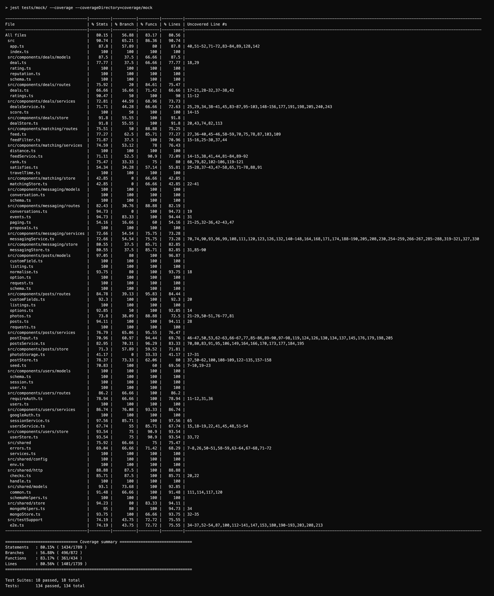

# Testing

## 1. Change History

| **Change Date** | **Modified Sections** | **Rationale** |
| --------------- | --------------------- | ------------- |
| 2026-10-20 | 2 | First version: the front-end end-to-end tests for Feature 1 (Use Cases 1, 2 and 4), how to run them, how each test maps to its use case scenario steps, and the logs of a full run (25/25 passed). Back-end and non-functional requirement tests will be added later. |
| 2026-10-21 | 2 | Replaced the Use Case 1, 2 and 4 tables with one table for the new Use Case 1: Manage Posts, added the new tests for every Use Case 1 success and failure scenario, and added the logs of a full run (42/42 passed). |
| 2026-10-30 | 2 | Added the post name to the Use Case 1 table: the tests enter "Test item" in "Name \*", `rejectsMissingName` covers a missing name (5a), and `createsPostAndShowsItInMyPosts` checks that the name is shown. |
| 2026-10-31 | 2, 3, 4 | Matched the document to the course template: the back-end APIs are section 2, non-functional requirements section 3, and the front-end specification moved from section 2 to section 4. Added the first back-end specification, for the Deals component: where each interface's tests are, how to run them, the coverage reports, and why some coverage is below 100%. |
| 2026-10-30 | 2 | The condition is now picked from a dropdown, so `createsPostWithOptionalFields` opens the condition dropdown before picking "Fair" or "Like New". |
| 2026-10-31 | 2 | Removed the note that no route creates a deal, since accepting a proposal now records one. |
| 2026-11-01 | 4 | Use Case 1 is now Create Post, after the use cases were split in the Requirements and Design. The table maps the tests to its steps 1–7 and failures 2a, 5a–5d and 6a; the edit, close, reopen and delete tests now cover the Edit, Close, Reopen and Delete post use cases instead of formal steps. |
| 2026-11-01 | 3 | Added the location and verification of the NFR 2 test, and noted that the NFR 1 test has not been added yet. |
| 2026-11-13 | 2 | Added the interface tests of the Messaging conversation routes: where they are, what is mocked, how the tables of errors are organized, and the known limitation for a conversation's last message. |
| 2026-11-13 | 2, 4 | Added the test-only `/api/e2e` routes the end-to-end tests seed their data with, and the Messaging end-to-end tests: Use Case 4: Send a Message step by step, and the Start a conversation, Send a proposal and Respond to a proposal use cases. Added how to run the end-to-end tests without Docker on Windows. |
| 2026-11-14 | 2 | Added the interface tests of the Messaging proposal routes, including the tests that a failed accept can be retried. |
| 2026-11-14 | 2 | Added the interface tests of `GET /api/events`, the live updates, and how they read the event stream and fake the heartbeat timer. |
| 2026-11-14 | 4 | Create deal is no longer a separate use case, so the Respond to a proposal tests are described as recording the deal when a proposal is accepted. Close post and Reopen post are now part of Edit post, so the ManagePostsTest row names the use cases it covers. |
| 2026-11-15 | 2 | Re-ran the back-end interface tests at commit `6533060` and replaced the coverage screenshots, commit hash and test counts (629 tests: 95 with mocks, 534 without). Added that `routes/users.ts` has full coverage. |
| 2026-11-15 | 2 | Added the interface tests of the profile routes, `GET /api/users/me` and `PATCH /api/users/me`, and listed the existing `GET /api/users/:id/reputation` tests. A body over 4 KB to `/api/users` now returns 413 instead of 500. |
| 2026-11-14 | 2 | Added the Messaging coverage: which files are at 100%, a test for a conversation about a post saved before posts had names, and why the one remaining branch in `routes/conversations.ts` and `routes/paging.ts` cannot be reached. |
| 2026-11-17 | 2, 3 | Added the interface tests of the Matching component, `GET /api/feed`, `GET /api/feed/listings` and `GET /api/feed/requests`, and why the two remaining branches in `matching/rank.ts` and `matching/satisfies.ts` cannot be reached. Added the NFR 1 test, feed ranking latency, with its verification and logs. |
| 2026-11-18 | 3 | The NFR 2 test now also times a rate-limited, failing and unreachable routing service, and logs each response time, so the verification log shows the measured times rather than only the pass count. |
| 2026-11-18 | 2 | Added the interface tests of the auth routes, `POST /api/auth/google`, `POST /api/auth/refresh` and `POST /api/auth/logout`, and of the session token that every protected route checks. Writing them showed that an auth body over 4 KB returned 500, so it now returns 413. Replaced the `app.ts` and `sessions.ts` coverage row with the reasons for their remaining branches and for `googleAuth.ts`. |
| 2026-11-18 | 4 | Added the end-to-end tests of Use Case 3: View Recommendations for a Post (`ViewRecommendationsTest.kt`), mapped to its steps 1–6 and failures 1a, 1b, 3a and 6a. Failures 5a and 5b need OpenRouteService to fail, which the front-end tests cannot cause, so the back-end tests cover them. |
| 2026-11-18 | 4 | Added the end-to-end tests of Use Case 5: Filter Feed (`FilterFeedTest.kt`), mapped to its steps 1–5 and failures 2a, 3a–3d, 5a and 5b. |
| 2026-11-18 | 4 | Added the test logs of Use Cases 3 and 5, and the bug the View Recommendations tests found: the home-address filter replaced the recommendations when "See recommendations" opened the feed first. |

---

## 2. Back-end Test Specification: APIs

This section covers the Deals, Messaging and Matching components, and the auth and profile routes of the Users component ([Section 4.1](Requirements_and_Design.md#41-main-components)). Tests for the other components will be added here as they are written.

### 2.1. Locations of Back-end Tests and Instructions to Run Them

#### 2.1.1. Tests

| **Interface** | **Describe Group Location, No Mocks** | **Describe Group Location, With Mocks** | **Mocked Components** |
| ------------- | ------------------------------------- | --------------------------------------- | --------------------- |
| **GET /api/deals** | [`tests/no-mock/getDeals.test.ts#L95`](https://github.com/m1lun/m1skeletonProject/blob/653306006d853609a66c1bd4d9bfe8f031008a4f/backend/tests/no-mock/getDeals.test.ts#L95) | [`tests/mock/getDeals.test.ts#L45`](https://github.com/m1lun/m1skeletonProject/blob/653306006d853609a66c1bd4d9bfe8f031008a4f/backend/tests/mock/getDeals.test.ts#L45) | Deals DB, Ratings DB, Reputations DB, Users DB, Listings DB, Requests DB |
| **POST /api/deals/:id/ratings** | [`tests/no-mock/ratings.test.ts#L260`](https://github.com/m1lun/m1skeletonProject/blob/653306006d853609a66c1bd4d9bfe8f031008a4f/backend/tests/no-mock/ratings.test.ts#L260) | [`tests/mock/ratings.test.ts#L81`](https://github.com/m1lun/m1skeletonProject/blob/653306006d853609a66c1bd4d9bfe8f031008a4f/backend/tests/mock/ratings.test.ts#L81) | Deals DB, Ratings DB, Reputations DB |
| **PUT /api/deals/:id/ratings** | [`tests/no-mock/ratings.test.ts#L334`](https://github.com/m1lun/m1skeletonProject/blob/653306006d853609a66c1bd4d9bfe8f031008a4f/backend/tests/no-mock/ratings.test.ts#L334) | [`tests/mock/ratings.test.ts#L116`](https://github.com/m1lun/m1skeletonProject/blob/653306006d853609a66c1bd4d9bfe8f031008a4f/backend/tests/mock/ratings.test.ts#L116) | Deals DB, Ratings DB, Reputations DB |
| **GET /api/feed/listings/:id** | [`tests/no-mock/dealPost.test.ts#L97`](https://github.com/m1lun/m1skeletonProject/blob/653306006d853609a66c1bd4d9bfe8f031008a4f/backend/tests/no-mock/dealPost.test.ts#L97) | [`tests/mock/dealPost.test.ts#L34`](https://github.com/m1lun/m1skeletonProject/blob/653306006d853609a66c1bd4d9bfe8f031008a4f/backend/tests/mock/dealPost.test.ts#L34) | Listings DB |
| **GET /api/feed/requests/:id** | [`tests/no-mock/dealPost.test.ts#L102`](https://github.com/m1lun/m1skeletonProject/blob/653306006d853609a66c1bd4d9bfe8f031008a4f/backend/tests/no-mock/dealPost.test.ts#L102) | [`tests/mock/dealPost.test.ts#L54`](https://github.com/m1lun/m1skeletonProject/blob/653306006d853609a66c1bd4d9bfe8f031008a4f/backend/tests/mock/dealPost.test.ts#L54) | Requests DB |
| **POST /api/conversations** | [`tests/no-mock/conversations.test.ts#L51`](../backend/tests/no-mock/conversations.test.ts#L51) | [`tests/mock/conversations.test.ts#L40`](../backend/tests/mock/conversations.test.ts#L40) | Listings DB, Requests DB, Conversations DB |
| **GET /api/conversations** | [`tests/no-mock/conversations.test.ts#L245`](../backend/tests/no-mock/conversations.test.ts#L245) | [`tests/mock/conversations.test.ts#L64`](../backend/tests/mock/conversations.test.ts#L64) | Conversations DB, Users DB, Listings DB |
| **GET /api/conversations/:id/messages** | [`tests/no-mock/conversations.test.ts#L334`](../backend/tests/no-mock/conversations.test.ts#L334) | [`tests/mock/conversations.test.ts#L85`](../backend/tests/mock/conversations.test.ts#L85) | Conversations DB, Messages DB |
| **POST /api/conversations/:id/messages** | [`tests/no-mock/conversations.test.ts#L406`](../backend/tests/no-mock/conversations.test.ts#L406) | [`tests/mock/conversations.test.ts#L105`](../backend/tests/mock/conversations.test.ts#L105) | Conversations DB, Messages DB |
| **POST /api/conversations/:id/proposal** | [`tests/no-mock/proposals.test.ts#L105`](../backend/tests/no-mock/proposals.test.ts#L105) | [`tests/mock/proposals.test.ts#L65`](../backend/tests/mock/proposals.test.ts#L65) | Conversations DB |
| **POST /api/conversations/:id/proposal/accept** | [`tests/no-mock/proposals.test.ts#L215`](../backend/tests/no-mock/proposals.test.ts#L215) | [`tests/mock/proposals.test.ts#L88`](../backend/tests/mock/proposals.test.ts#L88) | Conversations DB, Listings DB, Requests DB, Deals DB |
| **POST /api/conversations/:id/proposal/decline** | [`tests/no-mock/proposals.test.ts#L376`](../backend/tests/no-mock/proposals.test.ts#L376) | [`tests/mock/proposals.test.ts#L141`](../backend/tests/mock/proposals.test.ts#L141) | Conversations DB |
| **GET /api/events** | [`tests/no-mock/events.test.ts#L53`](../backend/tests/no-mock/events.test.ts#L53) | [`tests/mock/events.test.ts#L53`](../backend/tests/mock/events.test.ts#L53) | Timers (the 25-second heartbeat) |
| **GET /api/users/me** | [`tests/no-mock/users.test.ts#L77`](../backend/tests/no-mock/users.test.ts#L77) | [`tests/mock/users.test.ts#L41`](../backend/tests/mock/users.test.ts#L41) | Users DB |
| **PATCH /api/users/me** | [`tests/no-mock/users.test.ts#L127`](../backend/tests/no-mock/users.test.ts#L127) | [`tests/mock/users.test.ts#L57`](../backend/tests/mock/users.test.ts#L57) | Users DB |
| **GET /api/users/:id/reputation** | [`tests/no-mock/reputation.test.ts#L34`](../backend/tests/no-mock/reputation.test.ts#L34) | [`tests/mock/reputation.test.ts#L32`](../backend/tests/mock/reputation.test.ts#L32) | Reputations DB |
| **GET /api/feed** | [`tests/no-mock/feed.test.ts#L95`](../backend/tests/no-mock/feed.test.ts#L95), ranking in [`tests/no-mock/feedRanking.test.ts#L80`](../backend/tests/no-mock/feedRanking.test.ts#L80) | [`tests/mock/feed.test.ts#L57`](../backend/tests/mock/feed.test.ts#L57) | OpenRouteService, Listings DB, Requests DB |
| **GET /api/feed/listings** | [`tests/no-mock/feed.test.ts#L514`](../backend/tests/no-mock/feed.test.ts#L514) | [`tests/mock/feed.test.ts#L231`](../backend/tests/mock/feed.test.ts#L231) | Listings DB |
| **GET /api/feed/requests** | [`tests/no-mock/feed.test.ts#L537`](../backend/tests/no-mock/feed.test.ts#L537) | [`tests/mock/feed.test.ts#L248`](../backend/tests/mock/feed.test.ts#L248) | Requests DB |
| **POST /api/auth/google** | [`tests/no-mock/auth.test.ts#L92`](../backend/tests/no-mock/auth.test.ts#L92) | [`tests/mock/auth.test.ts#L71`](../backend/tests/mock/auth.test.ts#L71) | Google ID token check (`OAuth2Client.verifyIdToken`), Sessions DB, Users DB |
| **POST /api/auth/refresh** | [`tests/no-mock/auth.test.ts#L111`](../backend/tests/no-mock/auth.test.ts#L111) | [`tests/mock/auth.test.ts#L184`](../backend/tests/mock/auth.test.ts#L184) | Sessions DB |
| **POST /api/auth/logout** | [`tests/no-mock/auth.test.ts#L209`](../backend/tests/no-mock/auth.test.ts#L209) | [`tests/mock/auth.test.ts#L218`](../backend/tests/mock/auth.test.ts#L218) | Sessions DB |

The mocked tests use `jest.spyOn` on one store method at a time, so each database failure is forced on its own. Both groups otherwise run against a real MongoDB.

How the Messaging conversation tests are organized:

- **Unmocked groups** cover every success and every failure the API can cause. Requests every conversation route must refuse share two tables in `tests/helpers/conversationFixtures.ts`: `ACCESS_CASES` (a user outside the conversation, an unknown or malformed id, no token or an invalid one) and `unreadableBodies` (malformed JSON and a body over 16 KB). Each route runs them alongside its own table of invalid bodies, so one comment block describes all the cases in a table.
- **Mocked groups** make each store method the route calls reject in turn, through the helpers in `tests/helpers/storeFailures.ts`, and check for a handled 500.
- **Accepting a proposal** writes in steps: it records the deal, closes the posts, then marks the proposal accepted. In the mocked group, each of its eight store calls fails once, and the test then accepts again without the mock and checks that the retry finishes the deal: exactly one deal, both posts closed and the proposal accepted. The unmocked group sets up an accept that stopped partway directly in the database and checks that accepting again finishes it, and that a deal on the same posts with someone else, or at another price, still returns 409. MongoDB rejecting a deal because another accept saved one first is mocked, since the API cannot time two accepts that precisely.
- **Live updates.** `GET /api/events` keeps its response open, so `tests/helpers/eventStream.ts` opens it as a real HTTP client and records what the server writes. The unmocked group checks that each new message and each proposal change reaches every open stream of the other user, and never the sender or users outside the conversation. The mocked group fakes `setInterval` with Jest, so 25 seconds pass at once, to check the heartbeat and that closing a stream clears its timer: time is the one dependency these tests cannot control.
- **Profile routes.** `GET /api/users/me` and `PATCH /api/users/me` are tested in `tests/no-mock/users.test.ts` and `tests/mock/users.test.ts`. Every rejected address change, including a body over the 4 KB limit, also checks that the saved address is unchanged. The `Body Over 4 KB: 413` test was written first, failed with a 500, and passes since `/api/users` uses the same body-size handler as the ratings and conversation routes.
- **Matching feed.** The unmocked `GET /api/feed` group runs without an OpenRouteService key, so it never calls the routing service. It checks every hard requirement (category, radius, price, condition, dimensions in any orientation, text ignoring case, yes/no fields), that a listing's feed holds exactly the requests it meets, paging in rank order, the feed filters (a filter looser than the post's own requirement is ignored), and every 400, 403, 404 and 409. `feedRanking.test.ts` checks the scores. The mocked group fakes OpenRouteService with `jest.spyOn(global, 'fetch')` to check travel times, each travel mode, and that the feed still returns its ranked matches when the service fails, is rate-limited or answers with something unusable; it also makes each store method the feed calls reject in turn. `GET /api/feed/listings` and `GET /api/feed/requests` share their code, so `browseTests` in `tests/no-mock/feed.test.ts` runs the same cases for both, and each has its own price test.
- **Auth routes.** These tests start the app with the MongoDB session store, as in production, instead of the in-memory one in `tests/helpers/testApp.ts`. The unmocked groups get refresh tokens by starting a session directly, since only Google can issue a real ID token. They cover every unreadable body (missing or blank token, malformed JSON, over 4 KB), a token Google rejects, refresh-token rotation, reuse of an exchanged token revoking the whole sign-in, expiry, and sign-out of every token from a sign-in. `Unmocked: session token on protected routes` checks the session token that `requireAuth` reads on every route except `/health` and `/api/auth`: a missing or non-Bearer header, and expired, wrongly signed, wrong-audience and incomplete tokens. The mocked group for `POST /api/auth/google` replaces Google's `verifyIdToken` to sign in an account with and without names and a photo, and to reject the token, an unverified email and a ticket with no payload; the other mocked groups make each session store method fail in turn. The `Body Over 4 KB: 413` tests were written first, failed with a 500, and pass since `/api/auth` uses the same body-size handler as `/api/users`.
- **Known limitation.** If saving a message works but updating the conversation's last message fails, the conversations list shows the previous message until the next one is sent. Fixing it needs a MongoDB transaction, which needs a replica set. The mocked test `recordMessage Throws, Next Message Repairs The Last Message` checks that the next message corrects it.

**Test-only routes for the end-to-end tests.** The front-end tests in Section 4 create their data through these routes. They exist only when the backend runs with `ENABLE_E2E_ROUTES=true`, and only touch made-up users tied to the caller: an "E2E Buyer" for deals and an "E2E Seller" for conversations. The `/api/e2e/partner/conversations` routes are the real conversation and proposal routes run as the E2E Seller, so the tests can play the second user through the same code; their full behaviour is tested with the Messaging routes.

| **Interface** | **Describe Group Location, No Mocks** | **Describe Group Location, With Mocks** | **Mocked Components** |
| ------------- | ------------------------------------- | --------------------------------------- | --------------------- |
| **POST /api/e2e/deals** | [`tests/no-mock/e2eDeals.test.ts#L46`](../backend/tests/no-mock/e2eDeals.test.ts#L46) | [`tests/mock/e2eDeals.test.ts#L41`](../backend/tests/mock/e2eDeals.test.ts#L41) | Deals DB |
| **DELETE /api/e2e/deals** | [`tests/no-mock/e2eDeals.test.ts#L109`](../backend/tests/no-mock/e2eDeals.test.ts#L109) | [`tests/mock/e2eDeals.test.ts#L41`](../backend/tests/mock/e2eDeals.test.ts#L41) | Deals DB |
| **POST /api/e2e/listings** | [`tests/no-mock/e2eConversations.test.ts#L68`](../backend/tests/no-mock/e2eConversations.test.ts#L68) | [`tests/mock/e2eConversations.test.ts#L46`](../backend/tests/mock/e2eConversations.test.ts#L46) | Listings DB |
| **POST /api/e2e/conversations** | [`tests/no-mock/e2eConversations.test.ts#L111`](../backend/tests/no-mock/e2eConversations.test.ts#L111) | [`tests/mock/e2eConversations.test.ts#L46`](../backend/tests/mock/e2eConversations.test.ts#L46) | Conversations DB, Messages DB |
| **DELETE /api/e2e/conversations** | [`tests/no-mock/e2eConversations.test.ts#L168`](../backend/tests/no-mock/e2eConversations.test.ts#L168) | [`tests/mock/e2eConversations.test.ts#L46`](../backend/tests/mock/e2eConversations.test.ts#L46) | Conversations DB |
| **POST /api/e2e/partner/conversations/:id/messages** | [`tests/no-mock/e2eConversations.test.ts#L212`](../backend/tests/no-mock/e2eConversations.test.ts#L212) | [`tests/mock/e2eConversations.test.ts#L70`](../backend/tests/mock/e2eConversations.test.ts#L70) | Conversations DB |
| **POST /api/e2e/partner/conversations/:id/proposal** | [`tests/no-mock/e2eConversations.test.ts#L260`](../backend/tests/no-mock/e2eConversations.test.ts#L260) | [`tests/mock/e2eConversations.test.ts#L70`](../backend/tests/mock/e2eConversations.test.ts#L70) | Conversations DB |
| **POST /api/e2e/partner/conversations/:id/proposal/decline** | [`tests/no-mock/e2eConversations.test.ts#L282`](../backend/tests/no-mock/e2eConversations.test.ts#L282) | [`tests/mock/e2eConversations.test.ts#L70`](../backend/tests/mock/e2eConversations.test.ts#L70) | Conversations DB |

Rules that the HTTP interfaces cannot reach or prove are tested directly in [`no-mock/dealStore.test.ts`](https://github.com/m1lun/m1skeletonProject/blob/653306006d853609a66c1bd4d9bfe8f031008a4f/backend/tests/no-mock/dealStore.test.ts): the database validators, the unique indexes, and the store methods behind the routes. `deals.insert`, which records a new deal, is tested there.

#### 2.1.2. Commit Hash Where Tests Run

`653306006d853609a66c1bd4d9bfe8f031008a4f`

#### 2.1.3. Explanation on How to Run the Tests

1. **Clone the Repository**:

   - Open your terminal and run:
     ```
     git clone https://github.com/m1lun/m1skeletonProject.git
     cd m1skeletonProject
     git checkout 653306006d853609a66c1bd4d9bfe8f031008a4f
     ```

2. **Install the Tools**:

   - Install [Docker](https://www.docker.com/) and Node.js 22, and start Docker.

3. **Install the Dependencies**:

   - Run:
     ```
     cd backend
     npm ci
     cd ..
     ```

4. **Run the Tests**:

   - From the project root, run:
     ```
     ./scripts/run-backend-interface-tests.sh
     ```
     On Windows, run `scripts\run-backend-interface-tests.ps1`.

The script starts a throwaway MongoDB on port 27018 and runs the tests three times: `tests/mock/`, `tests/no-mock/`, then both together. It writes each coverage report to `backend/coverage/mock/`, `backend/coverage/no-mock/` and `backend/coverage/interface/`, and removes the database when it finishes.

To run tests from an IDE or with `npx jest`, start the database first with `docker compose -f docker-compose.test.yml up -d --wait` from the project root.

**Known issue on macOS:** `tests/no-mock/postName.test.ts` and `tests/no-mock/health.test.ts` use `request(app)`, which listens on all addresses. macOS can give that server a port another program already holds on `127.0.0.1`, such as Android Studio, so a request occasionally gets an unexpected response and the script stops. If this happens, run the script again. The Deals tests bind to `127.0.0.1` through `tests/helpers/testApp.ts` to avoid it.

### 2.2. GitHub Actions Configuration Location

`~/.github/workflows/backend-tests.yml`

### 2.3. Jest Coverage Report Screenshots With Mocks

These are the Jest reports for every back-end file at the commit above: 629 tests in total, 95 with mocks and 534 without. Each image shows Jest's text report from the script.



### 2.4. Jest Coverage Report Screenshots Without Mocks


**With and without mocks combined:**


**Reasons for coverage below 100%:**

These reports cover the whole back-end. Combined, the tests reach 91.29% of statements, 84.86% of branches, 89.6% of functions and 91.16% of lines.

The Uncovered Line # column shows lines of the compiled JavaScript, not the TypeScript source. The line numbers below are the real source lines.

Combined coverage is 100% for statements, lines, functions and branches in `models/deal.ts`, `models/rating.ts`, `models/reputation.ts`, `models/schema.ts`, `reputation/score.ts` and `routes/ratings.ts`.

For Messaging, combined coverage is 100% for statements, lines, functions and branches in `events.ts`, `routes/proposals.ts` and `routes/e2e.ts`, and 100% for statements, lines and functions in `routes/conversations.ts` and `routes/paging.ts`, with one defensive branch each (below).

For the profile routes, combined coverage is 100% for statements, lines, functions and branches in `routes/users.ts`.

For Matching, combined coverage is 100% for statements, lines, functions and branches in `routes/feed.ts`, `routes/feedFilter.ts`, `matching/distance.ts` and `matching/travelTime.ts`.

| **File** | **Statements** | **Branches** | **Reason** |
| -------- | -------------- | ------------ | ---------- |
| `routes/deals.ts` | 100% | 93.61% | Three defensive branches cannot be reached through the API. Line 41: a stored post always has an `id`. Line 71: Express always gives `req.query` as an object. Line 97: every listing has at least one photo, because the validator requires it. Each one keeps the code safe with the optional types, so removing it would not simplify the logic. |
| `routes/conversations.ts` | 100% | 98.83% | One defensive branch cannot be reached through the API. Line 94: `byId` skips a post without an `id`, but the store's `findByIds` always returns each post's `id`; the check is there because the store's return type makes every field optional. |
| `routes/paging.ts` | 100% | 95.83% | One defensive branch cannot be reached through the API. Line 41: `parsePageQuery` falls back to no parameters if the query is not an object, but Express always gives `req.query` as an object. The same check in `routes/deals.ts` is justified above. |
| `store/mongoStore.ts` | 74.39% | 60.71% | The three Deals store classes (`MongoDealCollection`, `MongoRatingCollection` and `MongoReputationCollection`) reach every line and branch. The uncovered code belongs to other components: options, custom fields, users, sessions, and parts of the post collection. |
| `matching/rank.ts` | 98.18% | 96.29% | One defensive branch cannot be reached through the API. Lines 59–60 (line 39 in the coverage report, which numbers the compiled JavaScript): `normaliseWeights` counts the four parts equally when every weight is 0, but the feed always ranks with `DEFAULT_WEIGHTS` (3, 3, 3, 3) until users can save ranking preferences. |
| `matching/satisfies.ts` | 97.91% | 97.14% | One defensive branch cannot be reached through the API. Lines 87–88 (line 83 in the coverage report): `satisfies` rejects a listing in another category, but the feed only fetches candidates in the post's category (`listOpenInCategory`). The check keeps the rule complete on its own, so a listing is in a request's feed exactly when the request is in the listing's. |
| `errors.ts` | 75.86% | 58.33% | The handler is shared by the whole back-end. Every path the Deals routes use is covered. The uncovered paths are the `errorMessage` log helper, a response that has already started, a duplicate field in a post, and a document the database validator rejects. Deals input is checked before it reaches the database, so the Deals routes do not reach them. |
| `app.ts` | 100% | 96.15% | One branch is code TypeScript adds, not ours. Line 3 of the compiled file (the coverage report numbers the compiled JavaScript) is the `__importDefault` helper that `import express from 'express'` compiles to. It returns the module unchanged only for a package compiled from ES modules, and Express is a CommonJS package, so that side is never taken. |
| `sessions.ts` | 100% | 90% | Line 3 (compiled) is the same `__importDefault` helper, for `import jwt from 'jsonwebtoken'`. Lines 96–97 (70–71 in the report): `verifySessionToken` reads no claims from a token whose payload is a plain string, but `jwt.verify` is called with an issuer and audience, and it rejects a string payload because it has neither, so a string never reaches those lines. They stay because `jwt.verify` returns `string \| JwtPayload`. |
| `googleAuth.ts` | 100% | 91.66% | Line 40 (27 in the report): `payload.email ?? ''` is for a ticket without an email. The line before it rejects an account whose `email_verified` is not `true`, and Google only sends `email_verified` together with `email` (both come from the `email` scope), so a ticket that gets this far always has an email. |

---

## 3. Back-end Test Specification: Tests of Non-Functional Requirements

### 3.1. Test Locations in Git

| **Non-Functional Requirement** | **Location in Git** |
| ------------------------------ | ------------------- |
| **NFR 1: Feed ranking latency** | [`backend/tests/nfr/feedLatency.test.ts`](../backend/tests/nfr/feedLatency.test.ts) |
| **NFR 2: Graceful degradation without the routing service** | [`backend/tests/nfr/routingFallback.test.ts`](../backend/tests/nfr/routingFallback.test.ts) |

Run the NFR tests with `./scripts/run-backend-nfr-tests.sh`.

### 3.2. Test Verification and Logs

**NFR 1:** the test saves 1,000 of another user's open chair listings, all meeting the hard requirements of my chair request, with varied prices, conditions, places, brands and colours, so every one is scored on each request. The request has a hard maximum price and soft preferences for condition, brand and colour. Without an OpenRouteService key, as NFR 1 excludes the travel-time lookup, it sends one warm-up request and then 100 `GET /api/feed?postId=<id>` requests one after another through Supertest. It checks that each returns 20 matches and the next cursor, takes the 95th percentile of the 100 response times, and checks that it is under 1 second. It logs the measured times:

```
NFR 1: 100 requests, 1000 candidates: p50 43.0 ms, p95 45.0 ms, max 65.4 ms, mean 41.5 ms (limit 1000 ms at p95)
Tests:       1 passed, 1 total
```

**NFR 2:** the test replaces OpenRouteService with a mock for each way it can fail, and times one `GET /api/feed` request for my request, which one listing matches. For a service that never answers, it checks that the feed abandons the routing request after `ROUTING_TIMEOUT_MS` (2 seconds), so the time is at least 2 seconds, and still answers in under 3 seconds. For a service that is rate-limited (429), fails (500) or refuses the connection, it checks that the feed answers in under 3 seconds without waiting for the timeout. In every case the routing service is called once and the feed returns the ranked match with `travelMinutes` null and `travelTimesAvailable` false, which the app shows as "Travel time unavailable".

```
NFR 2: routing service never answers: feed answered in 2023 ms (limit 3000 ms)
NFR 2: routing service is rate-limited (429): feed answered in 8 ms (limit 3000 ms)
NFR 2: routing service fails (500): feed answered in 6 ms (limit 3000 ms)
NFR 2: routing service is unreachable: feed answered in 6 ms (limit 3000 ms)
Tests:       4 passed, 4 total
```

---

## 4. Front-end Test Specification

### 4.1. Location in Git of Front-end Test Suite:

`frontend/app/src/androidTest/java/com/example/cpen321application/e2e/`

| **Test class** | **Use cases** |
| -------------- | ------------- |
| [`CreatePostTest.kt`](../frontend/app/src/androidTest/java/com/example/cpen321application/e2e/CreatePostTest.kt) | [Use Case 1: Create Post](Requirements_and_Design.md#uc1), steps 1–7 |
| [`ManagePostsTest.kt`](../frontend/app/src/androidTest/java/com/example/cpen321application/e2e/ManagePostsTest.kt) | [Use Case 1: Create Post](Requirements_and_Design.md#uc1), steps 1–2 and failure 2a. Its other tests cover the Edit post use case, including closing and reopening a post, and the Delete post use case ([Section 3.4](Requirements_and_Design.md#34-use-case-description)), which have no formal specification. |
| [`ViewRecommendationsTest.kt`](../frontend/app/src/androidTest/java/com/example/cpen321application/e2e/ViewRecommendationsTest.kt) | [Use Case 3: View Recommendations for a Post](Requirements_and_Design.md#uc3), steps 1–6 and failures 1a, 1b, 3a and 6a |
| [`SendMessageTest.kt`](../frontend/app/src/androidTest/java/com/example/cpen321application/e2e/SendMessageTest.kt) | [Use Case 4: Send a Message](Requirements_and_Design.md#uc4), steps 1–7 and failures 2a, 4a, 5a, 6a and 7a. Steps 1–2 and 2a are also the View conversations use case. |
| [`FilterFeedTest.kt`](../frontend/app/src/androidTest/java/com/example/cpen321application/e2e/FilterFeedTest.kt) | [Use Case 5: Filter Feed](Requirements_and_Design.md#uc5), steps 1–5 and failures 2a, 3a–3d, 5a and 5b |
| [`StartConversationTest.kt`](../frontend/app/src/androidTest/java/com/example/cpen321application/e2e/StartConversationTest.kt) | Start a conversation ([Section 3.4](Requirements_and_Design.md#34-use-case-description)) |
| [`SendProposalTest.kt`](../frontend/app/src/androidTest/java/com/example/cpen321application/e2e/SendProposalTest.kt) | Send a proposal ([Section 3.4](Requirements_and_Design.md#34-use-case-description)) |
| [`RespondToProposalTest.kt`](../frontend/app/src/androidTest/java/com/example/cpen321application/e2e/RespondToProposalTest.kt) | Respond to a proposal, including recording the deal when it is accepted ([Section 3.4](Requirements_and_Design.md#34-use-case-description)) |

Shared test steps are in `support/PostRobot.kt`, and the differences between the request and listing forms are in `support/PostForm.kt`. The Messaging tests' steps are in `support/MessagingSeed.kt`, and `support/E2eApi.kt` holds the backend calls shared by the Deals and Messaging tests.

**How the tests are set up.** Following the course rules, each test starts from the app's main screen with the user already signed in, and assumes no existing data:

- **Stand-alone tests.** Every post a test creates uses the category `e2e chair`. Before and after each test, `deleteTestPosts()` deletes every post in that category through the back-end API, so each test starts from an empty state and a failed test leaves nothing behind. The tester's posts in other categories are never touched. Tests that need an existing post create it through the UI first (`createPost`).
- **Both post types.** Requests and listings share the same screens, so both test classes are parameterized over `PostForm` and run every test once for requests (`[REQUEST]`) and once for listings (`[LISTING]`).
- **No mocking.** The tests talk to the real back-end. For failure scenarios 2a and 6a ("the network or server is unavailable"), the test switches on the emulator's airplane mode, and switches it off again in `@After` even if the test fails.
- **Results checked on the server.** When a scenario says nothing is saved, the test asks the back-end with `testPosts()` and checks the list is empty, instead of trusting the screen.
- **System UI.** The Android photo picker is not part of the app, so it is driven with UI Automator. `TestPhotos` adds small JPEGs to the emulator's gallery before each test and deletes them afterwards.
- **A second user for Messaging.** Every conversation needs another user. Before each Messaging test, `POST /api/e2e/listings` or `POST /api/e2e/conversations` (Section 2) gives the signed-in tester a made-up partner, "E2E Seller", with an open listing "E2E lamp" and, if needed, a conversation with up to 40 messages. During a test, the E2E Seller replies, proposes and declines through the real conversation routes, so live updates reach the app exactly as they would from a second phone, and no manual tester is needed. `DELETE /api/e2e/conversations` removes everything afterwards, including a deal made by accepting a proposal. The tester's real conversations and deals are never touched.
- **Another user's post for the Matching feed.** The feed only shows other users' posts, so before each feed test `POST /api/e2e/listings` gives the tester the E2E Seller's open listing "E2E lamp" ($30, category lamp, at 6335 Thunderbird Crescent). The recommendation tests create the tester's own request "E2E feed request" through the API, in the same category and place with a hard maximum price of $50, so the listing meets every hard requirement, and delete it before and after each test (`support/FeedSeed.kt`). The feed starts filtered near the tester's home address, so the tests clear the filters first, and the one test that needs the tester to have no open requests closes them and reopens them afterwards.
- **Back online after airplane mode.** The emulator needs several seconds to reconnect after airplane mode is turned off, so the tests call `waitUntilOnline()` before a step that needs the network again.

**How to run them.**

1. Complete the Frontend Setup and the `backend/.env` part of the Backend Setup in the [README](../README.md), and add `ENABLE_E2E_ROUTES=true` to `backend/.env`: the Deals and Messaging tests seed their data through the test-only routes. Docker must be running, and `java` must be on your `PATH`. Android Studio's bundled JDK works:
   ```bash
   export JAVA_HOME="/Applications/Android Studio.app/Contents/jbr/Contents/Home"   # macOS
   export PATH="$JAVA_HOME/bin:$PATH"
   ```
2. In `frontend/local.properties`, set `API_BASE_URL=http://10.0.2.2:3000` so the app uses the back-end the script starts on your machine.
3. From the project root, run:
   ```bash
   ./scripts/run-frontend-e2e-tests.sh        # Windows: scripts\run-frontend-e2e-tests.ps1
   ```
   The script starts the back-end and the `Pixel_9` emulator (set `AVD_NAME=<name>` for another AVD), then builds and installs the app. When prompted, sign in inside the app on the emulator, wait for the main screen, and press Enter. The full suite takes about 10 minutes.
4. The report is at `frontend/app/build/reports/androidTests/connected/debug/index.html`.

**Without Docker on Windows** (for example, with Docker installed only in WSL), the script cannot start the backend. Start MongoDB and run `npm run dev` in `backend/` instead, start the `Pixel_9` emulator and sign in inside the app, then run the tests from `frontend/`:

```powershell
.\gradlew.bat connectedDebugAndroidTest "-Pandroid.testInstrumentationRunnerArguments.class=com.example.cpen321application.e2e.SendMessageTest,com.example.cpen321application.e2e.StartConversationTest,com.example.cpen321application.e2e.SendProposalTest,com.example.cpen321application.e2e.RespondToProposalTest"
```

Leave out the class list to run every test in `e2e/`.

### 4.2. Tests

- **Use Case 1: Create Post** ([`CreatePostTest.kt`](../frontend/app/src/androidTest/java/com/example/cpen321application/e2e/CreatePostTest.kt) and [`ManagePostsTest.kt`](../frontend/app/src/androidTest/java/com/example/cpen321application/e2e/ManagePostsTest.kt), each test run once as `[REQUEST]` and once as `[LISTING]`)

  - **Expected Behaviors:**

    | **Scenario Steps** | **Test Case Steps** |
    | ------------------ | ------------------- |
    | 1. The user opens My Posts and chooses "I'm buying" (requests) or "I'm selling" (listings). | Tap "My Posts", then "I'm buying" (`[REQUEST]`) or "I'm selling" (`[LISTING]`). |
    | 2. The app shows the user's open and closed posts of that kind. | Check that "My requests (" or "My listings (" is shown. |
    | 2a. The network or server is unavailable when the posts are loaded. | (`showsErrorWhenPostsCannotLoad`) Open the other kind of post, turn on airplane mode, and tap "I'm buying" or "I'm selling". |
    | 2a1. The app shows "Could not reach the server. Check your connection." | Check that "Could not reach the server" is shown. |
    | 3. The user taps "New request" or "New listing". | Tap "New request" or "New listing". |
    | 4. The app shows the post form. | Check that the "Category \*" field is present on screen. |
    | 5. The user enters a name and a category and picks an address from the suggestions.<br>- For a request: a maximum price (required), and optionally a minimum condition, maximum size, search radius, brand and colour. Each of these fields, including the maximum price, is marked Hard or Soft, and a Soft field gets an importance from 1 to 5. The user may also add a description, custom fields, and up to 10 reference photos.<br>- For a listing: a price, a condition and 1–10 photos, and optionally a brand, colour, size, description and custom fields. | Input "Test item" in "Name \*".<br>Input "e2e chair" in "Category \*".<br>Input "6335 Thunderbird Crescent, Vancouver" in "Address \*", tap the first suggestion, and check that "✓ Address confirmed" is shown.<br>Input "150" as the price.<br>`[LISTING]`: tap "+ Add", select one photo in the system photo picker, tap "Done", and check that "Photos 1/10" is shown.<br>(`createsPostWithSeveralPhotos` selects three photos; `photoIsRequiredOnlyOnListings[REQUEST]` selects none, since photos are optional for requests; `createsPostWithOptionalFields` also inputs "Oak, barely used" in "Description", "120", "75" and "60" in "W", "H" and "D", "ikea" as the brand, "brown" as the colour, and a custom field "Material" with the value "oak" through "+ Add field", and picks "Fair" from the "Any" condition dropdown with a radius of "5" marked "Hard" (`[REQUEST]`) or picks "Like New" from the "Good" condition dropdown (`[LISTING]`).) |
    | 5a. A required field is missing or invalid. | **Missing category** (`rejectsMissingCategory`): open the form and tap the create button without filling it.<br>**Missing name** (`rejectsMissingName`): fill everything except the name and submit.<br>**Missing price** (`rejectsMissingPrice`): fill everything except the price and submit.<br>**Negative price** (`rejectsNegativePrice`): fill the form with the price "-5" and submit.<br>**Missing photo** (`photoIsRequiredOnlyOnListings[LISTING]`): fill everything except the photo and submit. |
    | 5a1. The app shows an error message, such as "Choose a category", "Enter a name", "Max price is required", "Enter a price", "Add at least one photo", or for a price below 0 "max price must be at least 0" (request) or "price must be a number of at least 0" (listing). Nothing is saved. | **Missing category:** check that "Choose a category" is shown and the create button is still on screen.<br>**Missing name:** check that "Enter a name" is shown and the back-end has no test posts.<br>**Missing price:** check that "Max price is required" (`[REQUEST]`) or "Enter a price" (`[LISTING]`) is shown and the back-end has no test posts.<br>**Negative price:** check that an error containing "at least 0" (`[REQUEST]`) or "price must be" (`[LISTING]`) is shown and the back-end has no test posts.<br>**Missing photo:** check that "Add at least one photo" is shown and the back-end has no test posts. |
    | 5b. The address was typed but not picked from the suggestions. | (`rejectsAddressThatWasNotPicked`) Fill the form without picking an address, input "zzzzqqqqxxxx nowhere" in "Address \*", and submit. |
    | 5b1. The app highlights the address field and shows "Choose your address from the suggestions list". | Check that "Choose your address from the suggestions list" is shown and the back-end has no test posts. |
    | 5c. A photo is larger than 5 MB. | (`rejectsPhotoOverFiveMegabytes`) Replace the test photos in the gallery with a single JPEG larger than 5 MB. Fill the form without photos, select that photo in the photo picker, and submit. |
    | 5c1. The app shows "Each photo must be at most 5 MB" and the post is not saved. | Check that "Each photo must be at most 5 MB" is shown and the back-end has no test posts. |
    | 5d. The user tries to add more than 10 photos. | (`limitsPhotosToTen`) Open the form, select 6 photos in the photo picker, then try to select 6 more. |
    | 5d1. The photo picker only lets the user select as many photos as are still allowed, and the app disables adding photos once there are 10. | Check that "Photos 10/10" is shown and the "+ Add" button is disabled. |
    | 6. The user taps "Create request" or "Create listing". | Tap "Create request" or "Create listing". |
    | 6a. The network or server is unavailable when the post is submitted. | (`showsErrorWhenServerIsUnreachable`) Fill the form, turn on airplane mode, and tap the create button. |
    | 6a1. The app shows "Could not reach the server. Check your connection." and the form keeps what the user entered. | Check that "Could not reach the server" is shown.<br>Turn off airplane mode and check that the form, with its create button, is still on screen. |
    | 7. The app saves the post and shows it in My Posts. | (`createsPostAndShowsItInMyPosts`) Check that "My requests (" or "My listings (" is shown with exactly one "e2e chair" post, and that "Test item" is shown.<br>(`createsPostWithOptionalFields` also checks on the back-end that the description, condition, Hard radius, dimensions, brand, colour and material were saved.) |

  - **Test Logs:**
    ```
    Pixel_9(AVD) - 16 (Android 16, API 36), 2026-10-21, ./scripts/run-frontend-e2e-tests.sh
    Commit 4c7c9b8 (PR #60, merged into main)

    com.example.cpen321application.e2e.CreatePostTest
      rejectsMissingPrice[REQUEST]                     PASSED   7.97 s
      rejectsAddressThatWasNotPicked[REQUEST]          PASSED   5.90 s
      createsPostAndShowsItInMyPosts[REQUEST]          PASSED   6.34 s
      showsErrorWhenServerIsUnreachable[REQUEST]       PASSED  11.81 s
      rejectsMissingCategory[REQUEST]                  PASSED   5.53 s
      limitsPhotosToTen[REQUEST]                       PASSED  10.39 s
      createsPostWithOptionalFields[REQUEST]           PASSED  22.15 s
      rejectsNegativePrice[REQUEST]                    PASSED   6.26 s
      createsPostWithSeveralPhotos[REQUEST]            PASSED   8.34 s
      photoIsRequiredOnlyOnListings[REQUEST]           PASSED   6.26 s
      rejectsPhotoOverFiveMegabytes[REQUEST]           PASSED   9.27 s
      rejectsMissingPrice[LISTING]                     PASSED   8.06 s
      rejectsAddressThatWasNotPicked[LISTING]          PASSED   7.89 s
      createsPostAndShowsItInMyPosts[LISTING]          PASSED   8.43 s
      showsErrorWhenServerIsUnreachable[LISTING]       PASSED  12.35 s
      rejectsMissingCategory[LISTING]                  PASSED   5.12 s
      limitsPhotosToTen[LISTING]                       PASSED  10.30 s
      createsPostWithOptionalFields[LISTING]           PASSED  24.19 s
      rejectsNegativePrice[LISTING]                    PASSED   8.21 s
      createsPostWithSeveralPhotos[LISTING]            PASSED   9.37 s
      photoIsRequiredOnlyOnListings[LISTING]           PASSED   6.15 s
      rejectsPhotoOverFiveMegabytes[LISTING]           PASSED   9.25 s

    com.example.cpen321application.e2e.ManagePostsTest
      editsPost[REQUEST]                               PASSED   6.75 s
      deletesPost[REQUEST]                             PASSED   6.21 s
      keepsPostClosedWhenReopenFails[REQUEST]          PASSED  12.35 s
      keepsPostWhenDeleteFails[REQUEST]                PASSED  26.07 s
      keepsPostWhenServerIsUnreachable[REQUEST]        PASSED  25.11 s
      rejectsInvalidEditAndKeepsPost[REQUEST]          PASSED  22.57 s
      showsErrorWhenPostsCannotLoad[REQUEST]           PASSED   7.10 s
      keepsPostWhenEditCannotBeSaved[REQUEST]          PASSED  25.85 s
      managesPostFromItsDetailScreen[REQUEST]          PASSED  22.45 s
      closesAndReopensPost[REQUEST]                    PASSED   6.67 s
      editsPost[LISTING]                               PASSED   9.68 s
      deletesPost[LISTING]                             PASSED   8.25 s
      keepsPostClosedWhenReopenFails[LISTING]          PASSED  14.13 s
      keepsPostWhenDeleteFails[LISTING]                PASSED  27.81 s
      keepsPostWhenServerIsUnreachable[LISTING]        PASSED  27.02 s
      rejectsInvalidEditAndKeepsPost[LISTING]          PASSED  24.12 s
      showsErrorWhenPostsCannotLoad[LISTING]           PASSED   7.24 s
      keepsPostWhenEditCannotBeSaved[LISTING]          PASSED  27.57 s
      managesPostFromItsDetailScreen[LISTING]          PASSED  25.14 s
      closesAndReopensPost[LISTING]                    PASSED   8.48 s

    Finished 42 tests on Pixel_9(AVD) - 16: 42 passed, 0 failed, 0 skipped (550.4 s)
    ```

- **Use Case 3: View Recommendations for a Post** ([`ViewRecommendationsTest.kt`](../frontend/app/src/androidTest/java/com/example/cpen321application/e2e/ViewRecommendationsTest.kt)). Each test starts with the E2E Seller's open listing "E2E lamp" at $30 and the tester's open request "E2E feed request" (category lamp, maximum price $50, hard), unless the row says otherwise. `showsRecommendationsForOwnPost` found a bug: when "See recommendations" was the first thing to open the feed, the feed's home-address filter finished loading afterwards and replaced the recommendations with the feed near home. `FeedViewModel` now applies the home filter only if nothing else has set the feed.

  - **Expected Behaviors:**

    | **Scenario Steps** | **Test Case Steps** |
    | ------------------ | ------------------- |
    | 1. The user opens one of their open posts and taps "See recommendations", or picks the post under "Recommended for" in the feed filters. | (`showsRecommendationsForOwnPost`) Tap "My Posts", then "I'm selling" and "I'm buying" (switching reloads My Posts, which the app loaded before the test created the request), tap "E2E feed request", and tap "See recommendations".<br>(`showsRecommendationsPickedInFilters`) Tap "Feed", clear the filters, tap "Filters", tap the "Recommended for" button, pick "Lamp · Seeded for the feed E2E tests", and tap "Apply". |
    | 1a. The user has no open posts. | (`saysWhenThereAreNoOpenPosts`) Close every open request of the tester through the API. Tap "Feed", clear the filters, and tap "Filters". |
    | 1a1. The feed filters show "You have no open posts to get recommendations for". | Check that "You have no open posts to get recommendations for" is shown, and that the "Recommended for" button does not appear within 3 seconds. The requests are reopened afterwards. |
    | 1b. The post is closed. | (`closedPostHasNoRecommendations`) Close "E2E feed request" through the API, then tap "My Posts", "I'm selling", "I'm buying" and "E2E feed request". |
    | 1b1. "See recommendations" is not shown, and the server returns no feed for it (409). | Check that "See recommendations" is not shown, and that `GET /api/feed?postId=<id>` returns 409. |
    | 2. The app shows "Recommended for: <post>". | Check that "Recommended for: Lamp · Seeded for the feed E2E tests" is shown (both ways in). |
    | 3. The system keeps other users' open posts in the same category that meet the request's hard requirements. | Covered by step 6: "E2E lamp" is in the same category, within 10 km and under the $50 maximum, so it is shown. The back-end interface tests check each hard requirement. |
    | 3a. No posts meet the hard requirements. | (`saysWhenNothingMatches`) Create the request in the category "e2e nothing matches" instead, open it and tap "See recommendations". |
    | 3a1. The app shows "Nothing here yet. Try changing the filters or check back soon." and a "Refresh" button. | Check that "Nothing here yet. Try changing the filters or check back soon." and the "Refresh" button are shown. |
    | 4. The system scores each remaining post and orders the best first. | Not checked on screen: only one other user's post is seeded. The back-end tests in `feedRanking.test.ts` check the order. |
    | 5. The system requests walking travel times for the first 20 results from OpenRouteService. | Covered by step 6, which checks the card's travel time. |
    | 5a. The routing service is unavailable, rate-limited or takes more than 2 seconds. | Not automated: the front-end tests use the real back-end and cannot make OpenRouteService fail. The mocked back-end tests and NFR 2 cover it. If the back-end runs without `ORS_API_KEY`, step 6 sees "Travel time unavailable", which is 5a1. |
    | 5b. No route exists for the user's travel mode. | Not automated, for the same reason; covered by the mocked back-end test `Travel Times From The Routing Service`. |
    | 6. The app shows the ranked list, 20 at a time; each item shows its price, condition and distance, plus its travel time on the first page. | Check that the "E2E lamp" card shows "$30.00", "Condition: good", "km away", and a travel time ("min walk", "min by bike" or "min drive") or "No route available" or "Travel time unavailable". |
    | 6a. The network or server is unavailable. | (`showsErrorWhenFeedCannotLoad`) Open "E2E feed request", turn on airplane mode, and tap "See recommendations". |
    | 6a1. The app shows "Couldn't load the feed. Check your connection and try again." and a "Retry" button. | Check that the message and the "Retry" button are shown.<br>Turn off airplane mode, wait until the back-end can be reached, tap "Retry", and check the "E2E lamp" card as in step 6. |

  - **Test Logs:**
    ```
    Pixel_9(AVD) - 16 (Android 16, API 36), 2026-11-18, adb shell am instrument (ViewRecommendationsTest, FilterFeedTest)
    main a7d227c with the tests of PR #216 (branch test/feed-e2e)

    com.example.cpen321application.e2e.ViewRecommendationsTest
      saysWhenNothingMatches                         PASSED   6.75 s
      showsRecommendationsForOwnPost                 PASSED   5.92 s
      showsErrorWhenFeedCannotLoad                   PASSED   7.20 s
      saysWhenThereAreNoOpenPosts                    PASSED  10.13 s
      closedPostHasNoRecommendations                 PASSED   4.01 s
      showsRecommendationsPickedInFilters            PASSED   9.26 s

    6 tests: 6 passed, 0 failed, 0 skipped (43.3 s)
    ```

- **Use Case 4: Send a Message** ([`SendMessageTest.kt`](../frontend/app/src/androidTest/java/com/example/cpen321application/e2e/SendMessageTest.kt)). Each test starts with a conversation with the E2E Seller about "E2E lamp", holding one message from them, "Message 1". Steps 7 and 7a are about the user who receives the message, so in those tests the signed-in tester receives it and the E2E Seller sends it.

  - **Expected Behaviors:**

    | **Scenario Steps** | **Test Case Steps** |
    | ------------------ | ------------------- |
    | 1. The user opens the Messages tab. | (`sendsMessage`) Tap "Messages" in the bottom bar. |
    | 2. The app shows the user's conversations, newest activity first, each with the other user, the listing and request, and the last message. | Check that the seeded conversation's card is shown, with "E2E Seller", "Listing: E2E lamp" and "Message 1". |
    | 2a. The network or server is unavailable when the conversations are loaded. | (`showsErrorWhenConversationsCannotLoad`) Turn on airplane mode and tap "Messages". |
    | 2a1. The app shows "Could not reach the server. Check your connection." and a "Retry" button. | Check that "Could not reach the server" and the "Retry" button are shown.<br>Turn off airplane mode, wait until the backend can be reached, tap "Retry", and check that the conversation's card is shown. |
    | 3. The user taps a conversation. | Tap the conversation's card. |
    | 4. The app shows its messages with the newest at the bottom, 30 at a time, with "Load earlier messages" when there are older ones. | Check that "Message 1" is shown.<br>(`loadsEarlierMessages`) Seed the conversation with 40 messages and open it. Check that "Message 40" is shown, scroll to "Load earlier messages" and tap it, then check that the button is gone and that "Message 1" is shown after scrolling up. |
    | 4a. The network or server is unavailable when the messages are loaded. | (`showsErrorWhenMessagesCannotLoad`) Open the Messages tab, turn on airplane mode, and tap the conversation. |
    | 4a1. The app shows "Could not reach the server. Check your connection." and a "Retry" button. | Check that "Could not reach the server" is shown.<br>Turn off airplane mode, wait until the backend can be reached, tap "Retry", and check that "Message 1" is shown. |
    | 5. The user types a message of up to 1000 characters and taps "Send". | Input "Is it still available?" in the message box and tap "Send". |
    | 5a. The message is empty or only spaces. | (`sendDisabledForBlankMessage`) Open the conversation with an empty message box, then input "   ". |
    | 5a1. "Send" is disabled. | Check that "Send" is disabled both times.<br>Input "hi" and check that "Send" is enabled. |
    | 6. The system saves the message, and the app shows it on the right and clears the message box. | Check that the message box is empty and that "Is it still available?" is shown.<br>Check on the backend that the conversation's messages are "Message 1" and "Is it still available?". |
    | 6a. The network or server is unavailable when the message is sent. | (`keepsMessageWhenSendFails`) Input "Is it still available?", turn on airplane mode, and tap "Send". |
    | 6a1. The app shows "Could not send the message. Try again." and the message stays in the message box. | Check that "Could not send the message. Try again." is shown and that the message box still contains "Is it still available?".<br>Turn off airplane mode and check on the backend that the only message is "Message 1". |
    | 7. The message appears in the other user's open conversation without refreshing. | (`showsOtherUsersMessageLive`) Open the conversation and wait two seconds for its live connection. The E2E Seller sends "Yes, still available".<br>Check that "Yes, still available" is shown without refreshing. |
    | 7a. The other user's connection to the server was lost. | (`catchesUpAfterReconnecting`) Open the conversation, turn airplane mode on and off, and wait until the backend can be reached. The E2E Seller sends "Sent while you were offline". |
    | 7a1. Their app reconnects and reloads the conversation, which then shows the message, within about a minute. | Check that "Sent while you were offline" is shown within 90 seconds. |

  - **Test Logs:**
    ```
    Pixel_9(AVD) - 16 (Android 16, API 36), 2026-11-13, .\gradlew.bat connectedDebugAndroidTest (SendMessageTest, StartConversationTest, SendProposalTest, RespondToProposalTest)
    Commit d92cfaf (branch test/e2e-messaging)

    com.example.cpen321application.e2e.SendMessageTest
      showsErrorWhenMessagesCannotLoad               PASSED  22.18 s
      showsOtherUsersMessageLive                     PASSED   9.34 s
      loadsEarlierMessages                           PASSED   7.25 s
      keepsMessageWhenSendFails                      PASSED  13.48 s
      catchesUpAfterReconnecting                     PASSED  48.69 s
      showsErrorWhenConversationsCannotLoad          PASSED  10.37 s
      sendsMessage                                   PASSED   6.21 s
      sendDisabledForBlankMessage                    PASSED   5.83 s

    8 tests: 8 passed, 0 failed, 0 skipped (123.4 s)
    ```

- **Use Case 5: Filter Feed** ([`FilterFeedTest.kt`](../frontend/app/src/androidTest/java/com/example/cpen321application/e2e/FilterFeedTest.kt)). Each test starts with the E2E Seller's open listing "E2E lamp" at $30 in the category lamp, at 6335 Thunderbird Crescent, and tests the "I'm buying" side, which lists other users' listings. The "I'm selling" side uses the same screen and filters on requests.

  - **Expected Behaviors:**

    | **Scenario Steps** | **Test Case Steps** |
    | ------------------ | ------------------- |
    | 1. The user opens the Feed tab and chooses "I'm buying" (listings) or "I'm selling" (requests). | (`filtersByCategoryAndPrice`) Tap "Feed", then "I'm buying". |
    | 2. The app shows other users' open posts of that kind, newest first, filtered near the user's home address if one is set. | Tap "Filters" and "Clear" to remove the home-address filter, which depends on the tester's profile. Check that the "E2E lamp" card is shown with "$30.00" and "Condition: good". |
    | 2a. The network or server is unavailable. | (`showsErrorWhenFeedCannotLoad`) Open the feed, turn on airplane mode, and tap "I'm selling" and then "I'm buying" to reload it. |
    | 2a1. The app shows "Couldn't load the feed. Check your connection and try again." and a "Retry" button. | Check that the message and the "Retry" button are shown.<br>Turn off airplane mode, wait until the back-end can be reached, tap "Retry", and check that the "E2E lamp" card is shown. |
    | 3. The user taps "Filters" and sets any of: category, minimum and maximum price, and "Near address" with "Within (km)". | Tap "Filters", input "lamp" as the category, "20" as the minimum and "40" as the maximum price.<br>(`filtersByDistanceFromAddress`) Tap "Filters", input "lamp" as the category, input "6335 Thunderbird Crescent, Vancouver" in "Near address", tap the first suggestion, and input "5" in "Within (km)". |
    | 3a. A price is not a number of 0 or more. | (`rejectsInvalidFilters`) Tap "Filters" and input "-5" as the minimum price. |
    | 3a1. The app shows "Enter a number of 0 or more". | Check that "Enter a number of 0 or more" is shown and "Apply" is disabled. |
    | 3b. The minimum is more than the maximum. | Input "50" as the minimum and "10" as the maximum price. |
    | 3b1. The app shows "Min must not be more than max". | Check that "Min must not be more than max" is shown and "Apply" is disabled. |
    | 3c. A distance is set without an address. | Clear both prices and input "5" in "Within (km)". |
    | 3c1. The app shows "Pick an address to filter by distance". | Check that "Pick an address to filter by distance" is shown and "Apply" is disabled. |
    | 3d. The distance is outside 0–100 km. | Input "150" in "Within (km)". |
    | 3d1. The app shows "Enter a distance from 0 to 100". | Check that "Enter a distance from 0 to 100" is shown and "Apply" is disabled. Clear the distance and check that "Apply" is enabled. |
    | 4. The user taps "Apply". | Tap "Apply" (in each test that sets filters). |
    | 5. The app reloads the list with only the posts that pass the filters; "Clear" removes the filters. | Check that the button reads "Filters (2)" and the "E2E lamp" card is shown, for the category and price filters and for the category and distance filters.<br>Set the minimum price to "31", tap "Apply", and check that "E2E lamp" is no longer shown.<br>Tap "Filters" and "Clear", and check that the button reads "Filters" and "E2E lamp" is shown again. |
    | 5a. No posts pass the filters. | Set the category to "e2e nothing matches" and tap "Apply". |
    | 5a1. The app shows "Nothing here yet. Try changing the filters or check back soon." and a "Refresh" button. | Check that the message and the "Refresh" button are shown. |
    | 5b. The network or server is unavailable. | (`showsErrorWhenFilteredFeedCannotLoad`) Open the feed, tap "Filters", input "lamp" as the category, turn on airplane mode, and tap "Apply". |
    | 5b1. The app shows "Couldn't load the feed. Check your connection and try again." and a "Retry" button. | Check that the message and the "Retry" button are shown.<br>Turn off airplane mode, wait until the back-end can be reached, tap "Retry", and check that the "E2E lamp" card is shown. |

  - **Test Logs:**
    ```
    Pixel_9(AVD) - 16 (Android 16, API 36), 2026-11-18, adb shell am instrument (ViewRecommendationsTest, FilterFeedTest)
    main a7d227c with the tests of PR #216 (branch test/feed-e2e)

    com.example.cpen321application.e2e.FilterFeedTest
      showsErrorWhenFilteredFeedCannotLoad           PASSED  11.07 s
      showsErrorWhenFeedCannotLoad                   PASSED   9.34 s
      filtersByDistanceFromAddress                   PASSED  13.21 s
      rejectsInvalidFilters                          PASSED  10.91 s
      filtersByCategoryAndPrice                      PASSED  14.48 s

    5 tests: 5 passed, 0 failed, 0 skipped (59.0 s)
    ```

- **Start a conversation** ([`StartConversationTest.kt`](../frontend/app/src/androidTest/java/com/example/cpen321application/e2e/StartConversationTest.kt)). This use case has no formal specification. Each test starts with the E2E Seller's open listing "E2E lamp" at $30 and no conversation about it.

  | **Test** | **Test Case Steps** |
  | -------- | ------------------- |
  | `startsConversationWithProposal` | Tap "Feed", find "E2E lamp" and tap it, then tap "Message". Check that the price is filled in with "30", input "Can I pick it up today?" as the note and tap "Propose".<br>Check that the conversation opens with "E2E Seller", "Listing: E2E lamp", "You proposed $30.00", the note and "Waiting for their answer". Check on the backend that the conversation exists with a pending proposal of 30 from the tester. |
  | `proposeDisabledForInvalidPrice` | Open the listing and tap "Message". Check that "Propose" is disabled for the prices "abc" and "-5" and enabled for "25". Tap "Cancel" and check on the backend that no conversation was started. |
  | `keepsProposalWhenServerIsUnreachable` | Open the listing and tap "Message", turn on airplane mode, and tap "Propose". Check that "Could not reach the server" is shown and the dialog still shows the price. Turn off airplane mode and check on the backend that no conversation was started. |

  - **Test Logs:**
    ```
    Pixel_9(AVD) - 16 (Android 16, API 36), 2026-11-13, .\gradlew.bat connectedDebugAndroidTest (SendMessageTest, StartConversationTest, SendProposalTest, RespondToProposalTest)
    Commit d92cfaf (branch test/e2e-messaging)

    com.example.cpen321application.e2e.StartConversationTest
      proposeDisabledForInvalidPrice                 PASSED   7.67 s
      keepsProposalWhenServerIsUnreachable           PASSED  11.67 s
      startsConversationWithProposal                 PASSED   8.22 s

    3 tests: 3 passed, 0 failed, 0 skipped (27.6 s)
    ```

- **Send a proposal** ([`SendProposalTest.kt`](../frontend/app/src/androidTest/java/com/example/cpen321application/e2e/SendProposalTest.kt)). This use case has no formal specification. Each test starts with a conversation with the E2E Seller and no proposal yet.

  | **Test** | **Test Case Steps** |
  | -------- | ------------------- |
  | `proposesPrice` | Open the conversation, tap "Propose a price", input "25" and the note "Pick up Friday?", and tap "Propose".<br>Check that "You proposed $25.00", the note and "Waiting for their answer" are shown, and that "Propose a price" is gone. Check on the backend that a pending proposal of 25 from the tester is saved. |
  | `proposeDisabledForInvalidPrice` | Open the propose dialog. Check that "Propose" is disabled with no price and with "-1", and enabled with "0". |
  | `keepsProposalWhenServerIsUnreachable` | Input "25", turn on airplane mode, and tap "Propose". Check that "Could not reach the server" is shown and the dialog stays open. Turn off airplane mode and check on the backend that no proposal is saved. |
  | `showsDeclineLiveAndAllowsProposingAgain` | Propose 25 and wait for "Waiting for their answer". The E2E Seller declines it.<br>Check that "Declined" is shown without refreshing, that "Propose a price" is shown again, and that the backend has the proposal as declined. |

  - **Test Logs:**
    ```
    Pixel_9(AVD) - 16 (Android 16, API 36), 2026-11-13, .\gradlew.bat connectedDebugAndroidTest (SendMessageTest, StartConversationTest, SendProposalTest, RespondToProposalTest)
    Commit d92cfaf (branch test/e2e-messaging)

    com.example.cpen321application.e2e.SendProposalTest
      proposeDisabledForInvalidPrice                 PASSED   6.41 s
      proposesPrice                                  PASSED   7.04 s
      keepsProposalWhenServerIsUnreachable           PASSED  14.26 s
      showsDeclineLiveAndAllowsProposingAgain        PASSED   7.91 s

    4 tests: 4 passed, 0 failed, 0 skipped (35.6 s)
    ```

- **Respond to a proposal**, including recording the deal when it is accepted ([`RespondToProposalTest.kt`](../frontend/app/src/androidTest/java/com/example/cpen321application/e2e/RespondToProposalTest.kt)). This use case has no formal specification. Each test starts with a conversation in which the E2E Seller proposed $25 with the note "Final price", and opens it to check that "They proposed $25.00" and the note are shown.

  | **Test** | **Test Case Steps** |
  | -------- | ------------------- |
  | `acceptsProposalAndCreatesDeal` | Tap "Accept" and check that "Accepted: the deal is in your Deals tab" is shown.<br>Check on the backend that the tester has a deal for the listing as the buyer, at 25, with "E2E Seller"; that the listing is closed; and that the proposal is accepted.<br>Tap "Deals" and check that the deal is shown with "E2E lamp", "$25.00" and "You bought from E2E Seller". |
  | `declinesProposal` | Tap "Decline". Check that "Declined" and "Propose a price" are shown, that the backend has the proposal as declined, and that no deal was made. |
  | `showsErrorWhenAlreadyAnsweredOnAnotherDevice` | Accept the proposal through the API, as if from another device, then tap "Accept". Check that "There is no pending proposal" is shown and that the backend has only the one deal, at 25. |
  | `keepsProposalPendingWhenAcceptFails` | Turn on airplane mode and tap "Accept". Check that "Could not reach the server" is shown. Turn off airplane mode and check on the backend that the proposal is still pending and no deal was made. |
  | `keepsProposalPendingWhenDeclineFails` | Turn on airplane mode and tap "Decline". Check that "Could not reach the server" is shown. Turn off airplane mode and check on the backend that the proposal is still pending. |

  - **Test Logs:**
    ```
    Pixel_9(AVD) - 16 (Android 16, API 36), 2026-11-13, .\gradlew.bat connectedDebugAndroidTest (SendMessageTest, StartConversationTest, SendProposalTest, RespondToProposalTest)
    Commit d92cfaf (branch test/e2e-messaging)

    com.example.cpen321application.e2e.RespondToProposalTest
      keepsProposalPendingWhenDeclineFails           PASSED  11.18 s
      keepsProposalPendingWhenAcceptFails            PASSED  11.50 s
      acceptsProposalAndCreatesDeal                  PASSED   6.14 s
      showsErrorWhenAlreadyAnsweredOnAnotherDevice   PASSED   5.04 s
      declinesProposal                               PASSED   4.51 s

    5 tests: 5 passed, 0 failed, 0 skipped (38.4 s)
    ```
