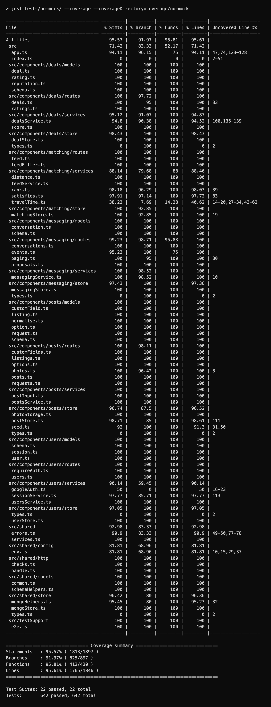
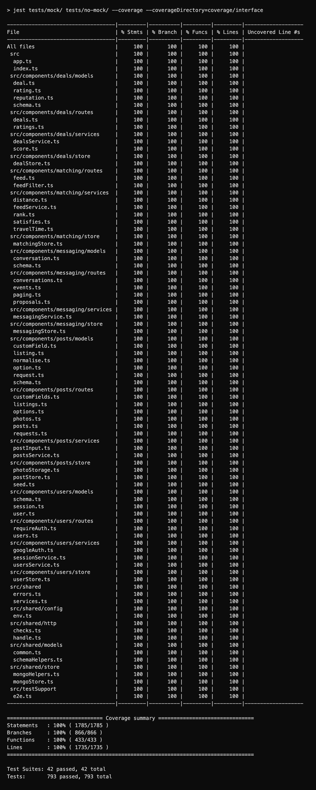

# Testing

## 1. Change History

| **Change Date** | **Modified Sections** | **Rationale** |
| --------------- | --------------------- | ------------- |
| 2026-10-20 | 2 | First version: the front-end end-to-end tests for Feature 1 (Use Cases 1, 2 and 4), how to run them, how each test maps to its use case scenario steps, and the logs of a full run (25/25 passed). Back-end and non-functional requirement tests will be added later. |
| 2026-10-21 | 2 | Replaced the Use Case 1, 2 and 4 tables with one table for the new Use Case 1: Manage Posts, added the new tests for every Use Case 1 success and failure scenario, and added the logs of a full run (42/42 passed). |
| 2026-10-30 | 2 | Added the post name to the Use Case 1 table: the tests enter "Test item" in "Name \*", `rejectsMissingName` covers a missing name (5a), and `createsPostAndShowsItInMyPosts` checks that the name is shown. |
| 2026-10-31 | 2, 3, 4 | Matched the document to the course template: the back-end APIs are section 2, non-functional requirements section 3, and the front-end specification moved from section 2 to section 4. Added the first back-end specification, for the Deals component: where each interface's tests are, how to run them, the coverage reports, and why some coverage is below 100%. |
| 2026-10-30 | 2 | The condition is now picked from a dropdown, so `createsPostWithOptionalFields` opens the condition dropdown before picking "Fair" or "Like New". |
| 2026-10-31 | 2 | Removed the note that no route creates a deal, since accepting a proposal now records one. |
| 2026-11-01 | 4 | Use Case 1 is now Create Post, after the use cases were split in the Requirements and Design. The table maps the tests to its steps 1–7 and failures 2a, 5a–5d and 6a; the edit, close, reopen and delete tests now cover the Edit, Close, Reopen and Delete post use cases instead of formal steps. |
| 2026-11-01 | 3 | Added the location and verification of the NFR 2 test, and noted that the NFR 1 test has not been added yet. |
| 2026-11-13 | 2 | Added the interface tests of the Messaging conversation routes: where they are, what is mocked, how the tables of errors are organized, and the known limitation for a conversation's last message. |
| 2026-11-13 | 2, 4 | Added the test-only `/api/e2e` routes the end-to-end tests seed their data with, and the Messaging end-to-end tests: Use Case 4: Send a Message step by step, and the Start a conversation, Send a proposal and Respond to a proposal use cases. Added how to run the end-to-end tests without Docker on Windows. |
| 2026-11-14 | 2 | Added the interface tests of the Messaging proposal routes, including the tests that a failed accept can be retried. |
| 2026-11-14 | 2 | Added the interface tests of `GET /api/events`, the live updates, and how they read the event stream and fake the heartbeat timer. |
| 2026-11-14 | 4 | Create deal is no longer a separate use case, so the Respond to a proposal tests are described as recording the deal when a proposal is accepted. Close post and Reopen post are now part of Edit post, so the ManagePostsTest row names the use cases it covers. |
| 2026-11-15 | 2 | Re-ran the back-end interface tests at commit `6533060` and replaced the coverage screenshots, commit hash and test counts (629 tests: 95 with mocks, 534 without). Added that `routes/users.ts` has full coverage. |
| 2026-11-15 | 2 | Added the interface tests of the profile routes, `GET /api/users/me` and `PATCH /api/users/me`, and listed the existing `GET /api/users/:id/reputation` tests. A body over 4 KB to `/api/users` now returns 413 instead of 500. |
| 2026-11-14 | 2 | Added the Messaging coverage: which files are at 100%, a test for a conversation about a post saved before posts had names, and why the one remaining branch in `routes/conversations.ts` and `routes/paging.ts` cannot be reached. |
| 2026-11-17 | 2, 3 | Added the interface tests of the Matching component, `GET /api/feed`, `GET /api/feed/listings` and `GET /api/feed/requests`, and why the two remaining branches in `matching/rank.ts` and `matching/satisfies.ts` cannot be reached. Added the NFR 1 test, feed ranking latency, with its verification and logs. |
| 2026-11-18 | 3 | The NFR 2 test now also times a rate-limited, failing and unreachable routing service, and logs each response time, so the verification log shows the measured times rather than only the pass count. |
| 2026-11-18 | 4 | Following TA feedback that only Create Post was described, added the test steps and logs of the Edit post and Delete post tests (`ManagePostsTest.kt`) and of the Deals end-to-end tests: Use Case 2: Rate a Deal, Edit a rating and View deals. |
| 2026-11-19 | 3 | Following peer feedback that the NFR 2 test used only one candidate, NFR 2 now runs every routing failure with the NFR 1 workload of 1,000 candidates and checks that the feed keeps the same ranked order as with a working routing service. NFR 1 now also checks that all 1,000 candidates are ranked. Replaced both logs with a new run. |
| 2026-11-18 | 2 | Added the interface tests of the auth routes, `POST /api/auth/google`, `POST /api/auth/refresh` and `POST /api/auth/logout`, and of the session token that every protected route checks. Writing them showed that an auth body over 4 KB returned 500, so it now returns 413. Replaced the `app.ts` and `sessions.ts` coverage row with the reasons for their remaining branches and for `googleAuth.ts`. |
| 2026-11-19 | 2 | Added the missing rows for the Posts routes, `/api/photos`, `/api/options`, `/api/custom-fields` and `/health` to the interface table, and pointed every test link at the describe group it names on main `1c8c835`. |
| 2026-11-19 | 2 | Re-ran the back-end tests at commit `1c8c835` (754 tests: 116 with mocks, 638 without) and replaced the coverage screenshots and figures. Every file below 100% is now listed with its reason, including the store files from splitting the Mongo store into one file per component. |
| 2026-11-25 | 2 | Re-ran the back-end interface tests at commit `17542fb`, after the back end was reorganised by component ([PR #242](https://github.com/m1lun/MatchMarket/pull/242)): updated the commit hash, the test counts (758 tests: 116 with mocks, 642 without), the combined coverage, and the paths and line numbers in the coverage table. The five type-only `types.ts` files share one row. |
| 2026-11-26 | 4 | Live updates now reach the whole app, so added tests to `SendMessageTest.kt` for Use Case 4: Send a Message steps 7 and 8 (the inbox, the unread dots and the banner). Failure 2a1 also checks a failed reload while conversations are shown. Replaced the Messaging test logs with a run of all 24 Messaging tests after the frontend was reorganised by component. |
| 2026-11-26 | 2, 4 | Removed content the course does not ask for: the notes on how the back-end tests are organized, the `dealStore.test.ts` and IDE notes, the out-of-date sentence that more tests would be added, the list of `support/` files, five of the front-end setup notes, and the repeated `ManagePostsTest` results in the Use Case 1 log. The Rate a Deal tests now describe the deal they start with. |
| 2026-11-26 | 4 | Use Case 4 failures 2a1 and 4a1: after going back online, the tests tap "Retry" only if it is still shown. Since live updates reach the whole app, a live connection that broke during the outage reconnects and reloads the inbox and the open conversation, which can remove "Retry" before the test taps it and made both tests flaky. A connection that lasts through the outage does not reload, so the tests cannot simply wait for that reload either. |
| 2026-11-26 | 4 | Use Case 1 now uses the app's labels, "Must have" and "Nice to have", instead of Hard and Soft, as in the tests. |
| 2026-11-26 | 2 | Re-ran the back-end tests at commit `8f90a68`, after each component got a service that owns its rules, including the input rules (758 interface tests: 116 with mocks, 642 without; NFR tests 5 of 5). Replaced the coverage screenshots and figures, and updated the coverage table for the files that moved: `logic/` became part of each component's `services/`, and the defensive branches of the deals list and the conversations list moved into `dealsService.ts` and `messagingService.ts`. |
| 2026-11-26 | 2, 4 | Use Case 4 steps 7 and 7a1 match the requirements wording. Section 2.2 links the workflow and says what it runs; the note on mocks names every kind of mock used; the macOS note says every other test binds to 127.0.0.1. |
| 2026-11-27 | 2, 4 | The end-to-end tests can also run against the VM, where the test routes are on; test data is only visible to its tester. |
| 2026-11-27 | 4 | Added the View deals tests of the deal map: `showsDealLocation` checks the map and address on the deal card, and `opensRequestWithExactLocation` checks that the request opened from the deal shows its address and map, not the approximate area. |

---

## 2. Back-end Test Specification: APIs

### 2.1. Locations of Back-end Tests and Instructions to Run Them

#### 2.1.1. Tests

| **Interface** | **Describe Group Location, No Mocks** | **Describe Group Location, With Mocks** | **Mocked Components** |
| ------------- | ------------------------------------- | --------------------------------------- | --------------------- |
| **GET /api/deals** | [`tests/no-mock/getDeals.test.ts#L95`](https://github.com/m1lun/MatchMarket/blob/8f90a68cf7d9d0fc1721ab24ab8021ab3448cd45/backend/tests/no-mock/getDeals.test.ts#L95) | [`tests/mock/getDeals.test.ts#L45`](https://github.com/m1lun/MatchMarket/blob/8f90a68cf7d9d0fc1721ab24ab8021ab3448cd45/backend/tests/mock/getDeals.test.ts#L45) | Deals DB, Ratings DB, Reputations DB, Users DB, Listings DB, Requests DB |
| **POST /api/deals/:id/ratings** | [`tests/no-mock/ratings.test.ts#L260`](https://github.com/m1lun/MatchMarket/blob/8f90a68cf7d9d0fc1721ab24ab8021ab3448cd45/backend/tests/no-mock/ratings.test.ts#L260) | [`tests/mock/ratings.test.ts#L81`](https://github.com/m1lun/MatchMarket/blob/8f90a68cf7d9d0fc1721ab24ab8021ab3448cd45/backend/tests/mock/ratings.test.ts#L81) | Deals DB, Ratings DB, Reputations DB |
| **PUT /api/deals/:id/ratings** | [`tests/no-mock/ratings.test.ts#L348`](https://github.com/m1lun/MatchMarket/blob/8f90a68cf7d9d0fc1721ab24ab8021ab3448cd45/backend/tests/no-mock/ratings.test.ts#L348) | [`tests/mock/ratings.test.ts#L116`](https://github.com/m1lun/MatchMarket/blob/8f90a68cf7d9d0fc1721ab24ab8021ab3448cd45/backend/tests/mock/ratings.test.ts#L116) | Deals DB, Ratings DB, Reputations DB |
| **GET /api/feed/listings/:id** | [`tests/no-mock/dealPost.test.ts#L97`](https://github.com/m1lun/MatchMarket/blob/8f90a68cf7d9d0fc1721ab24ab8021ab3448cd45/backend/tests/no-mock/dealPost.test.ts#L97) | [`tests/mock/dealPost.test.ts#L34`](https://github.com/m1lun/MatchMarket/blob/8f90a68cf7d9d0fc1721ab24ab8021ab3448cd45/backend/tests/mock/dealPost.test.ts#L34) | Listings DB |
| **GET /api/feed/requests/:id** | [`tests/no-mock/dealPost.test.ts#L102`](https://github.com/m1lun/MatchMarket/blob/8f90a68cf7d9d0fc1721ab24ab8021ab3448cd45/backend/tests/no-mock/dealPost.test.ts#L102) | [`tests/mock/dealPost.test.ts#L54`](https://github.com/m1lun/MatchMarket/blob/8f90a68cf7d9d0fc1721ab24ab8021ab3448cd45/backend/tests/mock/dealPost.test.ts#L54) | Requests DB |
| **POST /api/conversations** | [`tests/no-mock/conversations.test.ts#L53`](../backend/tests/no-mock/conversations.test.ts#L53) | [`tests/mock/conversations.test.ts#L40`](../backend/tests/mock/conversations.test.ts#L40) | Listings DB, Requests DB, Conversations DB |
| **GET /api/conversations** | [`tests/no-mock/conversations.test.ts#L247`](../backend/tests/no-mock/conversations.test.ts#L247) | [`tests/mock/conversations.test.ts#L65`](../backend/tests/mock/conversations.test.ts#L65) | Conversations DB, Users DB, Listings DB |
| **GET /api/conversations/:id/messages** | [`tests/no-mock/conversations.test.ts#L353`](../backend/tests/no-mock/conversations.test.ts#L353) | [`tests/mock/conversations.test.ts#L86`](../backend/tests/mock/conversations.test.ts#L86) | Conversations DB, Messages DB |
| **POST /api/conversations/:id/messages** | [`tests/no-mock/conversations.test.ts#L427`](../backend/tests/no-mock/conversations.test.ts#L427) | [`tests/mock/conversations.test.ts#L106`](../backend/tests/mock/conversations.test.ts#L106) | Conversations DB, Messages DB |
| **POST /api/conversations/:id/proposal** | [`tests/no-mock/proposals.test.ts#L105`](../backend/tests/no-mock/proposals.test.ts#L105) | [`tests/mock/proposals.test.ts#L65`](../backend/tests/mock/proposals.test.ts#L65) | Conversations DB |
| **POST /api/conversations/:id/proposal/accept** | [`tests/no-mock/proposals.test.ts#L215`](../backend/tests/no-mock/proposals.test.ts#L215) | [`tests/mock/proposals.test.ts#L88`](../backend/tests/mock/proposals.test.ts#L88) | Conversations DB, Listings DB, Requests DB, Deals DB |
| **POST /api/conversations/:id/proposal/decline** | [`tests/no-mock/proposals.test.ts#L376`](../backend/tests/no-mock/proposals.test.ts#L376) | [`tests/mock/proposals.test.ts#L142`](../backend/tests/mock/proposals.test.ts#L142) | Conversations DB |
| **GET /api/events** | [`tests/no-mock/events.test.ts#L53`](../backend/tests/no-mock/events.test.ts#L53) | [`tests/mock/events.test.ts#L60`](../backend/tests/mock/events.test.ts#L60) | Timers (the 25-second heartbeat) |
| **GET /api/users/me** | [`tests/no-mock/users.test.ts#L78`](../backend/tests/no-mock/users.test.ts#L78) | [`tests/mock/users.test.ts#L41`](../backend/tests/mock/users.test.ts#L41) | Users DB |
| **PATCH /api/users/me** | [`tests/no-mock/users.test.ts#L128`](../backend/tests/no-mock/users.test.ts#L128) | [`tests/mock/users.test.ts#L57`](../backend/tests/mock/users.test.ts#L57) | Users DB |
| **GET /api/users/:id/reputation** | [`tests/no-mock/reputation.test.ts#L34`](../backend/tests/no-mock/reputation.test.ts#L34) | [`tests/mock/reputation.test.ts#L32`](../backend/tests/mock/reputation.test.ts#L32) | Reputations DB |
| **GET /api/feed** | [`tests/no-mock/feed.test.ts#L95`](../backend/tests/no-mock/feed.test.ts#L95), ranking in [`tests/no-mock/feedRanking.test.ts#L80`](../backend/tests/no-mock/feedRanking.test.ts#L80) | [`tests/mock/feed.test.ts#L57`](../backend/tests/mock/feed.test.ts#L57) | OpenRouteService, Listings DB, Requests DB |
| **GET /api/feed/listings** | [`tests/no-mock/feed.test.ts#L514`](../backend/tests/no-mock/feed.test.ts#L514) | [`tests/mock/feed.test.ts#L231`](../backend/tests/mock/feed.test.ts#L231) | Listings DB |
| **GET /api/feed/requests** | [`tests/no-mock/feed.test.ts#L537`](../backend/tests/no-mock/feed.test.ts#L537) | [`tests/mock/feed.test.ts#L248`](../backend/tests/mock/feed.test.ts#L248) | Requests DB |
| **POST /api/auth/google** | [`tests/no-mock/auth.test.ts#L92`](../backend/tests/no-mock/auth.test.ts#L92) | [`tests/mock/auth.test.ts#L71`](../backend/tests/mock/auth.test.ts#L71) | Google ID token check (`OAuth2Client.verifyIdToken`), Sessions DB, Users DB |
| **POST /api/auth/refresh** | [`tests/no-mock/auth.test.ts#L111`](../backend/tests/no-mock/auth.test.ts#L111) | [`tests/mock/auth.test.ts#L184`](../backend/tests/mock/auth.test.ts#L184) | Sessions DB |
| **POST /api/auth/logout** | [`tests/no-mock/auth.test.ts#L209`](../backend/tests/no-mock/auth.test.ts#L209) | [`tests/mock/auth.test.ts#L218`](../backend/tests/mock/auth.test.ts#L218) | Sessions DB |
| **POST /api/listings** | [`tests/no-mock/posts.test.ts#L581`](../backend/tests/no-mock/posts.test.ts#L581) | [`tests/mock/posts.test.ts#L216`](../backend/tests/mock/posts.test.ts#L216) | Listings DB, Options DB, Custom fields DB |
| **POST /api/requests** | [`tests/no-mock/posts.test.ts#L586`](../backend/tests/no-mock/posts.test.ts#L586) | [`tests/mock/posts.test.ts#L221`](../backend/tests/mock/posts.test.ts#L221) | Requests DB, Options DB, Custom fields DB |
| **GET /api/listings** | [`tests/no-mock/posts.test.ts#L591`](../backend/tests/no-mock/posts.test.ts#L591) | [`tests/mock/posts.test.ts#L226`](../backend/tests/mock/posts.test.ts#L226) | Listings DB |
| **GET /api/requests** | [`tests/no-mock/posts.test.ts#L596`](../backend/tests/no-mock/posts.test.ts#L596) | [`tests/mock/posts.test.ts#L231`](../backend/tests/mock/posts.test.ts#L231) | Requests DB |
| **GET /api/listings/:id** | [`tests/no-mock/posts.test.ts#L601`](../backend/tests/no-mock/posts.test.ts#L601) | [`tests/mock/posts.test.ts#L236`](../backend/tests/mock/posts.test.ts#L236) | Listings DB |
| **GET /api/requests/:id** | [`tests/no-mock/posts.test.ts#L606`](../backend/tests/no-mock/posts.test.ts#L606) | [`tests/mock/posts.test.ts#L241`](../backend/tests/mock/posts.test.ts#L241) | Requests DB |
| **PATCH /api/listings/:id** | [`tests/no-mock/posts.test.ts#L611`](../backend/tests/no-mock/posts.test.ts#L611) | [`tests/mock/posts.test.ts#L246`](../backend/tests/mock/posts.test.ts#L246) | Listings DB, Options DB |
| **PATCH /api/requests/:id** | [`tests/no-mock/posts.test.ts#L616`](../backend/tests/no-mock/posts.test.ts#L616) | [`tests/mock/posts.test.ts#L251`](../backend/tests/mock/posts.test.ts#L251) | Requests DB, Options DB |
| **DELETE /api/listings/:id** | [`tests/no-mock/posts.test.ts#L621`](../backend/tests/no-mock/posts.test.ts#L621) | [`tests/mock/posts.test.ts#L256`](../backend/tests/mock/posts.test.ts#L256) | Listings DB |
| **DELETE /api/requests/:id** | [`tests/no-mock/posts.test.ts#L626`](../backend/tests/no-mock/posts.test.ts#L626) | [`tests/mock/posts.test.ts#L261`](../backend/tests/mock/posts.test.ts#L261) | Requests DB |
| **POST /api/photos** | [`tests/no-mock/photos.test.ts#L76`](../backend/tests/no-mock/photos.test.ts#L76) | [`tests/mock/photos.test.ts#L41`](../backend/tests/mock/photos.test.ts#L41) | Photos (GridFS) |
| **GET /api/photos/:id** | [`tests/no-mock/photos.test.ts#L168`](../backend/tests/no-mock/photos.test.ts#L168) | [`tests/mock/photos.test.ts#L64`](../backend/tests/mock/photos.test.ts#L64) | Photos (GridFS) |
| **GET /api/options** | [`tests/no-mock/options.test.ts#L54`](../backend/tests/no-mock/options.test.ts#L54) | [`tests/mock/options.test.ts#L40`](../backend/tests/mock/options.test.ts#L40) | Options DB |
| **POST /api/options** | [`tests/no-mock/options.test.ts#L108`](../backend/tests/no-mock/options.test.ts#L108) | [`tests/mock/options.test.ts#L58`](../backend/tests/mock/options.test.ts#L58) | Options DB |
| **GET /api/custom-fields** | [`tests/no-mock/customFields.test.ts#L55`](../backend/tests/no-mock/customFields.test.ts#L55) | [`tests/mock/customFields.test.ts#L40`](../backend/tests/mock/customFields.test.ts#L40) | Custom fields DB |
| **POST /api/custom-fields** | [`tests/no-mock/customFields.test.ts#L94`](../backend/tests/no-mock/customFields.test.ts#L94) | [`tests/mock/customFields.test.ts#L58`](../backend/tests/mock/customFields.test.ts#L58) | Custom fields DB |
| **DELETE /api/custom-fields/:key** | [`tests/no-mock/customFields.test.ts#L173`](../backend/tests/no-mock/customFields.test.ts#L173) | [`tests/mock/customFields.test.ts#L77`](../backend/tests/mock/customFields.test.ts#L77) | Custom fields DB |
| **GET /health** | [`tests/no-mock/health.test.ts#L9`](../backend/tests/no-mock/health.test.ts#L9) | None: the route uses no database or other service, so there is nothing that can fail to mock. | — |

The mocked tests use `jest.spyOn` to make one dependency fail at a time: a store method for a database failure, `fetch` for OpenRouteService, or Google's `verifyIdToken`; the `GET /api/events` tests fake the heartbeat timer. Both groups otherwise run against a real MongoDB.

**Test-only routes for the end-to-end tests.** They exist only when the backend runs with `ENABLE_E2E_ROUTES=true`, and the front-end tests in Section 4 create their data through them.

| **Interface** | **Describe Group Location, No Mocks** | **Describe Group Location, With Mocks** | **Mocked Components** |
| ------------- | ------------------------------------- | --------------------------------------- | --------------------- |
| **POST /api/e2e/deals** | [`tests/no-mock/e2eDeals.test.ts#L46`](../backend/tests/no-mock/e2eDeals.test.ts#L46) | [`tests/mock/e2eDeals.test.ts#L41`](../backend/tests/mock/e2eDeals.test.ts#L41) | Deals DB |
| **DELETE /api/e2e/deals** | [`tests/no-mock/e2eDeals.test.ts#L109`](../backend/tests/no-mock/e2eDeals.test.ts#L109) | [`tests/mock/e2eDeals.test.ts#L41`](../backend/tests/mock/e2eDeals.test.ts#L41) | Deals DB |
| **POST /api/e2e/listings** | [`tests/no-mock/e2eConversations.test.ts#L68`](../backend/tests/no-mock/e2eConversations.test.ts#L68) | [`tests/mock/e2eConversations.test.ts#L46`](../backend/tests/mock/e2eConversations.test.ts#L46) | Listings DB |
| **POST /api/e2e/conversations** | [`tests/no-mock/e2eConversations.test.ts#L111`](../backend/tests/no-mock/e2eConversations.test.ts#L111) | [`tests/mock/e2eConversations.test.ts#L46`](../backend/tests/mock/e2eConversations.test.ts#L46) | Conversations DB, Messages DB |
| **DELETE /api/e2e/conversations** | [`tests/no-mock/e2eConversations.test.ts#L168`](../backend/tests/no-mock/e2eConversations.test.ts#L168) | [`tests/mock/e2eConversations.test.ts#L46`](../backend/tests/mock/e2eConversations.test.ts#L46) | Conversations DB |
| **POST /api/e2e/partner/conversations/:id/messages** | [`tests/no-mock/e2eConversations.test.ts#L212`](../backend/tests/no-mock/e2eConversations.test.ts#L212) | [`tests/mock/e2eConversations.test.ts#L70`](../backend/tests/mock/e2eConversations.test.ts#L70) | Conversations DB |
| **POST /api/e2e/partner/conversations/:id/proposal** | [`tests/no-mock/e2eConversations.test.ts#L260`](../backend/tests/no-mock/e2eConversations.test.ts#L260) | [`tests/mock/e2eConversations.test.ts#L70`](../backend/tests/mock/e2eConversations.test.ts#L70) | Conversations DB |
| **POST /api/e2e/partner/conversations/:id/proposal/decline** | [`tests/no-mock/e2eConversations.test.ts#L282`](../backend/tests/no-mock/e2eConversations.test.ts#L282) | [`tests/mock/e2eConversations.test.ts#L70`](../backend/tests/mock/e2eConversations.test.ts#L70) | Conversations DB |

#### 2.1.2. Commit Hash Where Tests Run

`8f90a68cf7d9d0fc1721ab24ab8021ab3448cd45`

#### 2.1.3. Explanation on How to Run the Tests

1. **Clone the Repository**:

   - Open your terminal and run:
     ```
     git clone https://github.com/m1lun/MatchMarket.git
     cd MatchMarket
     git checkout 8f90a68cf7d9d0fc1721ab24ab8021ab3448cd45
     ```

2. **Install the Tools**:

   - Install [Docker](https://www.docker.com/) and Node.js 22, and start Docker.

3. **Install the Dependencies**:

   - Run:
     ```
     cd backend
     npm ci
     cd ..
     ```

4. **Run the Tests**:

   - From the project root, run:
     ```
     ./scripts/run-backend-interface-tests.sh
     ```
     On Windows, run `scripts\run-backend-interface-tests.ps1`.

The script starts a throwaway MongoDB on port 27018 and runs the tests three times: `tests/mock/`, `tests/no-mock/`, then both together. It writes each coverage report to `backend/coverage/mock/`, `backend/coverage/no-mock/` and `backend/coverage/interface/`, and removes the database when it finishes.

**Known issue on macOS:** `tests/no-mock/postName.test.ts` and `tests/no-mock/health.test.ts` use `request(app)`, which listens on all addresses. macOS can give that server a port another program already holds on `127.0.0.1`, such as Android Studio, so a request occasionally gets an unexpected response and the script stops. If this happens, run the script again. Every other test file binds to `127.0.0.1` through `tests/helpers/testApp.ts` to avoid it.

### 2.2. GitHub Actions Configuration Location

[`.github/workflows/backend-tests.yml`](../.github/workflows/backend-tests.yml): on every push to `main` it runs the typecheck, then `scripts/run-backend-interface-tests.sh` and `scripts/run-backend-nfr-tests.sh`.

### 2.3. Jest Coverage Report Screenshots With Mocks

These are the Jest reports for every back-end file at the commit above: 758 tests in total, 116 with mocks and 642 without. Each image shows Jest's coverage report from the script.


### 2.4. Jest Coverage Report Screenshots Without Mocks



**With and without mocks combined:**



**Reasons for coverage below 100%:**

These reports cover the whole back-end. Combined, the tests reach 97.66% of statements, 96.32% of branches, 98.37% of functions and 97.59% of lines. Every file not listed below has 100% combined coverage of statements, branches, functions and lines.

The Uncovered Line # column shows lines of the compiled JavaScript, not the TypeScript source. The line numbers below are the real source lines, with the report's line in brackets where they differ.

| **File** | **Statements** | **Branches** | **Reason** |
| -------- | -------------- | ------------ | ---------- |
| `index.ts` | 0% | 0% | The start-up file: it loads the configuration and starts the HTTP or HTTPS server. The tests build the app with `createApp` and call it through Supertest without starting a server, as the course's example does, so this file never runs under Jest. |
| `shared/config/env.ts` | 81.81% | 68.96% | Start-up checks of the environment. The tests always set valid values (`tests/setup.ts`), so the four errors that stop the server on a bad configuration are not reached: an invalid `PORT` (line 10), a missing variable (16), no `GOOGLE_CLIENT_ID` (34) and a `JWT_SECRET` under 32 characters (46). Nor are the defaults for an unset `PORT` (5) and `MONGODB_DB` (62). |
| `shared/store/types.ts`, `components/posts/store/types.ts`, `components/users/store/types.ts`, `components/deals/store/types.ts`, `components/messaging/store/types.ts` | 0% | 100% | Each file only declares TypeScript interfaces, which compile to nothing. The one line in the report (line 2) is the `__esModule` marker TypeScript adds to every module. |
| `components/posts/store/seed.ts` | 92% | 100% | Lines 34 and 55 (31 and 50 in the report) add context to an error when the categories cannot be converted or the built-in options cannot be saved at start-up. Both only run if MongoDB fails while the server starts, which stops the server. |
| `app.ts` | 100% | 96.15% | One branch is code TypeScript adds, not ours. Line 3 of the compiled file is the `__importDefault` helper that `import express from 'express'` compiles to. It returns the module unchanged only for a package compiled from ES modules, and Express is a CommonJS package, so that side is never taken. |
| `components/posts/routes/photos.ts` | 100% | 96.42% | Line 3 (compiled) is the same `__importDefault` helper, for `import multer from 'multer'`, which is also a CommonJS package. |
| `components/users/services/sessionService.ts` | 100% | 85.71% | Line 3 (compiled) is the same `__importDefault` helper, for `import jwt from 'jsonwebtoken'`. Lines 95–96 (68–69 in the report): `verifySessionToken` reads no claims from a token whose payload is a plain string, but `jwt.verify` is called with an issuer and audience, and it rejects a string payload because it has neither, so a string never reaches those lines. They stay because `jwt.verify` returns `string \| JwtPayload`. |
| `components/users/services/googleAuth.ts` | 100% | 91.66% | Line 40 (27 in the report): `payload.email ?? ''` is for a ticket without an email. The line before it rejects an account whose `email_verified` is not `true`, and Google only sends `email_verified` together with `email` (both come from the `email` scope), so a ticket that gets this far always has an email. |
| `shared/errors.ts` | 95.45% | 88.88% | Line 38 (43 in the report): `errorMessage` turns a thrown value that is not an `Error` into text, but every error in the back-end is an `Error`. Lines 45–47 (48–50): the handler passes an error on to Express when the response has already started, which only happens if a route fails after it began sending; no route writes part of a response and then throws. |
| `components/deals/routes/deals.ts` | 100% | 95% | One defensive branch cannot be reached through the API. Line 36 (33 in the report): Express always gives `req.query` as an object. |
| `components/deals/services/dealsService.ts` | 100% | 97.29% | Two defensive branches cannot be reached through the API. Line 83 (44 in the report): a stored post always has an `id`. Line 108 (65): every listing has at least one photo, because the validator requires it. Each one keeps the code safe with the optional types, so removing it would not simplify the logic. |
| `components/messaging/services/messagingService.ts` | 100% | 99.15% | One defensive branch cannot be reached through the API. Line 132 (69 in the report): `byId` skips a post without an `id`, but Posts' `findByIds` always returns each post's `id`; the check is there because its return type makes every field optional. |
| `components/messaging/routes/paging.ts` | 100% | 95% | One defensive branch cannot be reached through the API. Line 41 (30 in the report): `parsePageQuery` falls back to no parameters if the query is not an object, but Express always gives `req.query` as an object. The same check in `components/deals/routes/deals.ts` is justified above. |
| `components/matching/services/rank.ts` | 98.18% | 96.29% | One defensive branch cannot be reached through the API. Lines 59–60 (39 in the report): `normaliseWeights` counts the four parts equally when every weight is 0, but the feed always ranks with `DEFAULT_WEIGHTS` (3, 3, 3, 3) until users can save ranking preferences. |
| `components/matching/services/satisfies.ts` | 97.91% | 97.14% | One defensive branch cannot be reached through the API. Lines 87–88 (83 in the report): `satisfies` rejects a listing in another category, but the feed only fetches candidates in the post's category (`listOpenInCategory`). The check keeps the rule complete on its own, so a listing is in a request's feed exactly when the request is in the listing's. |
| `components/posts/store/postStore.ts` | 98.71% | 85% | Three branches. Line 49 (50 in the report): `listOpen` has a default of no filter, but its only caller, the browse feed, always passes one. Line 118 (107): `ensure` falls back to the option it was given if MongoDB returns nothing, which an upsert that returns the document after the write never does. Lines 122–123 (110–111): `ensureMany` returns early for an empty list, but its only caller saves the built-in options, which are never empty. |
| `shared/store/mongoHelpers.ts` | 95.45% | 80% | Lines 33–34 (31–32 in the report): `applySchema` updates the validator of a collection that already exists, which happens when the server restarts on an existing database. Each test file starts with a new, empty database, so the collections never exist yet. |
| `components/matching/store/matchingStore.ts` | 100% | 92.85% | Line 24 (19 in the report): the browse feed with a maximum price but no minimum price. The tests filter the browse feed by a price range and by a minimum price alone, which build the same query, but not by a maximum price alone. |

---

## 3. Back-end Test Specification: Tests of Non-Functional Requirements

### 3.1. Test Locations in Git

| **Non-Functional Requirement** | **Location in Git** |
| ------------------------------ | ------------------- |
| **NFR 1: Feed ranking latency** | [`backend/tests/nfr/feedLatency.test.ts`](../backend/tests/nfr/feedLatency.test.ts) |
| **NFR 2: Graceful degradation without the routing service** | [`backend/tests/nfr/routingFallback.test.ts`](../backend/tests/nfr/routingFallback.test.ts) |

Run the NFR tests with `./scripts/run-backend-nfr-tests.sh`.

### 3.2. Test Verification and Logs

**NFR 1:** the test saves 1,000 of another user's open chair listings, all meeting the hard requirements of my chair request, with varied prices, conditions, places, brands and colours, so every one is scored on each request. The request has a hard maximum price and soft preferences for condition, brand and colour. Without an OpenRouteService key, as NFR 1 excludes the travel-time lookup, it first asks for the last page (`cursor=980`) and checks that it holds 20 matches and no next cursor, which shows that all 1,000 candidates met the hard requirements and were ranked. It then sends one warm-up request and 100 `GET /api/feed?postId=<id>` requests one after another through Supertest, timing each from sending the request to receiving the whole response. It checks that each returns 20 matches and the next cursor, takes the 95th percentile of the 100 response times, and checks that it is under 1 second. It logs the measured times:

```
NFR 1: 100 requests, 1000 candidates: p50 40.9 ms, p95 51.5 ms, max 78.7 ms, mean 41.7 ms (limit 1000 ms at p95)
```

**NFR 2:** the test uses the same workload as NFR 1, 1,000 open listings that all match my request, so the feed does its full ranking work while the routing service is failing. For each way OpenRouteService can fail, it first gets the feed with a working routing service (mocked), then replaces it with the failure and times one `GET /api/feed` request. For a service that never answers, it checks that the feed abandons the routing request after `ROUTING_TIMEOUT_MS` (2 seconds), so the time is at least 2 seconds, and still answers in under 3 seconds. For a service that is rate-limited (429), fails (500) or refuses the connection, it checks that the feed answers in under 3 seconds without waiting for the timeout. In every case it checks that the feed returns the same 20 matches in the same ranked order as with a working routing service, in order of score, each with `travelMinutes` null, and with `travelTimesAvailable` false, which the app shows as "Travel time unavailable". It also checks that each feed asks the routing service once, for the 20 results on the first page only.

```
NFR 2: routing service never answers, 1000 candidates: feed answered in 2042 ms (limit 3000 ms)
NFR 2: routing service is rate-limited (429), 1000 candidates: feed answered in 31 ms (limit 3000 ms)
NFR 2: routing service fails (500), 1000 candidates: feed answered in 54 ms (limit 3000 ms)
NFR 2: routing service is unreachable, 1000 candidates: feed answered in 34 ms (limit 3000 ms)
```

Output of `./scripts/run-backend-nfr-tests.sh`:

```
Test Suites: 2 passed, 2 total
Tests:       5 passed, 5 total
```

---

## 4. Front-end Test Specification

### 4.1. Location in Git of Front-end Test Suite:

`frontend/app/src/androidTest/java/com/example/cpen321application/e2e/`

| **Test class** | **Use cases** |
| -------------- | ------------- |
| [`CreatePostTest.kt`](../frontend/app/src/androidTest/java/com/example/cpen321application/e2e/CreatePostTest.kt) | [Use Case 1: Create Post](Requirements_and_Design.md#uc1), steps 1–7 |
| [`ManagePostsTest.kt`](../frontend/app/src/androidTest/java/com/example/cpen321application/e2e/ManagePostsTest.kt) | Edit post, including closing and reopening a post, and Delete post ([Section 3.4](Requirements_and_Design.md#34-use-case-description)), which have no formal specification. One test also covers [Use Case 1: Create Post](Requirements_and_Design.md#uc1) failure 2a. |
| [`RateDealTest.kt`](../frontend/app/src/androidTest/java/com/example/cpen321application/e2e/RateDealTest.kt) | [Use Case 2: Rate a Deal](Requirements_and_Design.md#uc2), steps 1–7 and failures 2a, 5a, 6a and 6b |
| [`EditRatingTest.kt`](../frontend/app/src/androidTest/java/com/example/cpen321application/e2e/EditRatingTest.kt) | Edit a rating ([Section 3.4](Requirements_and_Design.md#34-use-case-description)) |
| [`ViewDealsTest.kt`](../frontend/app/src/androidTest/java/com/example/cpen321application/e2e/ViewDealsTest.kt) | View deals ([Section 3.4](Requirements_and_Design.md#34-use-case-description)) |
| [`SendMessageTest.kt`](../frontend/app/src/androidTest/java/com/example/cpen321application/e2e/SendMessageTest.kt) | [Use Case 4: Send a Message](Requirements_and_Design.md#uc4), steps 1–8 and failures 2a, 4a, 5a, 6a and 7a. Steps 1–2 and 2a are also the View conversations use case. |
| [`StartConversationTest.kt`](../frontend/app/src/androidTest/java/com/example/cpen321application/e2e/StartConversationTest.kt) | Start a conversation ([Section 3.4](Requirements_and_Design.md#34-use-case-description)) |
| [`SendProposalTest.kt`](../frontend/app/src/androidTest/java/com/example/cpen321application/e2e/SendProposalTest.kt) | Send a proposal ([Section 3.4](Requirements_and_Design.md#34-use-case-description)) |
| [`RespondToProposalTest.kt`](../frontend/app/src/androidTest/java/com/example/cpen321application/e2e/RespondToProposalTest.kt) | Respond to a proposal, including recording the deal when it is accepted ([Section 3.4](Requirements_and_Design.md#34-use-case-description)) |

**How the tests are set up.** Following the course rules, each test starts from the app's main screen with the user already signed in, and assumes no existing data:

- **Stand-alone tests.** Every post a test creates uses the category `e2e chair`. Before and after each test, `deleteTestPosts()` deletes every post in that category through the back-end API, so each test starts from an empty state and a failed test leaves nothing behind. The tester's posts in other categories are never touched. Tests that need an existing post create it through the UI first (`createPost`).
- **No mocking.** The tests talk to the real back-end. For failure scenarios 2a and 6a ("the network or server is unavailable"), the test switches on the emulator's airplane mode, and switches it off again in `@After` even if the test fails.
- **A second user for Messaging.** Every conversation needs another user. Before each Messaging test, `POST /api/e2e/listings` or `POST /api/e2e/conversations` (Section 2) gives the signed-in tester a made-up partner, "E2E Seller", with an open listing "E2E lamp" and, if needed, a conversation with up to 40 messages. During a test, the E2E Seller replies, proposes and declines through the real conversation routes, so live updates reach the app exactly as they would from a second phone, and no manual tester is needed. `DELETE /api/e2e/conversations` removes everything afterwards, including a deal made by accepting a proposal. The tester's real conversations and deals are never touched.

**How to run them.**

1. Complete the Frontend Setup and the `backend/.env` part of the Backend Setup in the [README](../README.md), and add `ENABLE_E2E_ROUTES=true` to `backend/.env`: the Deals and Messaging tests seed their data through the test-only routes. Docker must be running, and `java` must be on your `PATH`. Android Studio's bundled JDK works:
   ```bash
   export JAVA_HOME="/Applications/Android Studio.app/Contents/jbr/Contents/Home"   # macOS
   export PATH="$JAVA_HOME/bin:$PATH"
   ```
2. In `frontend/local.properties`, set `API_BASE_URL=http://10.0.2.2:3000` so the app uses the back-end the script starts on your machine.
3. From the project root, run:
   ```bash
   ./scripts/run-frontend-e2e-tests.sh        # Windows: scripts\run-frontend-e2e-tests.ps1
   ```
   The script starts the back-end and the `Pixel_9` emulator (set `AVD_NAME=<name>` for another AVD), then builds and installs the app. When prompted, sign in inside the app on the emulator, wait for the main screen, and press Enter. The full suite takes about 10 minutes.
4. The report is at `frontend/app/build/reports/androidTests/connected/debug/index.html`.

**Against the deployed backend:** the test routes are already on for the VM. Set `API_BASE_URL` in `frontend/local.properties` to the VM's address and run the script as usual.

**Without Docker on Windows** (for example, with Docker installed only in WSL), the script cannot start the backend. Start MongoDB and run `npm run dev` in `backend/` instead, start the `Pixel_9` emulator and sign in inside the app, then run the tests from `frontend/`:

```powershell
.\gradlew.bat connectedDebugAndroidTest "-Pandroid.testInstrumentationRunnerArguments.package=com.example.cpen321application.e2e"
```

### 4.2. Tests

- **Use Case 1: Create Post** ([`CreatePostTest.kt`](../frontend/app/src/androidTest/java/com/example/cpen321application/e2e/CreatePostTest.kt) and [`ManagePostsTest.kt`](../frontend/app/src/androidTest/java/com/example/cpen321application/e2e/ManagePostsTest.kt), each test run once as `[REQUEST]` and once as `[LISTING]`)

  - **Expected Behaviors:**

    | **Scenario Steps** | **Test Case Steps** |
    | ------------------ | ------------------- |
    | 1. The user opens My Posts and chooses "I'm buying" (requests) or "I'm selling" (listings). | Tap "My Posts", then "I'm buying" (`[REQUEST]`) or "I'm selling" (`[LISTING]`). |
    | 2. The app shows the user's open and closed posts of that kind. | Check that "My requests (" or "My listings (" is shown. |
    | 2a. The network or server is unavailable when the posts are loaded. | (`showsErrorWhenPostsCannotLoad`) Open the other kind of post, turn on airplane mode, and tap "I'm buying" or "I'm selling". |
    | 2a1. The app shows "Could not reach the server. Check your connection." | Check that "Could not reach the server" is shown. |
    | 3. The user taps "New request" or "New listing". | Tap "New request" or "New listing". |
    | 4. The app shows the post form. | Check that the "Category \*" field is present on screen. |
    | 5. The user enters a name and a category and picks an address from the suggestions.<br>- For a request: a maximum price (required), and optionally a minimum condition, maximum size, search radius, brand and colour. Each of these fields, including the maximum price, is marked "Must have" or "Nice to have", and a "Nice to have" field gets an importance from 1 to 5. The user may also add a description, custom fields, and up to 10 reference photos.<br>- For a listing: a price, a condition and 1–10 photos, and optionally a brand, colour, size, description and custom fields. | Input "Test item" in "Name \*".<br>Input "e2e chair" in "Category \*".<br>Input "6335 Thunderbird Crescent, Vancouver" in "Address \*", tap the first suggestion, and check that "✓ Address confirmed" is shown.<br>Input "150" as the price.<br>`[LISTING]`: tap "+ Add", select one photo in the system photo picker, tap "Done", and check that "Photos 1/10" is shown.<br>(`createsPostWithSeveralPhotos` selects three photos; `photoIsRequiredOnlyOnListings[REQUEST]` selects none, since photos are optional for requests; `createsPostWithOptionalFields` also inputs "Oak, barely used" in "Description", "120", "75" and "60" in "W", "H" and "D", "ikea" as the brand, "brown" as the colour, and a custom field "Material" with the value "oak" through "+ Add field", and picks "Fair" from the "Any" condition dropdown with a radius of "5" marked "Must have" (`[REQUEST]`) or picks "Like New" from the "Good" condition dropdown (`[LISTING]`).) |
    | 5a. A required field is missing or invalid. | **Missing category** (`rejectsMissingCategory`): open the form and tap the create button without filling it.<br>**Missing name** (`rejectsMissingName`): fill everything except the name and submit.<br>**Missing price** (`rejectsMissingPrice`): fill everything except the price and submit.<br>**Negative price** (`rejectsNegativePrice`): fill the form with the price "-5" and submit.<br>**Missing photo** (`photoIsRequiredOnlyOnListings[LISTING]`): fill everything except the photo and submit. |
    | 5a1. The app shows what is wrong, and nothing is saved. For either kind of post: "Choose a category" or "Enter a name". For a request: "Max price is required" or "max price must be at least 0". For a listing: "Enter a price", "price must be a number of at least 0" or "Add at least one photo". | **Missing category:** check that "Choose a category" is shown and the create button is still on screen.<br>**Missing name:** check that "Enter a name" is shown and the back-end has no test posts.<br>**Missing price:** check that "Max price is required" (`[REQUEST]`) or "Enter a price" (`[LISTING]`) is shown and the back-end has no test posts.<br>**Negative price:** check that an error containing "at least 0" (`[REQUEST]`) or "price must be" (`[LISTING]`) is shown and the back-end has no test posts.<br>**Missing photo:** check that "Add at least one photo" is shown and the back-end has no test posts. |
    | 5b. The address was typed but not picked from the suggestions. | (`rejectsAddressThatWasNotPicked`) Fill the form without picking an address, input "zzzzqqqqxxxx nowhere" in "Address \*", and submit. |
    | 5b1. The app highlights the address field and shows "Choose your address from the suggestions list". | Check that "Choose your address from the suggestions list" is shown and the back-end has no test posts. |
    | 5c. A photo is larger than 5 MB. | (`rejectsPhotoOverFiveMegabytes`) Replace the test photos in the gallery with a single JPEG larger than 5 MB. Fill the form without photos, select that photo in the photo picker, and submit. |
    | 5c1. The app shows "Each photo must be at most 5 MB" and the post is not saved. | Check that "Each photo must be at most 5 MB" is shown and the back-end has no test posts. |
    | 5d. The user tries to add more than 10 photos. | (`limitsPhotosToTen`) Open the form, select 6 photos in the photo picker, then try to select 6 more. |
    | 5d1. The photo picker only lets the user select as many photos as are still allowed, and the app disables adding photos once there are 10. | Check that "Photos 10/10" is shown and the "+ Add" button is disabled. |
    | 6. The user taps "Create request" or "Create listing". | Tap "Create request" or "Create listing". |
    | 6a. The network or server is unavailable when the post is submitted. | (`showsErrorWhenServerIsUnreachable`) Fill the form, turn on airplane mode, and tap the create button. |
    | 6a1. The app shows "Could not reach the server. Check your connection." and the form keeps what the user entered. | Check that "Could not reach the server" is shown.<br>Turn off airplane mode and check that the form, with its create button, is still on screen. |
    | 7. The app saves the post and shows it in My Posts. | (`createsPostAndShowsItInMyPosts`) Check that "My requests (" or "My listings (" is shown with exactly one "e2e chair" post, and that "Test item" is shown.<br>(`createsPostWithOptionalFields` also checks on the back-end that the description, condition, "Must have" radius, dimensions, brand, colour and material were saved.) |

  - **Test Logs:**
    ```
    Pixel_9(AVD) - 16 (Android 16, API 36), 2026-10-21, ./scripts/run-frontend-e2e-tests.sh
    Commit 4c7c9b8 (PR #60, merged into main)

    com.example.cpen321application.e2e.CreatePostTest
      rejectsMissingPrice[REQUEST]                     PASSED   7.97 s
      rejectsAddressThatWasNotPicked[REQUEST]          PASSED   5.90 s
      createsPostAndShowsItInMyPosts[REQUEST]          PASSED   6.34 s
      showsErrorWhenServerIsUnreachable[REQUEST]       PASSED  11.81 s
      rejectsMissingCategory[REQUEST]                  PASSED   5.53 s
      limitsPhotosToTen[REQUEST]                       PASSED  10.39 s
      createsPostWithOptionalFields[REQUEST]           PASSED  22.15 s
      rejectsNegativePrice[REQUEST]                    PASSED   6.26 s
      createsPostWithSeveralPhotos[REQUEST]            PASSED   8.34 s
      photoIsRequiredOnlyOnListings[REQUEST]           PASSED   6.26 s
      rejectsPhotoOverFiveMegabytes[REQUEST]           PASSED   9.27 s
      rejectsMissingPrice[LISTING]                     PASSED   8.06 s
      rejectsAddressThatWasNotPicked[LISTING]          PASSED   7.89 s
      createsPostAndShowsItInMyPosts[LISTING]          PASSED   8.43 s
      showsErrorWhenServerIsUnreachable[LISTING]       PASSED  12.35 s
      rejectsMissingCategory[LISTING]                  PASSED   5.12 s
      limitsPhotosToTen[LISTING]                       PASSED  10.30 s
      createsPostWithOptionalFields[LISTING]           PASSED  24.19 s
      rejectsNegativePrice[LISTING]                    PASSED   8.21 s
      createsPostWithSeveralPhotos[LISTING]            PASSED   9.37 s
      photoIsRequiredOnlyOnListings[LISTING]           PASSED   6.15 s
      rejectsPhotoOverFiveMegabytes[LISTING]           PASSED   9.25 s

    Finished 42 tests on Pixel_9(AVD) - 16: 42 passed, 0 failed, 0 skipped (550.4 s)
    ```

    The other 20 tests of this run are `ManagePostsTest`. Their log, from a later run, is under Edit post and Delete post below, including `showsErrorWhenPostsCannotLoad` for failure 2a.

- **Edit post and Delete post** ([`ManagePostsTest.kt`](../frontend/app/src/androidTest/java/com/example/cpen321application/e2e/ManagePostsTest.kt), each test run once as `[REQUEST]` and once as `[LISTING]`). These use cases have no formal specification. Each test first creates a post through the form, as in Use Case 1 (category "e2e chair", price 150), unless noted.

  | **Test** | **Test Case Steps** |
  | -------- | ------------------- |
  | `editsPost` | Open the post's "More options" menu and tap "Edit". Check that "Edit request" or "Edit listing" is shown, replace the price with "175" and tap "Save changes".<br>Check that My Posts is shown, open the post, and check that "175" is shown. |
  | `rejectsInvalidEditAndKeepsPost` | Tap "Edit" in the menu, clear "Category \*" and tap "Save changes". Check that "Choose a category" is shown. Go back and check that My Posts still shows exactly one test post. |
  | `closesAndReopensPost` | Tap "Close" in the menu and check that the post shows "Closed". Tap "Reopen" in the menu and check that it shows "Open". |
  | `deletesPost` | Tap "Delete" in the menu and confirm with "Delete". Check that no test post is shown. |
  | `managesPostFromItsDetailScreen` | Tap the post to open it. Tap "Close" and check "Closed", tap "Reopen" and check "Open". Tap "Edit", replace the price with "175", tap "Save changes" and check that "175" is shown. Tap the delete icon, confirm with "Delete", and check that no test post is shown. |
  | `keepsPostWhenServerIsUnreachable` | Turn on airplane mode and tap "Close" in the menu. Check that "Could not reach the server" is shown. Turn off airplane mode and check that the post still shows "Open". |
  | `keepsPostWhenEditCannotBeSaved` | Tap "Edit", replace the price with "175", turn on airplane mode and tap "Save changes". Check that "Could not reach the server" is shown. Turn off airplane mode, go back, and check that "175" is not shown. |
  | `keepsPostClosedWhenReopenFails` | Close the post and check "Closed". Turn on airplane mode and tap "Reopen" in the menu. Check that "Could not reach the server" is shown. Turn off airplane mode and check that the post still shows "Closed". |
  | `keepsPostWhenDeleteFails` | Turn on airplane mode, tap "Delete" in the menu and confirm. Check that "Could not reach the server" is shown. Turn off airplane mode and check that the test post is still shown. |
  | `showsErrorWhenPostsCannotLoad` | No post is created. Open the other kind of post, turn on airplane mode, and tap "I'm buying" or "I'm selling". Check that "Could not reach the server" is shown (Use Case 1, failure 2a). |

  - **Test Logs:**
    ```
    Pixel_9(AVD) - 16 (Android 16, API 36), 2026-11-18, .\gradlew.bat connectedDebugAndroidTest (every test in e2e/)
    main 3e448e4 (PR #230), run on its branch commit ae80bb6, which has the same code

    com.example.cpen321application.e2e.ManagePostsTest
      closesAndReopensPost[LISTING]                  PASSED   12.48 s
      closesAndReopensPost[REQUEST]                  PASSED    9.29 s
      deletesPost[LISTING]                           PASSED   12.47 s
      deletesPost[REQUEST]                           PASSED    9.77 s
      editsPost[LISTING]                             PASSED   12.92 s
      editsPost[REQUEST]                             PASSED   19.81 s
      keepsPostClosedWhenReopenFails[LISTING]        PASSED   16.70 s
      keepsPostClosedWhenReopenFails[REQUEST]        PASSED   14.06 s
      keepsPostWhenDeleteFails[LISTING]              PASSED   25.30 s
      keepsPostWhenDeleteFails[REQUEST]              PASSED   23.36 s
      keepsPostWhenEditCannotBeSaved[LISTING]        PASSED   26.42 s
      keepsPostWhenEditCannotBeSaved[REQUEST]        PASSED   22.58 s
      keepsPostWhenServerIsUnreachable[LISTING]      PASSED   25.14 s
      keepsPostWhenServerIsUnreachable[REQUEST]      PASSED   23.17 s
      managesPostFromItsDetailScreen[LISTING]        PASSED   23.14 s
      managesPostFromItsDetailScreen[REQUEST]        PASSED   20.71 s
      rejectsInvalidEditAndKeepsPost[LISTING]        PASSED   23.10 s
      rejectsInvalidEditAndKeepsPost[REQUEST]        PASSED   20.02 s
      showsErrorWhenPostsCannotLoad[LISTING]         PASSED    9.15 s
      showsErrorWhenPostsCannotLoad[REQUEST]         PASSED    7.43 s

    20 tests: 20 passed, 0 failed, 0 skipped (357.0 s)
    ```

- **Use Case 2: Rate a Deal** ([`RateDealTest.kt`](../frontend/app/src/androidTest/java/com/example/cpen321application/e2e/RateDealTest.kt)). Each test starts with a deal seeded through `POST /api/e2e/deals` (Section 2), in which the tester sold the made-up "E2E Buyer" the request "E2E desk" for $45, and which the tester has not rated.

  - **Expected Behaviors:**

    | **Scenario Steps** | **Test Case Steps** |
    | ------------------ | ------------------- |
    | 1. The user opens the Deals tab. | (`ratesDeal`) Tap "Deals". |
    | 2. The app shows the user's deals, newest first, with "Rate" on each deal they have not rated yet. | Wait for the seeded deal's "Rate" button. |
    | 2a. The deals cannot be loaded. | (`showsErrorWhenDealsCannotLoad`) Turn on airplane mode and tap "Deals". |
    | 2a1. The app shows "Could not reach the server. Check your connection." and a "Retry" button. | Check that "Could not reach the server" and the "Retry" button are shown.<br>Turn off airplane mode, tap "Retry", and check that the seeded deal's "Rate" button appears. |
    | 3. The user taps "Rate" on a deal. | Tap "Rate" on the seeded deal. |
    | 4. The app shows the stars and an optional comment field. | Check that the five star buttons and the comment field are shown. |
    | 5. The user picks 1 to 5 stars, optionally writes a comment, and taps "Submit". | Tap the fourth star, input "Smooth deal" as the comment, and tap "Submit". |
    | 5a. The user has not picked any stars. | (`submitDisabledWithoutStars`) Tap "Rate" on the seeded deal. |
    | 5a1. "Submit" is disabled. | Check that "Submit" is disabled, and still disabled after inputting "No stars yet" as the comment. Tap the third star and check that "Submit" is enabled. |
    | 6. The system saves the rating and updates the other user's score. | Check on the back-end that the tester's rating of the deal has 4 stars. |
    | 6a. The user already rated this deal on another device. | (`rejectsSecondRatingFromAnotherDevice`) Tap "Rate" and the fifth star. Rate the deal with 2 stars through the API, as if from another device, then tap "Submit". |
    | 6a1. The app shows "You already rated this deal" and the first rating is unchanged. | Check that "You already rated this deal" is shown, and on the back-end that the rating still has 2 stars. Tap "Cancel", reload the Deals tab, and check that "★★☆☆☆" is shown. |
    | 6b. The network or server is unavailable. | (`keepsRatingUnsavedWhenServerIsUnreachable`) Tap "Rate" and the third star, turn on airplane mode, and tap "Submit". |
    | 6b1. The app shows "Could not reach the server. Check your connection." and the rating is not saved. | Check that "Could not reach the server" is shown. Turn off airplane mode and check on the back-end that the deal has no rating from the tester. Tap "Cancel", reload the Deals tab, and check that "Rate" is still shown. |
    | 7. The app shows the rating and the other user's new score on the deal. | Check that "Smooth deal", "★★★★☆" and the score "★ 4.0 (1)" are shown. |

  - **Test Logs:**
    ```
    Pixel_9(AVD) - 16 (Android 16, API 36), 2026-11-18, .\gradlew.bat connectedDebugAndroidTest (every test in e2e/)
    main 3e448e4 (PR #230), run on its branch commit ae80bb6, which has the same code

    com.example.cpen321application.e2e.RateDealTest
      keepsRatingUnsavedWhenServerIsUnreachable      PASSED    7.95 s
      ratesDeal                                      PASSED    3.61 s
      rejectsSecondRatingFromAnotherDevice           PASSED    4.39 s
      showsErrorWhenDealsCannotLoad                  PASSED   15.13 s
      submitDisabledWithoutStars                     PASSED    3.66 s

    5 tests: 5 passed, 0 failed, 0 skipped (34.7 s)
    ```

- **Edit a rating** ([`EditRatingTest.kt`](../frontend/app/src/androidTest/java/com/example/cpen321application/e2e/EditRatingTest.kt)). This use case has no formal specification. Each test starts with the seeded deal, rated 4 stars with the comment "Smooth deal" through the API.

  | **Test** | **Test Case Steps** |
  | -------- | ------------------- |
  | `editsRating` | Tap "Deals" and "Edit" on the seeded deal. Check that "Edit your rating" and "Smooth deal" are shown. Tap the second star, replace the comment with "Late pickup", and tap "Save".<br>Check that "Late pickup", "★★☆☆☆" and the score "★ 2.0 (1)" are shown, and on the back-end that the rating has 2 stars and the comment "Late pickup". |
  | `keepsRatingWhenEditCannotBeSaved` | Tap "Edit" on the seeded deal and the first star, turn on airplane mode, and tap "Save". Check that "Could not reach the server" is shown. Turn off airplane mode and check on the back-end that the rating still has 4 stars and "Smooth deal". Tap "Cancel", reload the Deals tab, and check that "★★★★☆" is shown. |

  - **Test Logs:**
    ```
    Pixel_9(AVD) - 16 (Android 16, API 36), 2026-11-18, .\gradlew.bat connectedDebugAndroidTest (every test in e2e/)
    main 3e448e4 (PR #230), run on its branch commit ae80bb6, which has the same code

    com.example.cpen321application.e2e.EditRatingTest
      editsRating                                    PASSED    3.75 s
      keepsRatingWhenEditCannotBeSaved               PASSED    9.40 s

    2 tests: 2 passed, 0 failed, 0 skipped (13.2 s)
    ```

- **View deals** ([`ViewDealsTest.kt`](../frontend/app/src/androidTest/java/com/example/cpen321application/e2e/ViewDealsTest.kt)). This use case has no formal specification. Each test starts with the seeded deal.

  | **Test** | **Test Case Steps** |
  | -------- | ------------------- |
  | `showsDeal` | Tap "Deals". Check that the card shows the price "$45.00", "You sold to", the other user's score "New" (nobody has rated them), and "Request". |
  | `opensRequestOfDeal` | Tap "Deals" and "Request" on the card. Check that "E2E desk" and "Closed" are shown, and that neither "Delete" nor "Reopen" is shown, since the request is not the tester's. Go back and check that the Deals tab is shown again. |
  | `showsDealLocation` | Tap "Deals". Check that the card shows a map and the request's address, "6335 Thunderbird Crescent, Vancouver". |
  | `opensRequestWithExactLocation` | Tap "Deals" and "Request" on the card. Check that "E2E desk", a map and the address "6335 Thunderbird Crescent, Vancouver" are shown, and that "Approximate area" is not. Go back and check that the Deals tab is shown again. |

  - **Test Logs:**
    ```
    Pixel_9(AVD) - 16 (Android 16, API 36), 2026-11-18, .\gradlew.bat connectedDebugAndroidTest (every test in e2e/)
    main 3e448e4 (PR #230), run on its branch commit ae80bb6, which has the same code

    com.example.cpen321application.e2e.ViewDealsTest
      opensRequestOfDeal                             PASSED    2.33 s
      showsDeal                                      PASSED    2.00 s

    2 tests: 2 passed, 0 failed, 0 skipped (4.3 s)
    ```

- **Use Case 4: Send a Message** ([`SendMessageTest.kt`](../frontend/app/src/androidTest/java/com/example/cpen321application/e2e/SendMessageTest.kt)). Each test starts with a conversation with the E2E Seller about "E2E lamp", holding one message from them, "Message 1". Steps 7, 7a and 8 are about the user who receives the message, so in those tests the signed-in tester receives it and the E2E Seller sends it, after waiting two seconds for the app's live connection.

  - **Expected Behaviors:**

    | **Scenario Steps** | **Test Case Steps** |
    | ------------------ | ------------------- |
    | 1. The user opens the Messages tab. | (`sendsMessage`) Tap "Messages" in the bottom bar. |
    | 2. The app shows the user's conversations, newest activity first, each with the other user, the listing and request, and the last message. | Check that the seeded conversation's card is shown, with "E2E Seller", "Listing: E2E lamp" and "Message 1". |
    | 2a. The network or server is unavailable when the conversations are loaded. | (`showsErrorWhenConversationsCannotLoad`) Turn on airplane mode and tap "Messages". |
    | 2a1. The app shows "Could not reach the server. Check your connection." and a "Retry" button, above the conversations it already shows, if any. | Check that "Could not reach the server" and the "Retry" button are shown. The app loads the inbox when it starts, so the error shows above the conversation's card.<br>Turn off airplane mode, wait until the backend can be reached, and tap "Retry" unless the app is already reloading by itself after reconnecting, which removes it. Check that the conversation's card is shown. |
    | 3. The user taps a conversation. | Tap the conversation's card. |
    | 4. The app shows its messages with the newest at the bottom, 30 at a time, with "Load earlier messages" when there are older ones. | Check that "Message 1" is shown.<br>(`loadsEarlierMessages`) Seed the conversation with 40 messages and open it. Check that "Message 40" is shown, scroll to "Load earlier messages" and tap it, then check that the button is gone and that "Message 1" is shown after scrolling up. |
    | 4a. The network or server is unavailable when the messages are loaded. | (`showsErrorWhenMessagesCannotLoad`) Open the Messages tab, turn on airplane mode, and tap the conversation. |
    | 4a1. The app shows "Could not reach the server. Check your connection." and a "Retry" button. | Check that "Could not reach the server" is shown.<br>Turn off airplane mode, wait until the backend can be reached, and tap "Retry" unless the app is already reloading by itself after reconnecting, which removes it. Check that "Message 1" is shown. |
    | 5. The user types a message of up to 1000 characters and taps "Send". | Input "Is it still available?" in the message box and tap "Send". |
    | 5a. The message is empty or only spaces. | (`sendDisabledForBlankMessage`) Open the conversation with an empty message box, then input "   ". |
    | 5a1. "Send" is disabled. | Check that "Send" is disabled both times.<br>Input "hi" and check that "Send" is enabled. |
    | 6. The system saves the message, and the app shows it on the right and clears the message box. | Check that the message box is empty and that "Is it still available?" is shown.<br>Check on the backend that the conversation's messages are "Message 1" and "Is it still available?". |
    | 6a. The network or server is unavailable when the message is sent. | (`keepsMessageWhenSendFails`) Input "Is it still available?", turn on airplane mode, and tap "Send". |
    | 6a1. The app shows "Could not send the message. Try again." and the message stays in the message box. | Check that "Could not send the message. Try again." is shown and that the message box still contains "Is it still available?".<br>Turn off airplane mode and check on the backend that the only message is "Message 1". |
    | 7. The system pushes the message to the other user, whose app shows it without refreshing: in the conversation if it is open; otherwise at the top of their inbox with an unread dot on the conversation and the Messages tab, and, while they are on another tab, in a banner with "View", which opens the conversation. | (`showsOtherUsersMessageLive`) Open the conversation and wait two seconds for its live connection. The E2E Seller sends "Yes, still available".<br>Check that "Yes, still available" is shown without refreshing.<br>(`updatesInboxLive`) Open the Messages tab and check that "Message 1" is shown. The E2E Seller sends "Yes, still available". Check that "Yes, still available" and the conversation's unread dot are shown without refreshing.<br>(`marksMessageUnreadOnAnotherTab`) On My Posts, the E2E Seller sends "Yes, still available". Check that the banner "E2E Seller: Yes, still available" and the Messages tab's unread dot are shown. Tap "Messages" and check that the conversation's unread dot and "Yes, still available" are shown.<br>(`bannerOpensConversation`) On My Posts, the E2E Seller sends "Yes, still available". Tap "View" on the banner and check that the conversation opens with "Yes, still available" and that the Messages tab's unread dot is gone. |
    | 7a. The other user's connection to the server was lost. | (`catchesUpAfterReconnecting`) Open the conversation, turn airplane mode on and off, and wait until the backend can be reached. The E2E Seller sends "Sent while you were offline". |
    | 7a1. Their app reconnects and reloads their inbox and the conversation they have open, which then show the message within about a minute, without an unread dot or a banner. | Check that "Sent while you were offline" is shown within 90 seconds. |
    | 8. When the other user opens the conversation, its unread dot goes away, and so does the Messages tab's once no conversation is unread. | (`marksMessageUnreadOnAnotherTab`, continued) Tap the conversation's card and check that the Messages tab's unread dot is gone. Tap back and check that the conversation's unread dot is gone. |

  - **Test Logs:**
    ```
    Pixel_9(AVD) - 16 (Android 16, API 36), 2026-11-26, .\gradlew.bat connectedDebugAndroidTest (SendMessageTest, StartConversationTest, SendProposalTest, RespondToProposalTest)
    Branch feat/live-inbox, the commit that adds the live updates tests

    com.example.cpen321application.e2e.SendMessageTest
      bannerOpensConversation                        PASSED   6.41 s
      catchesUpAfterReconnecting                     PASSED   6.96 s
      keepsMessageWhenSendFails                      PASSED   8.63 s
      loadsEarlierMessages                           PASSED   5.38 s
      marksMessageUnreadOnAnotherTab                 PASSED   6.69 s
      sendDisabledForBlankMessage                    PASSED   4.15 s
      sendsMessage                                   PASSED   5.51 s
      showsErrorWhenConversationsCannotLoad          PASSED  15.50 s
      showsErrorWhenMessagesCannotLoad               PASSED   9.89 s
      showsOtherUsersMessageLive                     PASSED  12.72 s
      updatesInboxLive                               PASSED   5.47 s

    11 tests: 11 passed, 0 failed, 0 skipped (87.3 s)
    ```

- **Start a conversation** ([`StartConversationTest.kt`](../frontend/app/src/androidTest/java/com/example/cpen321application/e2e/StartConversationTest.kt)). This use case has no formal specification. Each test starts with the E2E Seller's open listing "E2E lamp" at $30 and no conversation about it.

  | **Test** | **Test Case Steps** |
  | -------- | ------------------- |
  | `startsConversationWithProposal` | Tap "Feed", find "E2E lamp" and tap it, then tap "Message". Check that the price is filled in with "30", input "Can I pick it up today?" as the note and tap "Propose".<br>Check that the conversation opens with "E2E Seller", "Listing: E2E lamp", "You proposed $30.00", the note and "Waiting for their answer". Check on the backend that the conversation exists with a pending proposal of 30 from the tester. |
  | `proposeDisabledForInvalidPrice` | Open the listing and tap "Message". Check that "Propose" is disabled for the prices "abc" and "-5" and enabled for "25". Tap "Cancel" and check on the backend that no conversation was started. |
  | `keepsProposalWhenServerIsUnreachable` | Open the listing and tap "Message", turn on airplane mode, and tap "Propose". Check that "Could not reach the server" is shown and the dialog still shows the price. Turn off airplane mode and check on the backend that no conversation was started. |

  - **Test Logs:**
    ```
    Pixel_9(AVD) - 16 (Android 16, API 36), 2026-11-26, .\gradlew.bat connectedDebugAndroidTest (SendMessageTest, StartConversationTest, SendProposalTest, RespondToProposalTest)
    Branch feat/live-inbox, the commit that adds the live updates tests

    com.example.cpen321application.e2e.StartConversationTest
      keepsProposalWhenServerIsUnreachable           PASSED   8.15 s
      proposeDisabledForInvalidPrice                 PASSED   6.40 s
      startsConversationWithProposal                 PASSED   6.66 s

    3 tests: 3 passed, 0 failed, 0 skipped (21.2 s)
    ```

- **Send a proposal** ([`SendProposalTest.kt`](../frontend/app/src/androidTest/java/com/example/cpen321application/e2e/SendProposalTest.kt)). This use case has no formal specification. Each test starts with a conversation with the E2E Seller and no proposal yet.

  | **Test** | **Test Case Steps** |
  | -------- | ------------------- |
  | `proposesPrice` | Open the conversation, tap "Propose a price", input "25" and the note "Pick up Friday?", and tap "Propose".<br>Check that "You proposed $25.00", the note and "Waiting for their answer" are shown, and that "Propose a price" is gone. Check on the backend that a pending proposal of 25 from the tester is saved. |
  | `proposeDisabledForInvalidPrice` | Open the propose dialog. Check that "Propose" is disabled with no price and with "-1", and enabled with "0". |
  | `keepsProposalWhenServerIsUnreachable` | Input "25", turn on airplane mode, and tap "Propose". Check that "Could not reach the server" is shown and the dialog stays open. Turn off airplane mode and check on the backend that no proposal is saved. |
  | `showsDeclineLiveAndAllowsProposingAgain` | Propose 25 and wait for "Waiting for their answer". The E2E Seller declines it.<br>Check that "Declined" is shown without refreshing, that "Propose a price" is shown again, and that the backend has the proposal as declined. |

  - **Test Logs:**
    ```
    Pixel_9(AVD) - 16 (Android 16, API 36), 2026-11-26, .\gradlew.bat connectedDebugAndroidTest (SendMessageTest, StartConversationTest, SendProposalTest, RespondToProposalTest)
    Branch feat/live-inbox, the commit that adds the live updates tests

    com.example.cpen321application.e2e.SendProposalTest
      keepsProposalWhenServerIsUnreachable           PASSED  11.08 s
      proposeDisabledForInvalidPrice                 PASSED   5.62 s
      proposesPrice                                  PASSED   7.01 s
      showsDeclineLiveAndAllowsProposingAgain        PASSED  10.02 s

    4 tests: 4 passed, 0 failed, 0 skipped (33.7 s)
    ```

- **Respond to a proposal**, including recording the deal when it is accepted ([`RespondToProposalTest.kt`](../frontend/app/src/androidTest/java/com/example/cpen321application/e2e/RespondToProposalTest.kt)). This use case has no formal specification. Each test starts with a conversation in which the E2E Seller proposed $25 with the note "Final price", and opens it to check that "They proposed $25.00" and the note are shown.

  | **Test** | **Test Case Steps** |
  | -------- | ------------------- |
  | `acceptsProposalAndCreatesDeal` | Tap "Accept" and check that "Accepted: the deal is in your Deals tab" is shown.<br>Check on the backend that the tester has a deal for the listing as the buyer, at 25, with "E2E Seller"; that the listing is closed; and that the proposal is accepted.<br>Tap "Deals" and check that the deal is shown with "E2E lamp", "$25.00" and "You bought from E2E Seller". |
  | `declinesProposal` | Tap "Decline". Check that "Declined" and "Propose a price" are shown, that the backend has the proposal as declined, and that no deal was made. |
  | `showsErrorWhenAlreadyAnsweredOnAnotherDevice` | Accept the proposal through the API, as if from another device, then tap "Accept". Check that "There is no pending proposal" is shown and that the backend has only the one deal, at 25. |
  | `keepsProposalPendingWhenAcceptFails` | Turn on airplane mode and tap "Accept". Check that "Could not reach the server" is shown. Turn off airplane mode and check on the backend that the proposal is still pending and no deal was made. |
  | `keepsProposalPendingWhenDeclineFails` | Turn on airplane mode and tap "Decline". Check that "Could not reach the server" is shown. Turn off airplane mode and check on the backend that the proposal is still pending. |

  - **Test Logs:**
    ```
    Pixel_9(AVD) - 16 (Android 16, API 36), 2026-11-26, .\gradlew.bat connectedDebugAndroidTest (SendMessageTest, StartConversationTest, SendProposalTest, RespondToProposalTest)
    Branch feat/live-inbox, the commit that adds the live updates tests

    com.example.cpen321application.e2e.RespondToProposalTest
      acceptsProposalAndCreatesDeal                  PASSED   5.78 s
      declinesProposal                               PASSED   4.40 s
      keepsProposalPendingWhenAcceptFails            PASSED  15.17 s
      keepsProposalPendingWhenDeclineFails           PASSED   8.25 s
      showsErrorWhenAlreadyAnsweredOnAnotherDevice   PASSED   4.64 s

    5 tests: 5 passed, 0 failed, 0 skipped (38.2 s)
    ```
